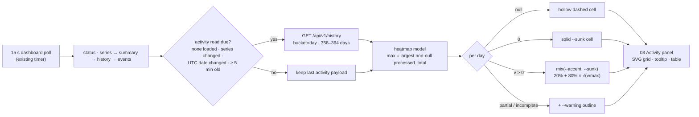

# Year activity heatmap (GitHub-style contribution calendar)

## 1. Human-review summary

### Summary
- Outcome: a new **03 Activity** panel sits between Trend and Period summary. It shows a GitHub-style contribution calendar for the selected series: 52 week columns × 7 weekday rows (Sun–Sat, UTC). The last column is the current UTC week, filled up to today. Each day's colour is a continuous gradient from the theme's sunk well (`--sunk`) to the theme's blue accent (`--accent`). Intensity is the square root of that day's processed tokens divided by the largest day observed in the window, so quieter days stay visible next to a burst day. Days without data look visibly different from days with a real zero.
- Scope: frontend only (a pure heatmap model, the store, a new panel component, styles, the 1080×1920 row budget, and renumbering the panels after Trend), plus the frontend smoke, specification D7, acceptance scenarios, README links, and a status/receipts set. There is no backend, API, schema, OpenAPI or token change. The data comes from the existing `GET /api/v1/history?bucket=day`.
- Readiness: execution-ready. The metric, colour, scale, week start, placement, refresh cadence and row budget are decided below as D1–D8. Review the assumptions; each one is a one-line change if the reviewer wants something different.

### Explain like I'm five
When the dashboard has a selected series, the store asks the existing history API for one daily bucket per UTC day. The range covers the 52-week calendar window, at most 364 days, so it stays under the API's 366-day daily cap. This read happens on first load, on a series change and on a UTC date change, and otherwise at most once every 5 minutes. It runs one after another with the other reads, never alongside them. A pure function turns the buckets into grid cells. It finds the largest observed daily `processed_total`, computes each day's share of that maximum, and sets the fill strength from the square root of that share. Days the API reports as `null` are drawn as hollow dashed squares, and a known zero is a solid dark square. Today and any partial day get a warning outline. Hovering a cell shows its exact value, UTC date, share of the maximum and quality. A "Show as table" disclosure lists the same days for keyboard and screen-reader users.

### Target flow


### Affected code
```text
README.md                              — plan/status links for this change
docs/                                  — this plan; spec D7 revision; acceptance scenario 31 + new section H; new activity-heatmap-status.md
└── receipts/
    └── activity-heatmap/              — new: smoke transcript and 1440 / 1080×1920 / 390 screenshots
frontend/src/
├── lib/                               — new heatmap.ts (window, grid, scale); dashboard.ts activity read + cadence
├── components/                        — new ActivityPanel.vue; App.vue mount; index renumber in SummaryCards/RatesPanel/DiagnosticsDisclosure
└── styles/                            — app.css: heatmap cell classes, 1080×1920 row budget, narrow-view internal scroll
scripts/                               — smoke_frontend.py: updated panel checks, new live and seeded activity phases
```

### Assumptions
- "Theme-appropriate" means the existing dark Tokyo Night palette (spec D7: one palette, no theme toggle). The hue is `--accent` (`#7aa2f7`, the theme's blue; user decision 2026-10-27), drawn over `--sunk`.
- "Contribution" means **processed tokens per UTC day** (`processed_total` = computed input + generated output), the dashboard's headline number. Requests per day are not stored, and cost is optional.
- "Relative to max observed" means a continuous square-root scale (user decision 2026-10-27) of each day's share of the largest non-null day inside the displayed window (including today). It does not use GitHub's four quantized levels or a lifetime maximum.
- Weeks start on Sunday with Mon/Wed/Fri row labels, matching GitHub. All dates are UTC, matching every other panel.
- The heatmap follows the selected series and ignores the Trend range presets. It is a fixed trailing-year overview.

## 2. Scope and acceptance criteria

**In scope**
- Pure heatmap model, store read and cadence, the Activity panel (SVG grid, month/weekday labels, legend, native tooltips, table disclosure, empty/baseline/loading states), styles, the portrait row budget, and renumbering the panels after Trend.
- Smoke migration and new heatmap phases; spec, scenario, README and status updates.

**Out of scope**
- Any API, query, schema, OpenAPI or `MAX_BUCKETS` change; a daily rollup table.
- Click-to-drill (a cell setting the Trend range), metric switching, multi-year navigation, a light theme.
- Executing the D9 resource workload (it remains an operator/qualification gate; see risks).

**Acceptance criteria**
- AC1: With a selected series, panel `activity-panel` (head "03 Activity") renders between `trend-panel` and `summary-panel`. It shows 52 columns × 7 rows (Sun–Sat). The first column starts on a Sunday, the last column is the current UTC week, and no future day is drawn. The cell count is `358 + getUTCDay(today)`, and one `/api/v1/history?bucket=day` request covers exactly that half-open range.
- AC2: For each day, `processed_total == null` → `data-state="none"` (hollow dashed); `"0"` → `data-state="zero"` (solid `--sunk`); `v > 0` → `data-state="value"`, `data-ratio = v / max` (3 decimals), `data-pct = 20 + 80·√ratio` (1 decimal), fill `color-mix(in srgb, var(--accent) pct%, var(--sunk))`. The maximum day has ratio `1.000` and pct `100.0`. A day at a quarter of the maximum has pct `60.0`. A null day is never drawn like a zero.
- AC3: Days with `partial` or `incomplete` (always including today) get a `--warning` outline and `data-partial="true"`. Every cell's tooltip states the UTC date, the exact processed total (or "no data"), the percent of max and the quality (partial, quality flags).
- AC4: The SVG carries an `aria-label` summary (window, max value and date, count of no-data days). A "Show as table" disclosure (`activity-disclosure`) lists one row per day with date, processed, computed input, generated output and quality. The disclosure is in the keyboard focus order after `chart-disclosure`.
- AC5: The activity read happens on first load, on a series change, and when the UTC window start changes. Otherwise it happens at most once per 300 s. It runs sequentially after events, inside the existing refresh cycle. Poll timers stay `[1000, 15000]`, hidden tabs make no reads, and a response for a previously selected series is discarded.
- AC6: At 1080×1920 the eight panels fill the screen with no page scroll and the Activity grid is fully visible. At 1440 the page scrolls vertically only. At 390 the page has no horizontal scroll, and the grid scrolls horizontally inside the panel, initially scrolled to the current week.
- AC7: Colours come only from existing tokens through `color-mix()`. `tests/test_ui_tokens.py` passes unchanged, and `scripts/export_openapi.py --check` passes (no contract change).
- AC8: Spec D7, the acceptance scenarios and README describe the panel. A status doc and receipts record executed evidence only.

## 3. Design decisions

- D1: Reuse `GET /api/v1/history?bucket=day` with a 52-column window. Reason: a 53-column window like GitHub's needs up to 371 days, which exceeds `MAX_BUCKETS["day"] = 366` (`src/jarvis_dashboard/queries.py`). 52 columns needs no API or spec D6 change. Contract: `today` = the UTC date of the browser clock (same convention as `paramsForRange`), `dow = getUTCDay(today)`, `start = today − (357 + dow)` days (always a Sunday), `from = start T00:00:00Z`, `to = (today + 1) T00:00:00Z`, so the window is 358–364 days.
- D2: Metric is the bucket's `processed_total`. Reason: it is the headline "work processed" figure, and it is already null when either primary counter is unobserved. Contract: values stay exact decimal strings. Max and ratio use BigInt (`ratio = Number(v × 10⁶ / max) / 10⁶`), so no value is rounded through `Number` before comparison. Tooltip and table values use the existing exact formatter in `frontend/src/lib/format.ts`.
- D3: Continuous square-root scale with a visibility floor (user decision). Reason: token usage is heavy-tailed, and a square root keeps ordinary days readable next to a burst day. The 20% floor keeps the smallest positive day distinguishable from a zero day. Contract: `ratio = v / max` (the linear share, shown as "% of max" in the tooltip and table) and `pct = 20 + 80 × √ratio` for `v > 0` (the fill strength only). The max is taken over non-null days in the window, today included. If no day is positive, there is no gradient and the legend shows "max —".
- D4: Three cell states plus a quality overlay, styled only in `app.css`. Reason: spec D7 requires null ≠ zero, a visibly incomplete current bucket, and no raw colour literals outside `tokens.css`. Contract: `.hm-none { fill: none; stroke: color-mix(--line 70%, transparent); stroke-dasharray }`, `.hm-zero { fill: var(--sunk) }`, `.hm-value { fill: color-mix(in srgb, var(--accent) calc(var(--p) * 1%), var(--sunk)) }` with a per-cell inline `--p` = `pct`, and `.hm-partial { stroke: var(--warning) }`. `--accent` and `--warning` stay visually distinct on a 14 px cell. The legend shows a no-data swatch, a zero swatch, a 20→100% ramp labelled "0 · √ scale · max", and the max value with its date.
- D5: Hand-rolled SVG, not Chart.js. Reason: it matches `Sparkline.vue`/`Gauge.vue`, adds no canvas (the smoke pins `canvas_count == 1`), and native `<title>` tooltips need no event code. Contract: one `<svg role="img">` with a `viewBox`, cells `aria-hidden`, and per-cell `data-day`, `data-state`, `data-ratio`, `data-pct`, `data-partial` for the smoke. Geometry: 14 px cell, 3 px gap, a 28 px weekday gutter (Mon/Wed/Fri), and a 14 px month row whose label sits on the first column containing that month's day 1.
- D6: Separate store slot with a slower cadence inside the existing poll. Reason: a year read aggregates about 8.7k hourly rows per counter plus gap and cost work. Spec D9's 366-day p95 is unmeasured, and the collector shares the 4-reader budget. Contract: `state.activity: HistoryResponse | null`, an `applied.activity` sequence, a non-reactive `activityFetchedAt` (ms) and `activitySeriesId`. Due when `activity` is null, the series differs, the window `from` differs, or `now − activityFetchedAt ≥ 300_000`. The read runs after events whenever a series is selected, independent of the Trend range's validity. `selectSeries` clears `activity`. Failures go through the existing `fail()` and keep the last payload. No new timer.
- D7: Placement and numbering. Reason: it keeps the history views together. Trend is the selected range in detail, and Activity is the year at a glance. Contract: order Live 01, Trend 02, **Activity 03**, Period summary 04, Latest rate 05, Diagnostics 06. Testid `activity-panel`, class `pnl-act`, rendered inside `App.vue`'s non-empty, non-first-load branch.
- D8: 1080×1920 row budget. Reason: the portrait grid is fixed. The receipt `docs/receipts/hud-dashboard/hud-1080x1920-normal.png` shows about 150 px unused at the bottom of Period summary and a mostly empty collapsed Diagnostics row. Contract: rows become `[head] 92px [strip] auto [live] 454px [trend] 1fr [activity] 200px [summary] 340px [rates] 212px [diag] 112px`. Trend absorbs the remaining ≈ 58 px (including the extra 10 px gap). Below 1080 px the grid wrapper gets `overflow-x: auto` with a `min-width` of the full 52-column SVG, and on mount and refresh it scrolls to the right edge.

## 4. Implementation steps

### Step 1: Pure heatmap model
- **Code area:** `frontend/src/lib/heatmap.ts` (new; proposed exports `activityWindow`, `buildHeatmap`).
- **Change:** Implement D1–D3 as pure functions. `activityWindow(now: Date) → { from, to, start, today, days }`. `buildHeatmap(history, window) → { columns: 52, cells[], months[], max: { value, day } | null, noDataDays }`, where each cell is `{ day, col, row, state: "none" | "zero" | "value", value: string | null, ratio, pct, partial, flags, computedInput, generatedOutput }`. Map buckets by their `bucket` label. A window day missing from the payload is `none`, and buckets outside the window are ignored. No DOM or Vue imports.
- **Depends on:** None.
- **Verification:** `cd frontend && npm run typecheck` exits 0. Behaviour is proven by the Step 6 seeded phase (AC1, AC2).

### Step 2: Store activity read and cadence
- **Code area:** `frontend/src/lib/dashboard.ts`.
- **Change:** Implement D6. Add `activity` to `DashboardState` and `applied`. After the events read in `refresh()`, when a series is selected and the read is due, call `fetchHistory(seriesId, w.from, w.to, "day", signal)`. Apply the result only if `seq >= applied.activity` and the series is still selected, then record `activityFetchedAt` and `activitySeriesId`. Move the read outside the `range` validity guard so an invalid custom range does not starve it. `selectSeries` clears `activity` and resets the due state.
- **Depends on:** Step 1.
- **Verification:** typecheck exits 0. Step 6 network and race checks: one year-range request on load, none more across two 15 s polls, one after a series switch, and the old-series response not applied (AC5).

### Step 3: Activity panel component
- **Code area:** `frontend/src/components/ActivityPanel.vue` (new), `frontend/src/App.vue`, `frontend/src/components/SummaryCards.vue`, `RatesPanel.vue`, `DiagnosticsDisclosure.vue`.
- **Change:** Implement D5 and D7. Build a `HudPanel` with index "03", title "Activity", testid `activity-panel`, class `pnl-act`. The meta reads "52 weeks · processed tokens · UTC · as of <generated_at UTC>". The body holds the SVG grid with month and weekday labels, the per-cell `<title>` (`2026-10-27 UTC · 1,234,567 tokens · 81% of max · partial`) and the legend row from D4. States: `activity` null → reuse `SkeletonBlock` styling inside the panel; all days `none` → the grid stays hollow, with "No observed days in this window" and "max —". Add the "Show as table" `<details data-testid="activity-disclosure">` modelled on TrendPanel's table alternative. Mount it in `App.vue` after `TrendPanel`. Renumber Summary to 04, Rates to 05 and Diagnostics to 06.
- **Depends on:** Steps 1, 2.
- **Verification:** `npm run typecheck && npm run build` exit 0. Step 6 DOM checks for order, cell count, states, tooltip text and the table (AC1–AC4).

### Step 4: Heatmap styles and responsive layout
- **Code area:** `frontend/src/styles/app.css`.
- **Change:** Add the D4 cell, legend and partial-outline classes using only `var(--token)` and `color-mix()`. Implement the D8 portrait rows (`.pnl-act { grid-row: activity; }`, new heights) and the sub-1080 internal horizontal scroll wrapper. The reduced-motion rule covers any hover transition.
- **Depends on:** Step 3.
- **Verification:** `PYTHONPATH=src .venv/bin/python -m pytest -q tests/test_ui_tokens.py` exits 0 (no hex outside `tokens.css`, AC7). Step 6 layout checks at 1080×1920, 1440 and 390 (AC6).

### Step 5: Migrate existing smoke expectations
- **Code area:** `scripts/smoke_frontend.py`.
- **Change:** `panel_order` gains `"activity-panel"` after `"trend-panel"`. `portrait_panels_without_nominal_bar` changes 6 → 7. `FOCUS_EXPECTED` gains `"activity-disclosure"` after `"chart-disclosure"`. Check every assertion that counts `.hud > .pnl` or panel indices, and update it only where the new panel changes the count. Keep `canvas_count == 1` and the poll-timer `[1000, 15000]` assertion unchanged as regression guards.
- **Depends on:** Steps 3, 4.
- **Verification:** the existing phases pass against the rebuilt bundle (Step 6 run).

### Step 6: New activity smoke phases
- **Code area:** `scripts/smoke_frontend.py` (new `activity_live` and `activity_seeded` phases; approximate names), screenshots to `docs/receipts/activity-heatmap/`.
- **Change:**
  - `activity_live`, on the existing fixture stack where only today has data:
    - assert 52 columns, cell count `358 + dow`, and the request `from`/`to`;
    - today is `value`, `ratio 1.000`, `pct 100.0` and `partial`; every earlier day is `none`;
    - the table row count equals the cell count;
    - focus order and AC5 request counting across two polls and a series switch (reusing `SECOND`);
    - 390 px internal scroll anchored right with no page horizontal scroll.
  - `activity_seeded`:
    - seed a short volume with `scripts/seed_history.py --db <tmp> --window-days 60 --cadence-recent 300 --case-days idle_day=5,collector_downtime=12 --manifest <tmp>/manifest.json`;
    - serve it with the real `serve`, as the seeder's `--verify` path does, and open it in Chromium;
    - assert against the manifest's per-day computed + generated totals: the idle day is `zero`, the downtime day is `none`, and days before the seeded window are `none`;
    - the manifest's largest day has `ratio 1.000` and `pct 100.0`; for a mid-range day, `data-ratio` is within 0.001 of `value/max` and `data-pct` within 0.1 of `20 + 80·√(value/max)`;
    - tooltip and table values equal the manifest exactly;
    - capture `activity-1440.png`, `activity-1080x1920.png` and `activity-390.png`.
- **Depends on:** Step 5.
- **Verification:** `cd frontend && npm ci && npm run typecheck && npm run build`, then `PYTHONPATH=src .venv/bin/python scripts/smoke_frontend.py` prints `FRONTEND SMOKE PASSED` (AC1–AC6).

### Step 7: Specification, scenarios, README and status evidence
- **Code area:** `docs/specification.md` (D7), `docs/acceptance-scenarios.md`, `README.md`, `docs/activity-heatmap-status.md` (new), `docs/receipts/activity-heatmap/` (new).
- **Change:**
  - D7 "Layout" becomes eight stacked panels with an Activity bullet: the 52-week UTC calendar of daily processed tokens, the blue square-root gradient relative to the window maximum, null hollow vs zero solid, the partial outline, and the table alternative.
  - The D7 polling paragraph gains the D6 cadence rule.
  - The "no redundant chart" sentence stays as is: the heatmap is a fixed-window overview, not the selected range again.
  - Scenario 31 adds the Activity panel to the 1080×1920 fit.
  - Add section "H. Year activity heatmap" with scenarios 47 (window shape and cap), 48 (null vs zero vs ratio, using scenario 19's days) and 49 (read cadence and stale-series discard).
  - README "Delivery planning" links this plan and the status doc.
  - The status doc records executed commands with exit codes, the smoke transcript, receipts and screenshots, and names unexecuted gates.
- **Depends on:** Step 6.
- **Verification:** the links in README resolve to existing files. Every number in the status doc comes from the Step 6 transcript (AC8).

## 5. End-to-end verification

- Full browser path: `cd frontend && npm ci && npm run typecheck && npm run build`, then `PYTHONPATH=src .venv/bin/python scripts/smoke_frontend.py`. Expected: `FRONTEND SMOKE PASSED`, with the activity phases' receipts showing the cell count, the request range, the idle-day `zero`, the downtime-day `none`, the max-day `ratio 1.000`, and three screenshots in `docs/receipts/activity-heatmap/` (AC1–AC6).
- Contract unchanged: `PYTHONPATH=src .venv/bin/python scripts/export_openapi.py --check` exits 0 and `PYTHONPATH=src .venv/bin/python -m pytest -q` passes the full suite (AC7).
- Visual review of `activity-1080x1920.png`: eight panels fill the screen, the grid is fully visible, and the Trend chart is not clipped (AC6).

## 6. Risks and open decisions

- **Risks:**
  - The square-root scale compresses the top end, so two busy days of quite different size can look similar. Mitigation: the tooltip and table show the exact value and the linear "% of max", and the legend labels the ramp "√ scale".
  - The extra year read adds load that spec D9 never measured. Mitigation: the 300 s cadence and sequential execution mean one extra reader at most, and the read is inside the existing budget. The D9 workload (scenario 33) remains an unexecuted qualification gate and must state that it now includes this read.
  - The D8 row budget could clip Period summary when long coverage or approximation notes appear. Mitigation: panels already scroll internally (HUD plan D2), and the smoke portrait check runs in normal and offline states.
  - Today's cell lags Trend by up to 5 minutes. Mitigation: the panel meta shows "as of <UTC time>", and today is outlined as partial.
  - The UTC date can roll over between seeding and assertion in the seeded phase. Mitigation: the phase computes its expected window from the same `now` it passes to the page assertions, and it re-seeds once if the date changed.
  - The low end of the gradient on `--panel` is below 3:1 non-text contrast by design, as on GitHub. Mitigation: values are never colour-only. The tooltip, table and `aria-label` carry them.
- **Open decisions:** None.
