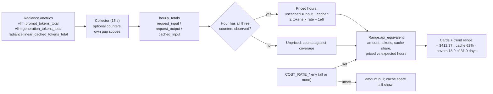

# Cache-aware API-equivalent cost estimate

## 1. Human-review summary

### Summary
- Outcome: the Today, This month and Lifetime cards and the selected trend range show an approximate API-equivalent cost and Jarvis's cache hit share. The cost uses one operator-configured set of three per-million-token rates (input, cached input, output) and the same cache hits Jarvis actually had. Only time with cache tracking is priced. A period that is partly tracked is marked partial with its coverage, e.g. "covers 18.0 of 31.0 days". The figure is meant to be read off the screen and compared with cloud plans elsewhere.
- Scope: one new durable optional counter (`cached_input` ← `radiance:linear_cached_tokens_total`) through collection, accounting, migration 0003 and the API. Cost and cache-share calculation happens at read time from stored hourly totals. Rates come from three environment variables; the UI shows them on the cards and the trend panel. No stored money, no comparison, no export, no subscription figures.
- Readiness: execution-ready. That the live Jarvis exposes `radiance:linear_cached_tokens_total` with the semantics described here is an operator-gate check, not a design blocker. If it is absent, nothing is priced and the UI says so.

### Explain like I'm five
The collector already stores how many prompt and output tokens requests used. It will also store how many prompt tokens Jarvis served from its prefix cache instead of computing them. When the dashboard reads a period, it adds up the hours in which all three numbers were recorded:
- cached input is priced at the cached rate;
- the rest of the input at the full input rate;
- output at the output rate.

Hours before cache tracking existed, or with a collection gap in any of the three counters, are left out, and the card says how much of the period was covered. Changing a rate and restarting reprices all history, because cost is never stored.

### Target flow


### Affected code
```text
compose.yaml                              — pass through the three COST_RATE_* variables (empty = unset)
README.md                                 — mention the estimate and link this plan
src/
└── jarvis_dashboard/                     — cached_input counter (domain, collector parse, accounting, storage insert),
    │                                       rate config, read-time cost/coverage in queries, API schema fields
    └── migrations/                       — (new file) 0003: samples.cached_input + delta_cached_input columns
docs/                                     — specification (scope, D3, D5, D6, D7, new cost decision), acceptance scenarios,
                                            deployment (rates, live counter check); new status file
└── receipts/
    └── cost-estimate/                    — (new) smoke transcripts and screenshots
frontend/
└── src/
    ├── api/                              — regenerated OpenAPI snapshot and types
    ├── lib/                              — money / coverage / ratio formatters
    └── components/                       — SummaryCards cost + cache lines, TrendPanel range line,
                                            DiagnosticsDisclosure cached-input gap line
tests/                                    — migration 0003, cached counter accounting, cost/coverage queries, config, API
└── fixtures/                             — fixture publishes the cached counter
scripts/                                  — smoke (cached accounting), frontend smoke (cost lines), compose env-key check
```

### Assumptions
- One currency, shown as USD (`$`). The rates are whatever the operator enters; the dashboard does not know or validate real provider prices.
- There is no cache-write rate, because Jarvis has no counter that corresponds to it.
- The cache hit share is cached ÷ request input over the same priced hours, so it is directly comparable with the cost on the same card.
- A missing `cached_input` does not change the existing "optional counters available" health signal. It shows up through coverage ("covers 0 of …") and the diagnostics gap line instead.

## 2. Scope and acceptance criteria

**In scope**
- Durable collection of `radiance:linear_cached_tokens_total` as optional counter `cached_input`, with its own gap scope, epochs and continuity, the same as `request_input`.
- Migration 0003 with the existing automatic pre-migration backup.
- Optional, validated rate configuration: three variables, all or none.
- Read-time calculation of amount, token split, cache share and hour coverage for summary ranges (today, month, lifetime) and the history range.
- UI lines on the three cards and in the trend panel, a rates footnote and the diagnostics gap line.
- Specification, acceptance-scenario, deployment and README updates.

**Out of scope**
- Subscription fees, provider comparison, multiple price profiles, currencies other than USD.
- Cache-write pricing; electricity or hardware cost.
- Per-bucket cost in the chart or table; CSV/JSON export; a dedicated cost API route.
- Pricing time before cache tracking, or backfilling `cached_input` for older history.
- Live (1 s) cost; the live panel plan is independent.

**Acceptance criteria**
- AC1 (pricing formula): with rates `3` / `0.30` / `15`, an hour where request input = 1,000,000, cached input = 600,000 and request output = 100,000 prices to $2.88 (400,000 × 3 + 600,000 × 0.30 + 100,000 × 15, ÷ 1e6). The API returns `amount` `"2.880000"` and cache share `0.6`; the card shows `≈ $2.88` and `cache 60%`.
- AC2 (tracked time only): a month in which `cached_input` exists only from day 14 prices only the hours where all three counters were observed. Request tokens from days 1–13 are excluded from the amount and the cache share. The card shows `partial` with `covers 18.0 of 31.0 days` (at month end). A period that is fully tracked shows no coverage note.
- AC3 (gaps): an hour with a collection gap that leaves `cached_input` (or either request counter) without an observed interval is unpriced and lowers coverage. Existing primary-counter gap reporting is unchanged.
- AC4 (no rates): with no `COST_RATE_*` set, `amount` is null and no dollar figure is rendered, while cache share and coverage are still shown. Setting only one or two of the three variables fails startup with an actionable configuration error.
- AC5 (timing skew): if, over a period's priced hours, cached input exceeds request input, the uncached part is priced as 0 and the range carries flag `cache_exceeds_input`. The UI shows it as approximate; it is never silently clamped.
- AC6 (repricing): after changing the rates and restarting, the same stored history shows amounts at the new rates. No money value exists in SQLite.
- AC7 (migration safety): a version-2 database migrates to version 3 with a `pre-migration-3` backup. Totals for the existing counters are unchanged (the A2 scenario still gives 960 processed). Old samples have null `cached_input`.
- AC8 (missing upstream counter): with the fixture not exposing `radiance:linear_cached_tokens_total`, collection of the other counters is unaffected, no period is priced ("covers 0.0 of …"), and the diagnostics show the cached-input scope as unobserved.

## 3. Design decisions

- D1: Cached tokens come from one counter, `radiance:linear_cached_tokens_total`, stored as optional key `cached_input` with its own gap scope `cached_input`. Reason: at pinned Radiance `9eaf10da`, `scheduler.cpp` sets `r.n_cached = reuse` (line 1099) for every model. `reuse` is the prompt length actually skipped, after the hybrid checkpoint clamp, the windowed-group clamp and adopt failures. The counter accumulates it once per admission (line 1157). `attn_cached_tokens_total` overstates on hybrid models by `prefix_hit_cut_tokens_total`, so no hybrid detection is needed. Contract:
  - add `cached_input` to `COUNTER_KEYS`, `OPTIONAL_KEYS`, `SCOPES`, `SCOPE_FOR_COUNTER`, `COUNTERS_FOR_SCOPE` and `METRIC_FOR_COUNTER` in `domain.py`;
  - same exact-integer parsing, duplicate rejection, epoch and continuity behaviour as `request_input`;
  - absent or invalid values never affect the primary pair.
- D2: Migration `0003_cached_input.sql` adds nullable `samples.cached_input` and `samples.delta_cached_input`, and `CURRENT_SCHEMA_VERSION` becomes 3. `hourly_totals`, `latest_interval`, `gap_spans` and `series_state.optional_json` are already keyed by counter or scope and need no change. Reason: the existing numbered-migration path with automatic backup. Contract:
  - the explicit `INSERT INTO samples(…)` column list in `storage.py` gains both columns;
  - existing rows keep null, so they are never priced;
  - a version-3 database is refused by an older image, as with any newer schema (documented under upgrade).
- D3: Rates come from `COST_RATE_INPUT_PER_MTOK`, `COST_RATE_CACHED_INPUT_PER_MTOK` and `COST_RATE_OUTPUT_PER_MTOK`, validated in `config.py`. Reason: one set of server-wide prices, consistent on every device. Changing them takes a restart. Contract:
  - empty or unset means unset;
  - all three set means enabled; one or two set is a `ConfigError` naming the missing variables;
  - each value is a decimal string, finite, `0 ≤ x ≤ 10000`, at most 6 fractional digits, parsed as `Decimal` (never float).
  
  `compose.yaml` passes them through with empty defaults.
- D4: Cost and coverage are calculated at read time in `queries.py` from `hourly_totals`, for summary ranges and the history range only. Reason: cost is never stored, so a rate change reprices history; ranges already fold hourly rows (`_range_payload`). Contract:
  - **Priced hour:** `request_input`, `request_output` and `cached_input` all have `observed_intervals > 0` and non-null tokens in that hour.
  - **Expected hours:** every complete hour overlapping `[range start, now)`, plus the current hour only if it already has any hourly row. This avoids a "partial" flicker at the top of each hour.
  - **Sums over priced hours only:**
    - `I = Σ request_input`, `C = Σ cached_input`, `O = Σ request_output`;
    - `uncached = I − C`; if negative, it becomes 0 and the flag `cache_exceeds_input` is set;
    - `amount = (uncached·r_in + C·r_cached + O·r_out) / 1,000,000`, calculated with `Decimal` and rendered with 6 fractional digits (`ROUND_HALF_EVEN`).
  - **Amount null when** rates are unset, or there are zero priced hours.
  - **`cache_hit_ratio`** = `C / I`, null when `I = 0` or there are no priced hours.
  - **`partial`** = priced hours < expected hours.
- D5: API contract changes are additive and the wire `schema_version` stays 1.
  - `Range` (not `Bucket`) gains `api_equivalent`.
  - `StatusResponse` gains `cost_rates` (null when unset), so rates appear once.
  - `CounterBlocks` and `GapScopes` gain `cached_input`.
  
  Reason: the selected-range and card figures are the only consumers; per-bucket cost is out of scope. Contract:
  ```json
  "api_equivalent": {
    "currency": "USD",
    "amount": "2.880000",
    "tokens": { "uncached_input": "400000", "cached_input": "600000", "output": "100000" },
    "cache_hit_ratio": 0.6,
    "priced_hours": 432,
    "expected_hours": 744,
    "partial": true,
    "flags": []
  }
  ```
  ```json
  "cost_rates": { "currency": "USD", "input_per_mtok": "3", "cached_input_per_mtok": "0.30", "output_per_mtok": "15" }
  ```
  Token values are decimal strings, following the existing exact-integer convention. `flags` ⊆ {`cache_exceeds_input`}.
- D6: UI presentation. Reason: read off the screen at a glance, with trust caveats visible in text and not only in colour (spec D7). Contract:
  - **Cards** (`SummaryCards.vue`) get two lines:
    - `API-equivalent ≈ $412.37`: 2 decimals with thousands separators; `< $0.01` when 0 < amount < 0.005; `no data` when the amount is null but rates are set; the line is hidden when rates are unset.
    - `Cache hits 62% of input`.
  - **Coverage note** when partial: `partial · covers 18.0 of 31.0 days`, in days with 1 decimal when expected ≥ 48 h, otherwise `covers 5 of 9 h`.
  - **Skew note**: `cache_exceeds_input` renders as "approximate — cache count ahead of request count".
  - **Trend panel**: one line for the selected range, same format.
  - **Rates footnote** under the cards from `/status`: "Approximate API-equivalent at $3.00 input / $0.30 cached / $15.00 output per M tokens (USD). Priced only where cache tracking exists."
  - **Diagnostics**: the gap list gains "Cached input".
  - Stable `data-testid`s for smoke.

## 4. Implementation steps

### Step 1: `cached_input` counter in domain, parsing and accounting
- **Code area:** `src/jarvis_dashboard/domain.py`, `src/jarvis_dashboard/metrics.py` (driven by `METRIC_FOR_COUNTER`), `src/jarvis_dashboard/accounting.py`, `tests/test_metrics_parser.py`, `tests/test_accounting.py`.
- **Change:** Implement D1. Confirm every `OPTIONAL_KEYS` iteration in accounting picks up the new key: optional slots, gap scopes, hour deltas, reset boundaries. Keep `collector.py`'s `optional_ok` limited to the two request counters (Assumptions). Add tests:
  - a scrape with the cached counter yields its exact value;
  - a missing or duplicate cached sample leaves the primary pair and the request counters valid;
  - cached-counter deltas, gaps and resets follow the same rules as `request_input`, including a counter decrease opening a reset boundary only for its own scope.
- **Depends on:** None.
- **Verification:** `.venv/bin/python -m pytest -q tests/test_metrics_parser.py tests/test_accounting.py` passes (AC3, AC8).

### Step 2: Migration 0003 and storage writes
- **Code area:** `src/jarvis_dashboard/migrations/0003_cached_input.sql` (new), `src/jarvis_dashboard/storage.py` (`CURRENT_SCHEMA_VERSION`, sample insert column list), `tests/test_storage.py`, a new `tests/test_cached_input_migration.py` modelled on `tests/test_metadata_migration.py`.
- **Change:** Implement D2. Migration tests:
  - a version-2 database holding the A2 scenario migrates to 3, keeps 900/60/960, writes `pre-migration-3`, passes the integrity check, and is idempotent;
  - post-migration polls write `cached_input` raw and delta values and hourly rows;
  - pre-existing samples stay null.
- **Depends on:** Step 1.
- **Verification:** `.venv/bin/python -m pytest -q tests/test_cached_input_migration.py tests/test_metadata_migration.py tests/test_storage.py` passes (AC7).

### Step 3: Rate configuration
- **Code area:** `src/jarvis_dashboard/config.py` (`Config` gains an optional rates value), `compose.yaml` (three passthrough variables with `:-` empty defaults), `tests/test_config.py`, `scripts/qualify_common.py` (expected compose environment keys).
- **Change:** Implement D3.
- **Depends on:** None.
- **Verification:** `.venv/bin/python -m pytest -q tests/test_config.py` passes. Tests cover: all unset → disabled; all set → `Decimal` values; one or two set → `ConfigError` naming the missing ones; negative, non-numeric, `NaN`, more than 6 decimals and above-max values → `ConfigError` (AC4).

### Step 4: Read-time cost, cache share and coverage
- **Code area:** `src/jarvis_dashboard/queries.py` (`_range_payload`, `read_summary`, `read_history`, `read_status`), `src/jarvis_dashboard/api.py` (pass rates into the query calls), `tests/test_queries.py`.
- **Change:** Implement D4 as a pure function over per-hour rows plus `(start, now, rates)`, called from `_range_payload`. `read_status` exposes `cost_rates`. Query tests:
  - the AC1 hour gives exactly `"2.880000"` and ratio 0.6;
  - AC2: tracking from day 14 → only those hours priced, `partial`, `priced_hours`/`expected_hours` correct, and request tokens outside priced hours excluded from both the amount and the ratio;
  - AC3: a gap hour is unpriced;
  - AC5: C > I gives uncached 0 and the flag;
  - no priced hours → null amount and null ratio;
  - rates unset → null amount with ratio and coverage present;
  - the current hour with no row is not expected; with a row it is;
  - the AC6 rate change gives a new amount from the same database.
- **Depends on:** Steps 2 and 3.
- **Verification:** `.venv/bin/python -m pytest -q tests/test_queries.py` passes (AC1–AC6).

### Step 5: API schema and contract snapshot
- **Code area:** `src/jarvis_dashboard/schemas.py` (proposed `ApiEquivalent`, `ApiEquivalentTokens`, `CostRates`; `Range.api_equivalent`; `StatusResponse.cost_rates`; `CounterBlocks.cached_input`; `GapScopes.cached_input`), `frontend/src/api/openapi.json` via `scripts/export_openapi.py`, `tests/test_api.py`.
- **Change:** Implement D5. API tests: `/api/v1/summary` and `/api/v1/history` return `api_equivalent` with the D5 shape and string tokens; `/api/v1/status` returns `cost_rates` when configured and null otherwise; `Bucket` items carry no `api_equivalent`.
- **Depends on:** Step 4.
- **Verification:** `.venv/bin/python -m pytest -q tests/test_api.py` passes; `.venv/bin/python scripts/export_openapi.py --check` exits 0 after regeneration (AC1, AC4).

### Step 6: Dashboard presentation
- **Code area:** `frontend/src/api/schema.ts` and `client.ts` (regenerated types; `CostRates`/`ApiEquivalent` exports), `frontend/src/lib/format.ts` (money, coverage, ratio formatters), `frontend/src/components/SummaryCards.vue`, `frontend/src/components/TrendPanel.vue`, `frontend/src/components/DiagnosticsDisclosure.vue`.
- **Change:** Implement D6. Rates come from `state.status.cost_rates`. A baseline-only series keeps rendering `no data` as today.
- **Depends on:** Step 5.
- **Verification:** `cd frontend && npm run verify` exits 0 and the bundle lands in `src/jarvis_dashboard/static/` (AC1, AC2, AC4, AC5).

### Step 7: Fixture and smoke coverage
- **Code area:** `tests/fixtures/fixture_server.py` (`install_fixture` gains an optional cached value, published as `radiance:linear_cached_tokens_total`), `scripts/smoke.py`, `scripts/smoke_frontend.py`.
- **Change:**
  - **`smoke.py`:** publish request and cached counters across polls. Assert through the API that the lifetime `cached_input` tokens and `api_equivalent.amount` match the hand-computed value for the published deltas, with the serve process started with rates set. The existing 960 assertions stay unchanged.
  - **`smoke_frontend.py`:** with rates set, the cards show `≈ $…`, `Cache hits …%` and the rates footnote. The first-hour coverage note appears and reads `covers … of …`. A phase without the cached counter shows no dollar amount for a period with zero priced hours ("no data"), with the diagnostics "Cached input" gap line. A serve restart without rates hides the dollar line while the cache share stays.
  - Take 1440 px and 390 px screenshots.
- **Depends on:** Steps 5 and 6.
- **Verification:** `.venv/bin/python scripts/smoke.py` exits 0 with `SMOKE PASS`; `.venv/bin/python scripts/smoke_frontend.py` exits 0 with `FRONTEND SMOKE PASSED` and the new checks in its transcript (AC1, AC2, AC4, AC8).

### Step 8: Specification, scenarios and operator docs
- **Code area:** `docs/specification.md`, `docs/acceptance-scenarios.md`, `docs/deployment.md`, `README.md`.
- **Change:**
  - **Specification:**
    - Scope: replace the blanket "cost estimates" exclusion with "billing-grade or stored cost"; the approximate read-time estimate is in scope.
    - D3: five counters; `cached_input` is optional and is never added to engine totals or `processed_total`.
    - D5: schema version 3.
    - D6: the `api_equivalent` and `cost_rates` fields.
    - D7: card and trend lines.
    - Add a new decision section "API-equivalent estimate" with D1, D3 and D4.
  - **Acceptance scenarios:** add numeric scenarios for AC1 (the $2.88 hour), AC2 (partial month), AC5 (cache ahead of request) and AC8 (counter absent).
  - **Deployment guide:** the three variables with an example, the all-or-none rule, "restart to reprice", and the operator-gate check that live `/metrics` exposes `radiance:linear_cached_tokens_total`. If a cached-only test request is available, also check that the counter rises by the reused prefix on a repeated prompt.
  - **README:** a one-line feature mention and links to this plan and the status file.
- **Depends on:** Steps 1–7.
- **Verification:** `.venv/bin/python scripts/qualify_image.py --docs-check` exits 0 (compose environment keys include the three rate variables). The specification no longer lists cost estimates as out of scope without qualification.

### Step 9: Evidence and status
- **Code area:** `docs/cost-estimate-status.md` (new), `docs/receipts/cost-estimate/` (new).
- **Change:** Record the environment, commands and exit codes, smoke transcripts and screenshots, and the migration receipt (`pre-migration-3` backup present, totals unchanged). List the pending operator-gate checks: the cached counter exists on live Jarvis, and a repeated prompt increases it by the reused prefix.
- **Depends on:** Steps 1–8.
- **Verification:** Every acceptance criterion has a linked receipt or a named pending gate.

## 5. End-to-end verification

- Full path: start `serve` with rates `3`/`0.30`/`15` against the fixture → publish counters so one hour accumulates request input 1,000,000, cached 600,000 and request output 100,000 → `/api/v1/summary` lifetime `api_equivalent.amount` = `"2.880000"`, `cache_hit_ratio` = 0.6 → the Lifetime card shows `≈ $2.88`, `Cache hits 60% of input` and the rates footnote (AC1). Covered by Step 7 plus the Step 4 query tests.
- Partial and history: the injected-clock query tests prove the AC2 day-14 month and AC3 gap hours. In the browser, the first-hour coverage note proves the coverage text renders (AC2, AC3).
- Upgrade: open a copy of a version-2 database (the A2 scenario) with the new build → `pre-migration-3` exists, 960 unchanged, and new polls populate `cached_input` (AC7).
- Rates off and repricing: restart `serve` without rates → no dollar line, cache share still shown. Restart with different rates → a new amount from the same database (AC4, AC6).
- Existing checks: `.venv/bin/python -m pytest -q`, `.venv/bin/python scripts/smoke.py`, `.venv/bin/python scripts/smoke_frontend.py`, `.venv/bin/python scripts/export_openapi.py --check`, `cd frontend && npm run verify` and `.venv/bin/python scripts/qualify_image.py --docs-check` all exit 0.

## 6. Risks and open decisions

- **Risks:**
  - **Counter semantics on live Jarvis:** this plan relies on `radiance:linear_cached_tokens_total` meaning "prompt tokens actually skipped" for every model. That is true at the pinned commit's `scheduler.cpp`, but the `/stats` comment calls the linear hit rate "zero on a model with no recurrent state", which contradicts the code. Mitigation: the operator-gate repeated-prompt check in Step 8. If live behaviour differs, the estimate prices less cache than really happened. It overstates cost rather than understating it.
  - **Admission-versus-finish timing:** cached tokens are counted at admission, request tokens when the request finishes. Hourly totals can shift work across an hour boundary. Period sums dampen this, and a net negative is flagged (AC5). Very short periods (today, early hours) are the most affected.
  - **Preemption and re-admission:** if Radiance counts a cache hit again when a preempted request is re-admitted, cached input can be inflated slightly. It is covered by the same AC5 flag when it exceeds input; otherwise undetectable from metrics.
  - **Irreversible schema step:** version 3 cannot be opened by an older image. The automatic `pre-migration-3` backup and the documented upgrade procedure are the rollback path.
  - **Lifetime is always partial:** history before deployment is never priced, so the Lifetime card permanently shows a coverage note. This is intended.
  - **Live panel plan ordering:** both plans add fields to `schemas.py` and regenerate `openapi.json`/`schema.ts`. Whichever lands second regenerates the snapshot again. No functional dependency.
- **Open decisions:** None.
