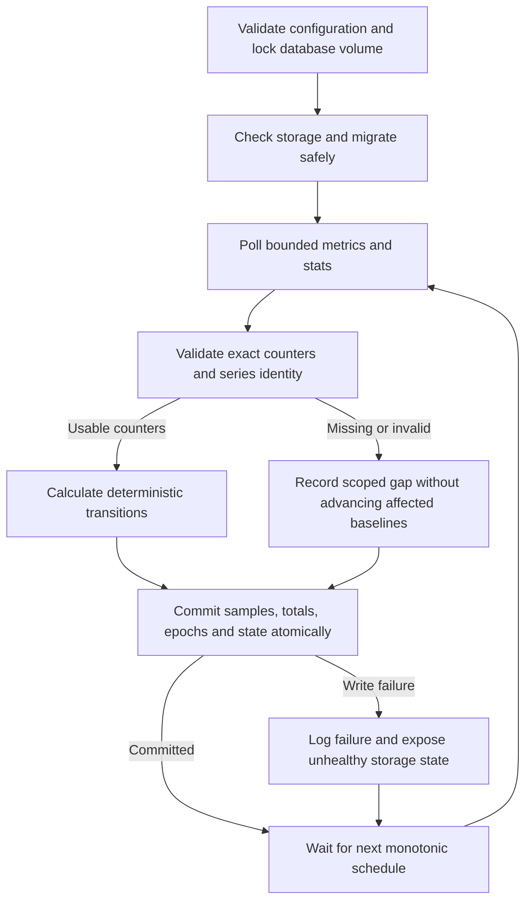

# Delivery 1 — durable collection and exact observed accounting

## 1. Human-review summary

### Summary
- Outcome: a runnable Python collector that polls a controlled or configured Radiance origin and persists exact, restart-safe observed token history in SQLite.
- Scope: specification implementation steps 1–2, including parsing, deterministic accounting, migrations, atomic persistence, gaps, retention, single-writer ownership and behavioral/process evidence. No API, dashboard or production container in this delivery.
- Readiness: execution-ready for local implementation. Follow the authoritative [specification](specification.md), normative [scenarios](acceptance-scenarios.md) and [delivery map](delivery-map.md); no live Jarvis access is required.

### Explain like I'm five
The collector reads cumulative counters, compares them with the last committed reading and saves only the observed increases. The first reading establishes a baseline rather than inventing historical usage. Failures leave that baseline intact; recoverable gaps can contribute once, while detected restart boundaries establish new baselines. Every credited increment and its baseline commit together, so restarting the collector cannot duplicate usage.

### Target flow


### Affected code
All application paths and symbols below are proposed new work. The repository currently contains the specification packet, not an application.

```text
/                                  — new pyproject.toml/Python lock; update README with real commands
├── src/jarvis_dashboard/           — new config, domain, parser, accounting, storage, collector and CLI
│   └── migrations/                — new numbered SQL schema migrations
├── tests/                         — new behavioral domain, persistence and process regressions
│   └── fixtures/                  — new controllable metrics/stats HTTP server
├── scripts/                       — new reproducible collector/process smoke runner
└── docs/                          — this plan, collector operations and executed delivery receipts
```

### Assumptions
- Implement into this repository unless the packet has been moved into a new repository; preserve user-owned changes and inspect the destination first.
- Python 3.13, standard-library SQLite/HTTP and a dedicated sequential collector are fixed choices, not candidates for redesign.
- Delivery 1 is a complete durable-core increment, not the final user-facing product. API, browser and container acceptance remain assigned to later deliveries.
- Test input comes from a local fixture. Do not contact the default LAN endpoint while running verification.

## 2. Scope and acceptance criteria

**In scope**
- D2 configuration and upstream safety; D3 numeric and identity contracts; D4 transitions; D5 storage, retention and failure behavior.
- A real collector CLI, bounded operational logging, migration snapshots and explicit runtime storage/collector state for later readiness integration.
- Deterministic regression coverage and actual HTTP/subprocess smoke, including abrupt termination around commit.

**Out of scope**
- FastAPI routes/OpenAPI, API pagination, response serialization, browser UI, Docker/Compose and the public backup/restore CLI.
- Live metric compatibility, resource-target claims and Unraid deployment. Internal pre-migration snapshots are included now; the operator backup/restore surface belongs to Delivery 2.
- Retry frameworks, ORM, distributed collectors, request interception or additional telemetry/product features.

**Acceptance criteria**
- D1-AC1: exact parsing preserves canonical source/labels, accepts legal escaping/scientific integers and rejects unsupported/duplicate/invalid counters without float loss; optional failures do not invalidate usable engine counters (spec AC1; scenarios 4–6, 15, 21–22).
- D1-AC2: deterministic transitions distinguish opening balances, valid zero, independent optional changes, compatible/unverified continuity, resets and wall-clock discontinuity; no baseline/reset interval credits work (spec AC1–AC2; scenarios 1–16, 26).
- D1-AC3: committed UTC hourly history preserves integer totals, per-counter observation coverage, scoped gaps and durable quality through hour/day boundaries and raw retention; absence remains distinguishable from observed zero (spec AC2–AC3; scenarios 17–19, 23).
- D1-AC4: sample, deltas, epoch/state and totals commit atomically; duplicate observation application is a no-op; abrupt restart and write/overflow failures cannot advance an affected persisted baseline or duplicate committed work (spec AC3, AC7; scenarios 22, 24–26, 28).
- D1-AC5: startup refuses unsafe configuration, a second collector, corruption and newer schema; supported migration preserves history after a verified snapshot. An endpoint change under the same source preserves history and creates a fresh baseline (spec AC3, AC7; scenarios 27–28, relevant parts of 30).
- D1-AC6: the actual collector uses bounded fetches, one in-flight poll, skipped missed schedules, interruptible monotonic scheduling, bounded retention batches and orderly termination; local HTTP/process smoke demonstrates persistent 900/60/960 and one-time gap recovery (spec steps 1–2).

## 3. Design decisions

### D1. Small explicit boundaries
Use ordinary typed domain records and functions, not a generic event-processing framework. Proposed modules are `config`, `domain`, `metrics`, `accounting`, `storage`, `collector` and `cli`; filenames may follow the implementation's established conventions if code already exists.

The accounting function takes committed per-series state, validated counters, observation UTC time, stats request timing/evidence and poll interval. It returns proposed next state, per-counter deltas or absence, observed-interval counts, rate eligibility, epoch changes, gap changes and quality flags. It performs no HTTP, clock reads or SQL. Scheduling consumes an injected monotonic clock; wall-clock values are explicit observation inputs. This boundary permits tests without sleeps and storage with a single transaction owner.

A baseline has no observed contribution: retain null/absent delta and zero observed intervals, not a synthetic observed zero. A later valid unchanged reading contributes integer zero with one observed interval. Preserve four independent coverage counts; primary pair transitions are coupled, but optional counters remain independent. Processed total is only computed input plus generated output, with checked addition.

### D2. Exact parser and bounded transport
Use a maintained Prometheus text parser for exposition syntax and decoded labels. Before committing to the dependency, run its exact-number spike against `9007199254740991`, `9007199254740992`, scientific notation and escaped labels. If it only exposes floats, retain original selected numeric lexemes through its supported tokenizer/parser facilities or a narrowly scoped token-preservation adapter; never reconstruct integers from floats or split label sets by commas. Lock the verified dependency and document the adapter if needed.

Parse numeric lexemes using exact decimal semantics with bounded input work. Reject negative, fractional, non-finite and upstream values above 2^53−1; guard exponent/length conversions before allocating huge integers. Internally counters/sums are nonnegative signed int64; checked arithmetic applies to counter totals, processed totals and query-facing aggregate helpers. SQLite `SUM`/UPSERT arithmetic must not silently promote overflowing integers to REAL.

Identity is `(SOURCE_ID, complete sorted decoded labels)`; persist deterministic canonical JSON with a unique constraint. Duplicate selected metric/identity samples are invalid rather than summed. Invalid required metrics reject the primary pair for that identity; optional failures affect only their counters. Oversize bodies, over 256 selected identities or structurally untrustworthy exposition reject the scrape without baseline changes. Ignore unrelated metric families and exposition sample timestamps.

Fetch only `/metrics` and `/stats` appended to the validated origin using standard-library HTTP facilities. Validate D2 environment ranges and URL rules; reject credentials/fragments and non-origin path/query configuration. Disable automatic redirects; report a redirect as an upstream error rather than following it. Bound each response at 2 MiB, enforce the configured total per-request deadline across reads, close sockets on all branches, and never retain/log upstream bodies. Stats failure alone must not discard usable metrics.

### D3. Epoch and continuity ownership
Couple the two engine baselines: either engine decrease resets both; malformed/absent primary input advances neither. Optional counters have separate baselines/times and reset independently; a valid optional counter may still advance when another counter is unavailable. Confirmed source restart evidence invalidates optional continuity too for the series to which that evidence applies.

Match stats only when `model` equals the series `model_name` and `engine` is `0`. Persist the intersection of compatible process-start intervals `[stats_start - uptime - 2s, stats_end - uptime + 2s]`. Disjoint intervals cause conservative rebaselining even when counters increased. Missing/mismatched/invalid evidence marks continuity unverified; preserve the last usable evidence for comparison when stats returns. Do not retroactively change prior contributions.

A new epoch records its reason and opening balances. Clock equality/regression creates a fresh baseline with no credit and no invalid duration. A configured endpoint change under the same source creates a durable boundary before accepting new counters; historical sources/series remain intact. Store a stable normalized endpoint fingerprint, not a new identity derived from its IP. Changing SOURCE_ID creates a separate source.

### D4. Coverage, gaps and UTC attribution
Persist each accepted delta in the UTC hour of its ending observation. Crossing an hour boundary or a gap sets `time_attribution_approximate`; never prorate tokens. Contiguous valid primary intervals permit rates; baseline, reset, clock-discontinuous, missing and recovered-gap intervals do not. Persist timing/delta evidence sufficient for Delivery 2 to return those rates without inventing them.

Track gap spans per counter, using the last usable observation as the start of uncertain interval coverage and recovery as the exclusive end. Open the gap on a failed/absent counter or an elapsed interval strictly greater than twice the configured poll interval. Persist open gap state without advancing the baseline. Repeated failures extend one gap rather than double-counting overlap. No prior usable observation means unavailable state, not fabricated pre-collection gap duration. Primary gaps cover both engine counters; optional gaps need not affect engine availability. UTC regression records a discontinuity rather than a negative span.

Split interval coverage by UTC hour, unioning overlapping spans within each counter. Gap-only hours have zero observed intervals and null semantic totals even if SQL stores additive zeros. Attach reset/unavailable/clock flags to their observation hours without incrementing observed counts. Keep first/last observations and durable quality in compact summaries/state/epochs, including baseline-only cases with no token contribution.

For arbitrarily long gaps, persist the compact closed span and durable materialization cursor in the same transaction as recovery. Materialize hourly overlap in batches of at most 1,000 hours between polls; update cursor and hourly coverage atomically so restart cannot double-apply coverage. Delivery 2 queries must overlay unmaterialized portions and open gaps, without counting materialized overlap again. Token contributions and baseline advancement are never deferred outside their observation transaction. This bounds downtime recovery without temporarily claiming complete coverage.

### D5. One durable writer and explicit transactions
Use the D5 logical tables (`sources`, `series`, `collector_state`, `epochs`, `samples`, `hourly_totals`, `events`) plus compact gap-span/cursor storage required by D4. Persist source-level attempts/errors even before any series exists. Use per-series unique observation application keys; a poll ID may be shared by its series, but uniqueness must not prevent independent series insertion.

The collector thread owns its SQLite connection; the CLI/main thread never shares it. Take a process-lifetime advisory exclusive lock beside the database before migrations or collector startup. Use WAL, foreign keys, synchronous FULL, 5-second busy timeout, initial 4 MiB page cache and disabled unbounded mmap; initialize connection pragmas deliberately. Index raw time/series and hourly series/hour.

Apply a poll's changes in an explicit transaction after loading committed state and checking observation replay. Insert samples, apply checked sums, persist epochs/gaps/events and advance state together. A duplicate observation is a no-op. On failure roll back all pending changes, discard proposed in-memory baselines and read durable state on recovery. Failure-status transactions never advance affected counter baselines. Expose storage/collector health in a small synchronized runtime state for Delivery 2; logs remain the fallback if SQLite cannot record an error.

Aggregate history from hourly rows, not raw samples. Implement bounded SQL/streaming helpers for delivery smoke and later API use, preserving observation counts and missingness. Do not add a temporary history HTTP endpoint or duplicate in-memory history store.

### D6. Safe migrations and maintenance
Use numbered SQL migrations and `PRAGMA user_version`; refuse newer schema or failed integrity checks before collection. Existing databases receive a separate non-overwriting online snapshot, checked with `PRAGMA integrity_check`, before pending migrations. Execute migrations transactionally; failure stops startup and leaves the original history recoverable. A fresh database needs no snapshot; an existing corrupt database must never be replaced as though fresh. Keep the snapshot helper reusable for Delivery 2, without prematurely exposing the full backup CLI.

Once daily, delete expired raw samples/events in batches of at most 1,000 between polls; continue across maintenance slots instead of blocking indefinitely. Never delete baselines, epochs, hourly summaries or outstanding gap work. No full periodic VACUUM. Keep errors bounded and payload-free.

### D7. Runnable lifecycle and proof
Provide an installed collector entry point, proposed invocation `jarvis-dashboard collect`, with configuration from the specified environment. On SIGTERM stop scheduling, finish or roll back the active transaction, close HTTP/database resources, release the volume lock and exit within 15 seconds. The collector remains a dedicated thread so the later ASGI application can reuse the lifecycle without rewriting the core.

Use pytest for deterministic behavioral tests; use a controllable local HTTP fixture for actual transport and a subprocess smoke runner for collector behavior. Add test-only transaction fault hooks sufficient to pause immediately before and after commit; the harness kills the process externally. Hooks must not be enabled by production environment variables or change normal CLI behavior. No permanent tests of source text or incidental table/module layout.

## 4. Implementation steps

### Step 1: Establish the runnable package and configuration boundary
- **Code area:** root Python manifests/lock, `src/jarvis_dashboard/`, `tests/`, README.
- **Change:** Establish Python 3.13 packaging and locked dependencies, CLI collector lifecycle, validated configuration and explicit clock/observation/domain records. Follow D1, D2 and D7; configure tests to use temporary paths and loopback URLs, never the LAN default. Do not advertise unimplemented API/UI commands.
- **Depends on:** None.
- **Verification:** Exercise configuration with valid defaults overridden to loopback, invalid poll/timeout/retention/port values, credentials/fragments/path/query and unsupported URL schemes. Expect actionable startup failure before collection. Run the installed CLI help in the actual environment; confirm documented entry point exists (D1-AC5–6).

### Step 2: Implement exact exposition parsing and the controlled upstream
- **Code area:** `src/jarvis_dashboard/`, `tests/`, `tests/fixtures/`, Python lockfile.
- **Change:** Verify/select the parser, implement exact numeric preservation, canonical identities, duplicate checks and scoped invalidity under D2. Implement an HTTP fixture whose counters, labels, uptime, delays and failures can be controlled locally. Keep its controls separate from the production application.
- **Depends on:** Step 1.
- **Verification:** Cover scenarios 4–6, 15, 21–22: permuted and escaped labels, distinct engines, independent optional errors, scientific `1e3`, exact 2^53−1, rejected larger value, duplicates, fractions/non-finite values and unrelated metrics. Read actual fixture responses through the transport helper; reject >2 MiB, >256 identities, redirects and delayed/drip-fed responses within the configured request deadline, without baseline effects (D1-AC1, D1-AC6).

### Step 3: Implement deterministic counter transitions
- **Code area:** `src/jarvis_dashboard/`, `tests/`.
- **Change:** Implement D1/D3 transition outputs independently of SQL: opening balance, coupled primary reset, independent optional baselines, valid zero, unavailable counters, uptime interval intersection, continuity restoration and UTC regression. Include per-counter coverage and rates eligibility.
- **Depends on:** Step 2.
- **Verification:** Scenarios 1–16 and 26 produce exact expected deltas/flags with injected clocks. Specifically assert 900/60/960, then 1003 after the normative reset sequence; one primary decrease suppresses both primary deltas; missing stats accepts flagged nonnegative deltas; engine 1 never borrows engine 0 uptime; hidden restart with increased uptime/counters credits nothing. Assert missing/invalid optional counter does not suppress normal engine work (D1-AC2).

### Step 4: Implement UTC gap and quality contributions
- **Code area:** `src/jarvis_dashboard/`, `tests/`.
- **Change:** Implement D4 interval splitting, scoped gap state, checked per-hour contributions, quality union, missing-versus-observed counts and compact long-gap materialization work. Define disjoint span/cursor boundaries for later API overlays.
- **Depends on:** Step 3.
- **Verification:** Scenarios 17–19: 10:59:50 → 11:00:05 credits only the ending hour; midnight recovery splits gap seconds but not tokens; untouched and gap-only buckets remain unavailable, valid unchanged buckets are observed zero. Test overlapping failures, optional-only gaps, exact two-interval versus greater-than-two-interval boundaries, open gaps and multi-year gaps processed in bounded batches without double counting (D1-AC3).

### Step 5: Implement schema, process ownership and safe startup
- **Code area:** `src/jarvis_dashboard/`, `src/jarvis_dashboard/migrations/`, `tests/`.
- **Change:** Create D5 schema/indexes and versioned migrations, lock ownership, storage validation and D6 verified pre-migration snapshots. Define stable source/series identities and endpoint boundaries. Refuse corruption/newer schema rather than recreating storage.
- **Depends on:** Steps 1 and 4.
- **Verification:** Start two processes on one temporary volume; the second refuses promptly with an actionable lock error. Use corrupt and unwritable paths and a newer `user_version`; no collector starts or replacement history appears. Exercise the migration runner with a test-only older schema fixture and pending migration; compare totals and snapshot integrity, including deliberate migration failure. If only initial production migration exists, report upgrade machinery as verified with that fixture, not as a real previous-release upgrade (D1-AC5).

### Step 6: Persist observations atomically and guard overflow
- **Code area:** `src/jarvis_dashboard/`, `tests/`.
- **Change:** Apply D5 transactions to domain results; persist compact observations, summaries, epochs, failure attempts and gap work. Implement checked aggregate reads/writes and durable runtime error status. Do not advance in-memory state ahead of commit.
- **Depends on:** Steps 3–5.
- **Verification:** Scenarios 22, 24–26, 28 and endpoint portion of 30: force checked-sum overflow; apply the same observation twice; observe unchanged counters under a new ID; kill before/after commit and reopen. Snapshot equality must show all-or-none effects. Use a constrained SQLite page count to induce SQLITE_FULL, a held transaction to induce timeout, and a corrupt database; failed writes preserve committed baselines. Change endpoint under the same source and then SOURCE_ID; old totals persist with respectively fresh epoch or separate identity (D1-AC4–5).

### Step 7: Run the bounded collector and resumable maintenance
- **Code area:** `src/jarvis_dashboard/`, `tests/`, `tests/fixtures/`.
- **Change:** Connect real HTTP polling to the durable writer and CLI thread lifecycle. Fetch stats with explicit UTC request timings; poll sequentially with monotonic deadlines, skip missed slots and avoid retries. Add absent-known-series handling, source attempt/error state, open-gap updates, resumable gap materialization and once-daily retention.
- **Depends on:** Steps 2 and 6.
- **Verification:** Slow the fixture beyond a schedule slot and assert one in-flight poll/no queued burst. Test metrics failure versus stats-only failure, disappearance/reappearance, downtime recovery, and early failure before any known series. Expire raw records in batches and compare persistent hourly/lifetime values and quality before/after. Terminate an actual running collector during idle and active requests; observe exit within 15 seconds and released lock (D1-AC3, D1-AC6).

### Step 8: Prove and document the durable-core delivery
- **Code area:** `scripts/`, `tests/fixtures/`, `docs/`, README; tests for any defects exposed by smoke.
- **Change:** Supply a reproducible smoke runner using actual HTTP fixture and collector subprocesses plus SQLite readback. Document exact supported install/run/test/smoke commands, local collector configuration, storage location/locking, migration behavior and remaining deliveries. Record executed environment, dependency versions, numeric receipts and failure outcomes after running them. Remove throwaway experiments, keeping reusable fixtures and smoke tools.
- **Depends on:** Step 7.
- **Verification:** Run all Delivery 1 behavioral tests once after integration and execute every end-to-end scenario below. Publish actual results and any failed criteria; do not call the delivery accepted until all D1-AC1–6 pass. No API/UI/container or memory-fit claims (D1-AC1–6).

## 5. End-to-end verification

Commands must be documented from the implemented package and smoke runner, not guessed in advance. The only proposed command above is explicitly a target CLI contract. All scenarios below are planned, not observed results.

1. **Normal usage and process restart:** start fixture with stable uptime evidence and `(1000,100)`, then advance to `(1600,140)` and `(1900,160)`, waiting for each commit. Read the database via bounded helpers: input 900, output 60, processed 960. Stop/restart collector on the same path; unchanged counters keep 960. Optional `(2000,100)` → `(3000,140)` contributes separately. First baseline alone has no observed interval; valid unchanged reading has an observed zero (D1-AC1–2, D1-AC4, D1-AC6).
2. **Recoverable and unrecoverable gaps:** fail metrics after `(100,10)`, advance to `(400,40)` and recover with compatible evidence: credit 300/30 exactly once, mark gap/approximate attribution and null rate. Repeat with disjoint start evidence: credit nothing on recovery, preserve earlier totals and record an epoch boundary. Repeat across UTC midnight and with optional-only failure (D1-AC2–3, D1-AC6).
3. **Crash atomicity:** pause the application before commit, kill it, reopen and compare baseline/sample/hour/epoch effects; none of the pending observation may exist. Repeat after commit but before transient publication: all effects exist once; restart/replay cannot add them again. Verify gap materialization cursor and coverage also resume without duplicate overlap (D1-AC3–4).
4. **Storage and ownership:** induce full/locked storage during an increment and inspect committed state after recovery; baseline and token totals remain unchanged until a successful transaction. Observe payload-free error logging and unhealthy runtime storage state. A second collector refuses the live volume; a fresh process refuses corrupt/newer-schema storage. Supported migration preserves totals and leaves an integrity-checked snapshot (D1-AC4–5).
5. **Durable history and endpoint boundary:** expire all relevant raw records while retaining hourly totals, coverage flags, epochs and baselines; compare exact sums and null/zero semantics before and after. Change the endpoint under the same source and confirm the new opening balance is excluded with old totals preserved. Exercise a very long gap with a small batch cap, restart mid-materialization and verify final per-hour gap overlap (D1-AC3, D1-AC5).
6. **Lifecycle and limits:** use oversized/slow fixture responses, missed schedule slots and SIGTERM to prove bounded transport, no concurrent polls/retry burst, bounded maintenance and exit within 15 seconds. Record actual process output/state rather than relying only on unit tests (D1-AC6).

### Delivery handoff contract
- Deliver the committed schema/migration versions, domain transition contracts, counter/quality identifiers, query helpers and documented collector lifecycle to Delivery 2.
- Explicitly document how queries overlay open and not-yet-materialized closed gaps; persisted additive zeros alone never determine availability.
- Map receipts to the Delivery 1 scenario rows in the delivery map. Scenario 20 HTTP behavior, scenario 29 public backup/restore proof, API/UI presentation and scenario 30 full restore remain pending later work, not unexplained failures of this core increment.

## 6. Risks and open decisions

- **Parser precision:** common Prometheus parsers expose float values. Mitigation: exact-number dependency spike before building accounting on that representation; preserve raw numeric tokens where necessary and retain boundary regressions.
- **Ambiguous upstream restart:** uptime is heuristic, and the two requests can straddle a restart. Mitigation: conservative interval evidence, visible unverified continuity and excluded new baselines; never claim billing-grade recovery.
- **Long-gap maintenance:** eager hourly expansion can monopolize the writer; deferred expansion can hide gaps from later queries. Mitigation: durable spans/cursors, bounded idempotent batches and an explicit overlay contract for Delivery 2.
- **Fault realism:** mocked write exceptions do not prove transaction/process behavior. Mitigation: actual subprocess kills, SQLite locking and page-limit disk-full simulation; document the simulated failure mechanism rather than claiming physical-disk testing.
- **Time coverage:** a gap describes unobserved collection coverage, not measured server downtime or recoverable exact generation timestamps. Preserve that distinction in stored diagnostics and later API/UI wording.
- **Open decisions:** none blocking local implementation. The parser's exact-token integration is an explicit bounded implementation spike with a selected exactness requirement, not permission to relax it. Actual NAS paths, UID/GID, LAN binding and live access remain later operator inputs.
