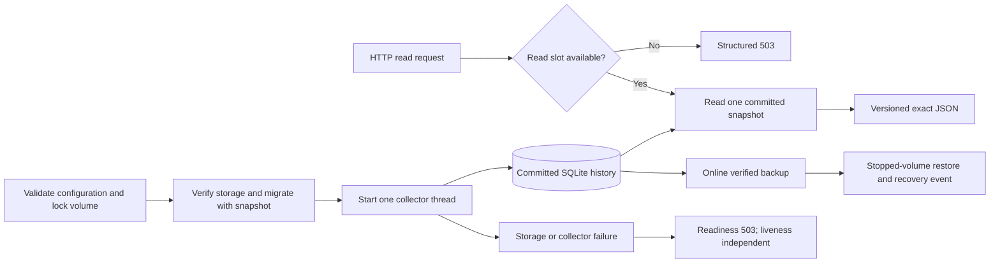

# Delivery 2 — bounded read APIs and operational recovery

## 1. Human-review summary

### Summary
- Outcome: expose the durable collector through exact, bounded HTTP contracts and run it in a recoverable non-root container, with verified online backup and stopped-volume restore.
- Scope: delivery-map Step 2, including API models/OpenAPI, database reads, readiness, lifecycle, Docker/Compose and operations. Preserve Delivery 1 accounting; do not implement or imitate the frontend.
- Readiness: execution-ready for local implementation, subject to the explicit Delivery 1 contract-repair gate in Step 2. No unresolved product or architecture decision. Application/container checks below are planned, not executed by writing this plan.

### Explain like I'm five
The running application collects into the same database as before. HTTP requests read a committed snapshot, never Jarvis, and distinguish observed zero from missing or uncertain data. Too many reads fail promptly instead of queuing. Operators can back up while collection continues, restore only while the target is stopped, and recreate the limited container without losing or replaying committed work.

### Target flow


### Affected code
All named new modules/commands below are proposed, not existing symbols.
```text
/                                  — update pyproject.toml, uv.lock, README; new Dockerfile, Compose, .dockerignore
├── src/jarvis_dashboard/           — update collector/storage/CLI; new API models, queries, lifecycle and backup support
│   └── migrations/                — new numbered migration after 0001; durable API metadata/indexes
├── tests/                         — API, coverage, concurrency, lifecycle and recovery behavior
│   └── fixtures/                  — reuse controlled HTTP server; add version-1 database/recovery inputs
├── scripts/                       — preserve collector smoke; add actual HTTP/container/recovery smoke runner
└── docs/                          — this plan, map link, operations, executed Delivery 2 receipt
```

### Assumptions
- The request is to write this plan, not execute Delivery 2 or change the product specification.
- [specification.md](specification.md), especially D1–D6 and D8, and [acceptance-scenarios.md](acceptance-scenarios.md) are normative. [delivery-map.md](delivery-map.md) owns delivery boundaries.
- Delivery 1 code now exists. Its [status receipt](delivery-1-status.md) is historical evidence, not proof that every required downstream contract exists. Inspect and repair the concrete gaps below before building consumers.
- Frontend bundling remains Delivery 3; complete image/resource qualification and authorized Jarvis/Unraid evidence remain Delivery 4 and the separate operator gate. Fixtures use explicit local endpoints, never the default LAN origin.

## 2. Scope and acceptance criteria

**In scope**
- All seven D6 GET routes, exact response/error models, examples and OpenAPI; UTC range validation, bounded pagination, read admission and read-only snapshot queries.
- Durable coverage/diagnostic metadata needed by those routes, including correctness after retention and during deferred gap materialization.
- One Uvicorn worker and one dedicated writer thread, in-memory readiness, storage error classification, bounded shutdown and exclusive volume ownership.
- Locked Python runtime dependencies, pinned build/runtime images, non-root backend-only Docker image and constrained private-bound Compose example.
- Verified non-overwriting online backup, stopped-volume restore with recovery event, upgrade instructions and actual local HTTP/container evidence.

**Out of scope**
- Vue/Chart.js, generated frontend types/assets, static caching implementation and browser acceptance; no placeholder page or fake production dashboard.
- Authentication, writable administration HTTP routes, inference proxy, additional workers/services, arbitrary upstream/SQL/path HTTP inputs.
- The 30-minute two-tab resource qualification, live deployment, target-host fit and real known-generation comparison.

**Acceptance criteria**
- D2-AC1: all D6 routes and OpenAPI use schema version 1, UTC timestamps, decimal-string token values and stable structured errors. HTTP summary/history agree with committed database values, including 900/60/960 and sums above JavaScript's exact-integer range.
- D2-AC2: baseline-only, empty, zero, partial, stale, recovered gaps and resets remain distinct; all six quality dimensions, per-counter coverage and epoch diagnostics survive raw retention. UTC half-open ranges, current incomplete buckets and precise bounds follow D6 without clamping.
- D2-AC3: no more than four concurrent API database reads; a fifth is rejected promptly with 503, without a queued blocking task. Each response uses a short read-only snapshot and closes its connection. Series/events pages are bounded and stable under concurrent inserts.
- D2-AC4: readiness is 503 before startup completion and on storage/collector failure, even when saving an error fails; Jarvis outage alone leaves readiness 200. Liveness is independent. One writer owns the volume; SIGTERM exits within 15 seconds without partial commits or abandoned writer ownership.
- D2-AC5: online backup includes committed WAL state, passes integrity check and refuses overwrite; restore to a fresh stopped volume matches that backup snapshot, records recovery and resumes without duplicated increments. Migration preserves totals, snapshots before changes and refuses newer/corrupt storage.
- D2-AC6: locked/pinned backend-only production image runs non-root with read-only root, writable owned appdata, bounded tmpfs/logs, 256 MiB and 0.5 CPU; private binding is explicit. Recreating it preserves 960. Receipts distinguish early constrained smoke from final resource/browser/live qualification.

## 3. Design decisions

### D1. Adapt the actual durable core before freezing the API
Reason: the map's documentation-only footprint is obsolete, and the current implementation differs from several intended Delivery 1 contracts.

Observed source contracts:
- `cli.main` currently exposes only `collect`, creates its writer connection on the main thread and runs `Collector.run_forever` there. `Collector` already accepts `request_stop`; production serving must move connection creation/use/closure together into its dedicated thread, not disable SQLite thread checks.
- `storage.CURRENT_SCHEMA_VERSION` is 1. Series are keyed by `(source_id, identity)` where identity is canonical label JSON, not a numeric series ID. `series_state` holds baselines, open gaps and last acceptance; `collector_state` holds runtime key/value strings.
- `hourly_totals` is per counter with tokens, interval count and quality JSON, but lacks first/last contributing observations. `_apply_hour_delta` currently does not merge contribution quality; `_apply_hour_gap` marks only computed input. Closed/open `gap_spans` and deferred gap work are separate.
- `_mark_unhealthy` attempts database writes and logs, but has no published in-memory readiness state. The loop can overwrite collector status after failures; runtime flags cannot alone prove health.
- `_connect` sets a roughly 16 MiB page cache (`cache_size=-16000`), rather than the specified initial 4 MiB. Migration snapshots call `Connection.backup` inline without explicit result integrity verification or non-overwrite protection, despite stronger wording in the status receipt.

Contract: inspect these exact paths and reproduce consumer-visible discrepancies in Step 2; preserve valid committed token sums/baselines. Add a numbered migration, never edit `0001_initial.sql`. Persist per-counter first/last contributing observation and quality union, plus compact latest accepted interval diagnostics sufficient for rates after retention. Correct scope propagation and durable metadata at the writer transaction boundary, not by making the API invent facts. Index bounded queries by series and time/event order.

Backfill new metadata from retained samples, epochs and gap spans in bounded batches during migration. Retained raw data may not cover all existing history: preserve sums and explicitly expose `metadata_complete: false` and null unrecoverable bounds/diagnostics; never infer clean coverage from missing evidence. Fresh collection must produce complete metadata and pass retention invariants. A newly introduced metadata-completeness field is distinct from the six domain quality flags. Document this existing-database limitation rather than claiming lost historical details were reconstructed.

### D2. Exact versioned wire contract, owned by code
Reason: Delivery 3 needs one authoritative schema, not a second independently maintained interface.

Contract: introduce explicit FastAPI response models in `src/jarvis_dashboard/`; OpenAPI and checked examples are generated from these models. Application responses, including errors and health JSON, carry `schema_version: 1` and one UTC `generated_at` captured per request. Errors additionally carry `error: {code, message}`. Normalize validation errors to 400, not FastAPI's default 422; unknown series is 404, saturation is 503 (`read_capacity_exceeded`), and storage unavailable is 503. Unexpected internal errors return a payload-free generic 500; log bounded diagnostic codes, never tracebacks to clients. Set `Cache-Control: no-store` on API and health responses, including errors. No wildcard CORS.

Token counts, opening balances and processed totals are nonnegative decimal strings or null. Interval counts are JSON integers; durations/rates may be finite JSON numbers, with explicit seconds/tokens-per-second units. Compute totals with exact integers and checked signed-int64 addition; reject aggregate overflow visibly rather than coercing to float or returning wrapped values. `processed_total` exists only when both primary counters have observed intervals; it never includes request counters. Never perform SQLite `SUM` with an unchecked overflow/floating fallback. Stream compact hourly rows or use a checked exact aggregate without collecting lifetime rows into lists.

Expose stable opaque `series_id` as versioned URL-safe base64 encoding of the UTF-8 JSON pair `[source_id, canonical_identity]`; validate its structure and canonical round trip, then resolve the exact stored pair with parameterized SQL. Unknown valid ID is 404, malformed ID is 400. Identity encoding is not authorization; never silently select another series or aggregate all series. Preserve complete labels separately in series responses.

### D3. Four admitted reads and one snapshot per response
Reason: sync handlers alone do not bound thread-pool queuing or connection/cache memory.

Contract: acquire one of four non-waiting admission slots in the async HTTP boundary *before* dispatching a database-reading synchronous handler. Saturated requests return 503 immediately; release in `finally`, including cancellation/error paths, without releasing before offloaded work actually finishes. Run SQL off the ASGI event loop. Each admitted request opens its own SQLite URI `mode=ro` connection inside that thread, sets `query_only`, bounded busy timeout, 4 MiB cache and disabled mmap, starts a read transaction, reads all response components from that snapshot and closes promptly. Do not use `immutable=1` with live WAL or `open_storage` for reader connections. Readers cannot create, migrate or write. Writer uses WAL/FULL/foreign keys/5-second busy timeout and 4 MiB initial cache. Health routes use the small in-memory lifecycle snapshot, not a fifth database connection. Backup has its separate single maintenance connection and is not an HTTP read route.

Use SQL range filters, indexed keyset queries and bounded streaming. No duplicate history cache, all-sample scans, persistent per-request connection pool or unbounded request work queue. Query complexity for lifetime scales with compact hourly history; hourly/daily response materialization never exceeds 744/366 points.

### D4. UTC, per-counter coverage and current state
Reason: a numerical sum alone cannot distinguish baseline, no data and observed zero.

Contract: normalize accepted RFC3339 UTC inputs (`Z` or zero offset; reject naive/nonzero-offset timestamps); require `from < to`, correct alignment, and exact maxima. Attribute tokens to the ending observation's bucket, including half-open exclusion at `to`; never interpolate them across hours.

Each summary range/history bucket includes bounds, four counter values, `processed_total`, per-counter interval counts/first-last observations/gap seconds/quality flags, metadata completeness, and `incomplete` for a bucket whose end is later than `generated_at`. Use observed-interval count, not row presence, to choose null versus `"0"`. Union the six established quality flags; optional sums expose missing intervals through per-counter coverage and partial indicators, not substituted engine values. A range is partial when it contains known gaps, unavailable counter intervals or incomplete metadata; ongoing/current-period incompleteness is separately exposed. Do not promise full wall-clock coverage merely because intervals exist.

For gap seconds, query authoritative spans overlapping the requested range, clip to bucket bounds and `generated_at`, and union overlaps within each counter scope. Use `SCOPE_FOR_COUNTER` for the coupled primary scope. Deferred hourly gap markers are not additional durations. Overlay open gaps and implicit downtime beyond two poll intervals from the last successful observation when not yet persisted; never write from GET. Preserve exact-two-interval versus greater-than-two boundary. An open/queued gap is visible before maintenance catches up, and closing/materializing it must not double-count duration. Historical sums remain readable while upstream is down.

Today starts at UTC midnight, month at first-of-month UTC midnight, lifetime at the first baseline/collection observation. Summary range end is the request's `generated_at`; sum through the current observed hour only, never include opening balances. First/last *contributing* observations are separate from first baseline. Diagnostics include current epoch/opening balances, retention policy, last error, continuity caveat and bounded epoch pagination. Keep summary diagnostics bounded: current epoch plus a newest-first page of at most 20 epochs with an opaque continuation token accepted by summary; do not inline unlimited epochs. Epoch detail pagination is part of summary query/models, not a new HTTP route.

Rates are computed from the latest accepted interval only, with persisted interval delta/duration/eligibility, not by searching backward for an old eligible interval. Return null for stale, gap, baseline, reset or ineligible latest intervals; valid contiguous unchanged work gives numeric zero. Preserve Delivery 1's conservative uptime-chain eligibility; do not broaden it accidentally while integrating.

### D5. Route and pagination behavior
Reason: bounds must apply to identities and diagnostics as well as history.

| Route | Selected contract beyond D2–D4 |
|---|---|
| `/health/live` | 200 while the process/event loop serves; no upstream/storage query. |
| `/health/ready` | 200 only after writable validated/migrated storage and collector initialization; otherwise 503, including shutdown/fatal thread failure. |
| `/api/v1/status` | Safe source ID/poll interval/raw retention, server time, latest attempt/success/error, first observation, storage and collection state; omit endpoint credentials, raw URL and payloads. |
| `/api/v1/series` | Default 100, max 100/page; labels, display fields, first/last valid presence, active/stale; deterministic opaque keyset cursor. |
| `/api/v1/summary` | Required exact series ID; today/month/lifetime, latest rates and bounded diagnostics described above. |
| `/api/v1/history` | Required series/from/to/bucket; hour max 31 days/744 points; day max 366 days/366 points. Generate every requested bucket, including empty null buckets; never clamp. |
| `/api/v1/events` | Required series; default 20/max 100; descending `(occurred_at,event_id)` keyset order, retention disclosure and next cursor. Include source-wide events applicable to the selected source. |

Cursor payloads are versioned, URL-safe, length-bounded, strictly decoded and bound to route, selected series/filter and ordering. Include first-page high-water marks: series pages exclude identities created after that page (use a migration-backed monotonic enumeration key); events/epochs exclude later inserted IDs. Later pages use the last sort key, not OFFSET. Deleted retained events may shorten a page; no duplicated rows or false promise of frozen mutable status. Reject invalid/reused-for-other-filter cursors with 400. Add `limit` bounds errors, invalid enums and missing-required-parameter cases to the common 400 model.

Collection-state precedence: `starting` before any primary success in this process/history context; if attempts continue without any success beyond two configured intervals since startup, `offline`. Otherwise no primary success for more than two intervals means `offline`; timely primary success with unavailable uptime/optional data or a current primary failure means `degraded`; fully usable recent data means `healthy`. Store/publish primary success separately from metrics transport success: parsed-but-invalid/empty primary data must not refresh it. Overall status uses successful primary data for the configured source; per-series stale state remains independent. Storage health is orthogonal and can fail readiness in any collection state.

### D6. One writer lifecycle with failure publication
Reason: readiness must survive the very database failure it reports.

Contract: add proposed `jarvis-dashboard serve`, retaining the useful standalone `collect` command on the same lifecycle implementation. Serve with one Uvicorn worker, no reload, internal port from validated `PORT` (default 8080). The collector thread acquires the process lock, opens/migrates the writer, validates real transactional writability, initializes collection and publishes readiness through a small thread-safe in-memory record. Hold lock until the writer has closed. Startup failure aborts serving; while startup is observable, readiness is false. A second collect/serve instance refuses, not merely waits for SQLite locks.

Publish storage/collector failure before attempting durable error logging; distinguish full, locked, read-only and corrupt errors. Failed transactions cannot publish success. Mark storage healthy again only after successful storage work, not simply a loop iteration. Unexpected thread death fails readiness and terminates the service with nonzero exit rather than leaving an inert API indefinitely. HTTP upstream failures do not kill the writer or fail readiness.

SIGTERM/SIGINT first disable readiness, stop scheduling and request collector stop, drain bounded API work, finish/roll back the active write, close all connections and join the thread before process exit. Include two upstream request deadlines and SQLite waits/maintenance in the overall 15-second budget: stop between requests and bound/cancel maintenance/admission as needed without committing partial observations. Configure Uvicorn shutdown and Compose stop grace so Docker does not mask a violation with SIGKILL; measure actual signal-to-exit time during idle, active fetch, write contention and backup.

### D7. One verified snapshot primitive and stopped restore
Reason: migration safety and public backup must not maintain competing SQLite-copy implementations.

Contract: extract/harden the existing `Connection.backup` code into shared support used by migrations and proposed `jarvis-dashboard backup --output PATH`. Backup opens an existing source without initialization/migration or the exclusive collector lock, creates the destination exclusively, refuses source/destination aliasing and existing paths (including symlinks), copies committed WAL through the online backup API in bounded page steps, and checks destination `PRAGMA integrity_check`. On failure remove only its newly created incomplete output, return nonzero and never label it a completed backup. Preserve an existing backup untouched. Do not copy the live main file, checkpoint as a substitute for backup, retain response bodies or merge later live totals. Backup requires storage/output settings, not reachable/valid upstream configuration. Migration snapshots verify integrity and refuse overwrite before applying any migration.

Use a small proposed offline command `jarvis-dashboard restore --input PATH` to make the documented stopped-volume procedure repeatable and emit recovery correctly; no HTTP mutation route. It acquires the target volume lock, refuses a running target, validates input integrity/schema before touching the destination and preserves any existing main/WAL/SHM files together in a new non-overwriting recovery directory. Install via a staging file on the target filesystem, set documented ownership through the operator's UID/GID procedure, then create a durable source-wide `restore` event identifying recovery time and snapshot provenance without secrets. Keep token/baseline state identical to the backup; the recovery event is the only intentional accounting-independent difference. The next serve may run supported migrations with its own snapshot; newer-schema input is refused. Failures keep the old set recoverable and do not silently start an empty database. Backups of a fresh volume need no Jarvis access; take completed backups off-pool. External receipts later than the backup are not merged or claimed restored.

### D8. Backend-only production packaging and evidence boundaries
Reason: the runtime must be real before frontend work without impersonating a finished dashboard.

Contract: locked Python install and multi-stage slim Python 3.13 runtime; pin reviewed concrete versions/digests at implementation time, including build tooling. No guessed future patch tags, dev reload, Node runtime, Docker socket/GPU mounts or privileged mode. Build the wheel with migrations, exclude venv/caches/test data/backups from build context/runtime. Serve API/OpenAPI; `/` returns an ordinary 404 until Delivery 3, not a placeholder UI. Document this explicitly.

Compose runs explicit numeric non-root UID/GID (documented substitution), restart `unless-stopped`, `mem_limit: 256m`, `cpus: 0.5`, rotated bounded logs, read-only root, a small size-limited `/tmp` tmpfs and `/data` bind. Disable bytecode writes; runtime needs no home-directory cache. Require private host-address substitution, e.g. `${DASHBOARD_BIND_ADDRESS:?set a trusted LAN address}`, plus configurable host port; no implicit `0.0.0.0` host publish. Supply readiness healthcheck using standard-library HTTP rather than adding curl. Document precreating appdata with correct ownership, a local SSD/cache-pool path and no SMB/NFS/mover relocation. No chmod 777. Healthcheck failure reports unhealthy, not a false promise that Compose restarts unhealthy processes.

Measure early constrained smoke (RSS, total cgroup/Docker memory and peak/OOM, CPU, database/WAL growth, HTTP latency and shutdown) but do not call it D9 qualification. Final frontend build/static cache policy and two-tab 30-minute workload remain future deliveries; operator credentials/host access are not required for local completion.

## 4. Implementation steps

### Step 1: Extract the verified online snapshot primitive
- **Code area:** `src/jarvis_dashboard/` storage/backup support and CLI; `tests/`.
- **Change:** Implement D7 snapshot creation once; route migrations and the backup CLI through it. Separate CLI argument/config validation so backups do not initialize the source or require upstream access. Return actionable failure codes with payload-free output.
- **Depends on:** existing Delivery 1 storage implementation; does not depend on the new schema or HTTP routes.
- **Verification:** While an actual collector writes WAL, create a backup, reopen it and check integrity plus coherent totals/baselines. Repeat existing output, alias/symlink destination, unwritable output, invalid source and failed backup; existing files remain unchanged and no incomplete output is advertised. A pending migration refuses to proceed if snapshot creation/verification fails (D2-AC5; scenario 29).

### Step 2: Repair and migrate durable API prerequisites
- **Code area:** `src/jarvis_dashboard/storage.py`, `collector.py`, `accounting.py`, `domain.py`, `migrations/`; `tests/`, `tests/fixtures/`.
- **Change:** Execute D1: reproduce lost quality propagation, missing retained observation metadata and incorrect last-seen/status semantics before fixing them. Add the next numbered migration and bounded backfill, monotonic series enumeration/indexes, durable latest-interval diagnostics, first/last successful-presence and contribution metadata. Keep per-counter coverage/flags atomic with sums/baselines. Preserve incomplete legacy metadata honestly. Correct the cache budget. Use Step 1's verified snapshot implementation before applying the new production migration.
- **Depends on:** Step 1 and the existing Delivery 1 accounting/schema.
- **Verification:** On a version-1 fixture, verify unchanged 900/60/960, baseline/epoch state and pre-migration snapshot; newer/corrupt schema is refused. Fresh gap/reset/unverified/optional cases retain all required quality and first/last metadata after raw purge. Legacy raw-expired history retains exact totals and reports unknown metadata, never invented completeness. Cover scenarios 1–19, 22–28 and migration part of 30 (D2-AC1–2, D2-AC5).

### Step 3: Integrate the server and reliable lifecycle health
- **Code area:** `src/jarvis_dashboard/` CLI/collector/new lifecycle/API bootstrap; `pyproject.toml`, `uv.lock`; `tests/`, `tests/fixtures/`.
- **Change:** Add/lock FastAPI and Uvicorn; implement D6 and health routes with code-owned models/error handling. Writer creation/use/close stays in its thread. Both collect/serve reuse ownership, stop and fault publication. Correct attempt/success reporting on all parse/missing-primary paths without changing accounting semantics.
- **Depends on:** Steps 1–2.
- **Verification:** Launch actual serve against loopback fixture; liveness succeeds and readiness becomes 200 without requiring upstream success. Disconnect metrics: offline after the threshold, readiness still 200. Missing stats/optional counters degrades without offline. Induce full/locked/unwritable storage, including inability to persist errors: readiness 503 and baselines unchanged. Kill/fail writer and observe nonzero process exit. Second process refuses. Measure SIGTERM during idle and slow requests (D2-AC4).

### Step 4: Implement exact snapshot queries and retained coverage
- **Code area:** `src/jarvis_dashboard/` proposed read-query/model modules; `tests/`.
- **Change:** Implement D2–D4 parameterized snapshot readers: exact checked sums, baseline/zero/null handling, UTC rollups, per-scope clipped gap union, open/implicit/deferred overlays, persisted latest rates and bounded diagnostics. Define reusable schema models/examples before route binding. Never query raw samples for lifetime totals or rely on them for retained coverage.
- **Depends on:** Steps 2–3.
- **Verification:** Compare database and query results for 900/60/960, values above 2^53, aggregate int64 overflow, independent optional reset/absence, valid zero, baseline-only and raw-expired data. Cross UTC hour/month/midnight boundaries, exact `to`, ongoing gaps and pending multi-year gap materialization; totals/seconds remain unchanged after materialization catches up. Latest gap/reset invalidates rates rather than resurfacing old rates (D2-AC1–2).

### Step 5: Bind every bounded API route and freeze OpenAPI
- **Code area:** `src/jarvis_dashboard/` API/models/admission/queries; `tests/`, `tests/fixtures/`, `scripts/` HTTP smoke.
- **Change:** Implement D2–D5 routes, strict ranges/IDs/cursors, snapshot-bound summary/history, pagination and uniform error/cache behavior. Gate admission before sync execution. Publish OpenAPI response examples for all success/error variants; freeze schema version 1 for Delivery 3 mechanical type generation/checking.
- **Depends on:** Steps 3–4.
- **Verification:** Run real HTTP requests for every route, maximum legal ranges, malformed/misaligned/reversed/oversize ranges, missing/unknown IDs and tampered/cross-filter cursors. Page >100 identities/events with equal timestamps and concurrent insertions; no duplicates or bound escapes. Hold four reads in a controlled test seam, send a fifth and observe prompt 503; cancellation/failure releases capacity only when work ends. Continue polling and repeat reads; responses are coherent snapshots, no connections accumulate and no HTTP call fetches upstream. Inspect OpenAPI/examples and no-store headers (D2-AC1–3).

### Step 6: Implement stopped-volume restore and upgrade operations
- **Code area:** `src/jarvis_dashboard/` restore/CLI/storage; `tests/`, `scripts/`, `docs/` operations; README.
- **Change:** Implement D7 offline restore, recovery event and preservation/install failure behavior. Document exact CLI commands, ownership, stop/backup/upgrade/restore sequence, WAL safety, backup off-pool copying and endpoint-change semantics. Keep existing Delivery 1 receipt historical; correct current instructions rather than rewriting old results.
- **Depends on:** Steps 1–2 and 5 for HTTP comparison.
- **Verification:** Back up during collection; advance the live database further, stop it, then restore backup to a fresh target. Before any new poll, HTTP/query totals and baseline match the backup, not the advanced live database. Observe recovery event, restart with unchanged counters and no duplicate credit. Refuse restore to locked volume/newer/corrupt backup; preserve existing main/WAL/SHM together. Test failure before install and recover the old set. Exercise supported migration after restore and endpoint change preserving totals (D2-AC5; scenarios 29–30).

### Step 7: Build the constrained backend-only image
- **Code area:** root Dockerfile/Compose/.dockerignore, manifests/lock; `scripts/`, `tests/fixtures/`; README and `docs/` operations.
- **Change:** Implement D8 image/Compose using the actual serve/backup/restore commands. Reuse a controlled upstream reachable only on a local Docker test network; application remains one production service. Document private host substitution, appdata ownership, upgrade/health/logs and absence of frontend. Keep test fixture controls out of the image.
- **Depends on:** Steps 3, 5 and 6.
- **Verification:** Build with frozen dependencies; inspect numeric non-root identity, one worker/collector, required packaged migrations and lack of Node/dev artifacts. Run with 256 MiB/0.5 CPU, read-only root and tmpfs, explicit loopback/private bind and owned persistent volume; health/API work. Root remains unwritable. Recreate the container and keep 960 with unchanged counters. Run backup while collecting and restore via stopped-volume tooling. Measure SIGTERM in active-fetch/write-contention/backup cases within 15 seconds; record memory/peak/OOM/CPU/latency and DB/WAL rather than inferring fit from RSS (D2-AC4–6).

### Step 8: Record delivery evidence and frontend handoff
- **Code area:** `scripts/`, `tests/fixtures/`, `docs/`, README and delivery-map links; behavioral tests only for defects exposed during integration.
- **Change:** Provide a reproducible actual HTTP/container/recovery smoke runner that orchestrates the earlier checks with explicit fixture endpoints. After integration run the relevant existing suite once, the existing Delivery 1 smoke and new Delivery 2 smoke. Write `docs/delivery-2-status.md` only with executed commands/environment/image/dependencies, expected/actual values, timings, limits, failures and scenario/AC coverage. Update current project description so it no longer says implementation does not exist. Hand off OpenAPI/models/examples and pagination/error/coverage semantics, not a second handwritten frontend schema.
- **Depends on:** Steps 1–7.
- **Verification:** Every D2 criterion has recorded whole-path evidence or an explicit failure; do not accept the delivery with failing hard criteria. Scenarios 1–19 and 21–28 gain serialization/operations evidence, 20 and 29 are first proven here, and 30 gains full restore proof. Explicitly leave 31–33, live 34, final AC4–6 qualification and AC8 operator comparison pending (D2-AC1–6).

## 5. End-to-end verification

All scenarios here are planned. Known existing commands are `uv sync --frozen`, `.venv/bin/pytest` and `.venv/bin/python scripts/smoke.py`; these are not results of this planning task. New CLI names above are target contracts; document exact build/Compose/smoke commands from the implementation rather than fabricating runnable commands now.

1. **Accounting → HTTP → recreation:** use controlled `(1000,100)` → `(1600,140)` → `(1900,160)` with compatible uptime, waiting for committed samples. Baseline summary is null; final input/output/processed are `"900"`/`"60"`/`"960"` in summary and aligned history. Optional `(2000,100)` → `(3000,140)` stays separate. Recreate the constrained container on the same volume with unchanged counters; 960 persists, then a real unchanged interval is zero. Check a second engine/label set is never included implicitly (D2-AC1–2, D2-AC6; scenarios 1–6, 24–27).
2. **History trust under outage and retention:** cross midnight with fixture failure and compatible recovery; delta belongs to the ending hour and gaps split by UTC hour, gap-only counts are null and rates remain null. Repeat with changed uptime evidence, stats-only outage and optional-only failure. Retain sums/quality after raw expiry, and compare before/after draining deferred gaps. HTTP current bucket is incomplete; exact `to` excludes its boundary. Readiness stays 200 for upstream outage but flips 503 for failed storage writes that cannot save an event (D2-AC2, D2-AC4; scenarios 7–19, 23, 28).
3. **Bounded reads and exact errors:** request 31-day hourly and 366-day daily history; observe exactly bounded bucket sequences. Larger/misaligned/reversed/invalid-ID requests return stable 400/404 without clamping. Four deliberately held reads admit no fifth; fifth gets prompt structured 503 while health stays responsive. Release/cancel work and verify collection continues and slots/connections return to baseline. Page concurrent identity/event insertions and validate exact large integer strings (D2-AC1–3; scenarios 20–22).
4. **Live snapshot → stopped restore → continuation:** create a backup while writer commits, validate integrity, and capture comparison values from the completed backup itself. Advance live totals; restore a fresh stopped target and compare against backup, not later live totals. Observe recovery diagnostic, preserved baseline and no replay. Refuse overwrite/running-target/corrupt/newer-schema operations, preserve old file set, and verify supported migration snapshot and endpoint-change boundary (D2-AC5; scenarios 29–30).
5. **Operational production smoke:** record effective Compose limits/private binding/log rotation/root-filesystem mode/UID/GID, health behavior, memory/CPU/DB-WAL readings and actual SIGTERM exit duration under the non-idle cases. A second process refuses the volume, recreation preserves totals and backend routes work without a frontend. Report this as Delivery 2 smoke only, not production-browser, 30-minute D9, NAS or live Radiance qualification (D2-AC4–6; local subset of 34).

## 6. Risks and open decisions

- **Legacy metadata loss:** current hourly rows do not contain all downstream diagnostics; raw-retained backfill cannot recover information already deleted. Preserve exact totals, expose incomplete metadata and test fresh collection/retention fully. Never silently represent old unknown quality as verified clean history.
- **Contract drift:** Delivery 1's planned thread/cache guarantees and recorded snapshot-integrity claim do not all match the inspected implementation. Step 1/2 source-driven repair and real upgrade receipts are prerequisites, not assumptions of prior success.
- **Memory and event-loop pressure:** four connections plus writer/backup, framework threads, tmpfs and filesystem cache all count. Admit before dispatch, close readers promptly, use 4 MiB caches/disabled mmap and measure total cgroup usage. Do not raise 256 MiB to make smoke pass.
- **Shutdown budget:** sequential request deadlines, SQLite waits and backup/maintenance can consume 15 seconds. Exercise combined contention, stop between operations and keep atomic write boundaries; Docker's kill grace is not proof of graceful exit.
- **Snapshot comparison race:** live totals may advance during/after backup. Compare restored data to the completed backup's committed snapshot, and treat recovery diagnostics separately from accounting equality.
- **Local versus target evidence:** Docker availability is a prerequisite for executing container checks, not for writing this plan. Missing runtime/access must be stated in execution receipts; fixture proof cannot satisfy authorized Jarvis/Unraid or final browser/resource gates.
- **Open decisions:** none blocking local implementation. Reviewed dependency/image pins are resolved during implementation; deployment UID/GID, pool and private host binding remain configurable operator inputs. Frontend completion is deliberately pending, not replaced with a mock.
