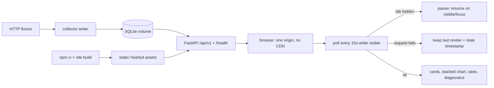

# Deliver the bundled production dashboard (Delivery 3)

## 1. Human-review summary

### Summary
- Outcome: the production image serves its own Vue 3 + Chart.js dashboard from `src/jarvis_dashboard/static/` over the same origin as `/api/v1`, presenting every specified D7 state with exact UTC numbers, one consistent selected series, bounded polling, and self-hosted hashed assets — verified in a real headless browser against the controlled HTTP fixture, including the exact `960` processed total.
- Scope: new `frontend/` npm project (locked), generated TypeScript types from the frozen FastAPI OpenAPI schema, static file serving plus per-path cache headers in the existing FastAPI app, a Node build stage added to the existing multi-stage Dockerfile, browser-driven smoke tooling, and the Delivery 3 receipts. Out of scope: resource qualification (Delivery 4) and any live Jarvis/Unraid work (operator gate).
- Readiness: execution-ready. No blocking decision remains. The container build itself cannot be executed in this environment (no `docker`/`podman`), exactly as already recorded for Delivery 2.

### Explain like I'm five
The collector and the read API already exist. This delivery adds the screen an operator actually looks at. `npm ci && npm run build` compiles the Vue app into hashed files that land in `src/jarvis_dashboard/static/`; the FastAPI app serves `index.html` and `/assets/*` from that directory next to `/api/v1`, so the browser talks to exactly one origin. The app polls `summary`/`history` every 15 seconds only while the tab is visible, keeps one selected series across cards, chart, rates and diagnostics, and shows real zeros, missing data, partial coverage, staleness, and the last good render with a stale timestamp without inventing numbers. Big token values stay exact strings formatted with `BigInt`, so `960` is `960` in the database, the API and the page.

### Target flow


### Affected code
```text
frontend/                       — new: locked npm manifests, Vite/TS config, index.html
└── src/
    ├── api/                    — new: generated OpenAPI types + typed fetch client
    ├── lib/                    — new: formatting, polling/store, Chart.js registration
    ├── components/             — new: header, cards, trend, rates, diagnostics, state banners
    ├── styles/                 — new: CSS token system (light/dark, spacing, focus)
    └── App.vue, main.ts        — new: single-screen composition
src/jarvis_dashboard/
├── app.py                      — static mounts, cache-header scoping, API 404 prefix
├── config.py                   — new optional STATIC_DIR configuration field
└── static/                     — new (generated, git-ignored): built assets in image/package
tests/
├── test_static.py              — new: static serving, cache headers, API contract regression
├── test_ui_tokens.py           — new: WCAG AA token contrast, token set completeness
└── fixtures/fixture_server.py  — add per-path request counter (browser→upstream proof)
scripts/
├── export_openapi.py           — new: OpenAPI snapshot + --check freshness gate
├── browser_driver.py           — new: stdlib-only Chrome DevTools Protocol client
└── smoke_frontend.py           — new: fixture + real serve process + real browser receipts
docs/
├── delivery-3-status.md        — new: executed receipts, environment, unexecuted gates
├── receipts/delivery-3/        — new: 390px/1440px screenshots from the smoke run
├── deployment.md               — frontend build stage, static serving, cache policy
├── delivery-map.md             — Step 3 executed/not-executed disclosure line
└── delivery-3-implementation-plan.md — this plan
README.md                       — dashboard now served by the image; Delivery 3 links
.gitignore, .dockerignore, Dockerfile, compose.yaml — build context, Node build stage, pins
```

### Assumptions
- The dashboard ships as static files generated at image build time; `src/jarvis_dashboard/static/` is build output and is never committed. The repository has no frontend source today (verified: no `frontend/`, no `src/jarvis_dashboard/static/`).
- Browser verification uses the system Chromium at `/usr/bin/chromium` ("Chromium 156.0.8078.47") driven by a small standard-library DevTools Protocol client, matching this repository's existing no-extra-dependency tooling style (`tests/asgi_client.py`, `scripts/container_healthcheck.py`). No Playwright/Puppeteer dependency is added.
- Local run only. `docker build`, `docker compose up`, and the 256 MiB / 0.5 CPU enforcement cannot be executed here (no container runtime installed); they are authored, locally validated as far as possible, and disclosed as pending, the same treatment `docs/delivery-2-status.md` records.
- The plan is written at `docs/delivery-3-implementation-plan.md` to match the existing `docs/delivery-1-implementation-plan.md` / `docs/delivery-2-implementation-plan.md` convention linked from `docs/delivery-map.md`.

## 2. Scope and acceptance criteria

**In scope**
- A locked Vue 3 + TypeScript + Vite project in `frontend/` with Chart.js 4 (only the bar controller/elements/scales/plugins it registers), native accessible controls, shared card/control primitives, a CSS token system, no router, and no global state library.
- TypeScript types mechanically generated from the FastAPI OpenAPI document, plus a build-time freshness gate so a backend contract change fails the build (`docs/delivery-map.md` D4).
- The full D7 single-screen contract: compact header, three primary cards, stacked-bar trend panel with 24h/7d/30d/custom UTC controls, rates secondary panel, "Request-accounted usage" disclosure, diagnostics disclosure, and every listed UI state.
- Exact numeric presentation: `BigInt` formatting for every displayed token count, `Number` only for chart coordinates, exact strings in tooltips; UTC everywhere with the lifetime start date visible.
- Bounded polling lifecycle: 15 s while visible, pause when hidden, refresh on focus, no overlapping or out-of-order responses, one selected series across all panels, charts destroyed on unmount and reused on refresh.
- Backend static serving of the built assets with `index.html` revalidating and hashed assets immutable, while every API, health, and error response keeps `Cache-Control: no-store`.
- Self-hosted hashed assets only: no CDN, no web fonts, no external runtime requests; the browser never contacts the fixture/Jarvis origin directly.
- Packaging: Node build stage in the existing Dockerfile, assets copied into the slim runtime, no Node.js in the runtime stage, pinned build/runtime images.
- Delivery 3 evidence: `docs/delivery-3-status.md`, screenshots in `docs/receipts/delivery-3/`, `docs/deployment.md`, `README.md`, `docs/delivery-map.md` updates.

**Out of scope**
- Specification D9 resource qualification (memory/CSS/p95 workload, two-tab 30-minute run) — Delivery 4.
- Any live Jarvis or Unraid access, deployment, operator gate, or real-metric discovery — Delivery 4 instructions plus the authorized operator gate.
- Backend accounting, API routes, response models, schema version, backup/restore, lifecycle behavior, and container limits: consumed as frozen Delivery 1–2 contracts, changed only where static serving forces a cache-header scope decision.
- Frontend unit-test framework (vitest/jest), SSR/hydration, i18n, PWA/service worker, adding an authentication layer, or a settings page.

**Acceptance criteria**
- AC1: opening the served `index.html` in a real browser against the fixture seeded with the A2 sequence (1000/100 → 1600/140 → 1900/160) shows processed total text exactly `960` on the "Observed since collection began" card, with the computed-input `900` / generated-output `60` breakdown.
- AC2: every visible token count in the DOM is a locale-grouped exact integer derived from the API decimal string (never `Number`-rounded), including values above 2^53; tooltips show exact strings, UTC bucket bounds, and quality flags.
- AC3: the trend panel offers 24h (hourly buckets), 7d and 30d (daily buckets), and a custom UTC date range whose end is exclusive and labeled; requests satisfy the API alignment/limit rules, and an over-limit or misaligned custom range is refused in the UI with the same message category the API uses.
- AC4: missing buckets are not drawn as zero bars and no line is drawn across missing data; the current UTC hour/day bucket is visibly marked incomplete; null (no data) and `"0"` (observed zero) render distinctly.
- AC5: one selected series drives header, cards, chart, rates, and diagnostics simultaneously; changing the selection while an older response is in flight never lets the older response overwrite the newer selection.
- AC6: exactly one 15 s poll timer exists; polls stop while the tab is hidden and resume on visible/focus; canvas elements and Chart instances do not accumulate across range/series/theme/visibility cycles.
- AC7: all D7 states are reachable and rendered from the fixture: first-load skeleton, real zero, no data, baseline-only guidance, offline banner retaining historical cards, unavailable optional counters, partial buckets with accessible text, empty selection, API failure retaining the last successful render with a stale timestamp, and schema/parse failure with a concise action.
- AC8: theme toggle defaults to the system theme, persists the local choice across reload, keyboard focus is visible and Tab reaches every control, `prefers-reduced-motion: reduce` disables transitions, all token pairs meet WCAG AA contrast, and every state carries a text label independent of color.
- AC9: every browser request goes to the app origin only; the fixture's request counter shows no browser-originated upstream requests; no external hostname is reachable (enforced by host-resolver rules); the console log has zero `error` entries during the session.
- AC10: the API/health/error contract is unchanged — `Cache-Control: no-store` on `/api/v1/*`, `/api/v1/openapi.json`, `/health/*`, and every error response (including the generic 500), while `index.html` returns `no-cache` and `/assets/*` returns `public, max-age=31536000, immutable`.
- AC11: the production image definition contains a locked Node build stage and a runtime stage with the built assets and no Node.js; the full Python suite passes with the new static behavior.

## 3. Design decisions

### Repository findings (verified by inspection on 2026-10-25)
- `src/jarvis_dashboard/schemas.py:18-226` is the frozen wire contract, `SCHEMA_VERSION = 1`, every response extends `Envelope` with `schema_version` and `generated_at`. Key shapes: `CounterBlock{tokens: str|None, observed_intervals, first_observed_at, last_observed_at, gap_seconds, quality_flags, metadata_complete}`, `CounterBlocks{computed_input, generated_output, request_input, request_output}`, `Aggregates{counters, processed_total: str|None, quality_flags, metadata_complete, gap_seconds: GapScopes{primary,request_input,request_output}, partial, incomplete}`, `Bucket{bucket, started_at, ended_at}`, `Range{started_at: str|None, ended_at, observed}`, `Rate{observed_at, tokens, interval_seconds, tokens_per_second, eligible, quality_flags}`, `Epoch{epoch_id, reason, started_at, opening_computed_input, opening_generated_output}`, `StatusResponse`, `SeriesItem{series_id, labels, model_name, engine, state, stale_since, first_seen_at, last_seen_at, first_valid_at, last_valid_at}`, `SummaryResponse{series_id, labels, model_name, engine, first_observation_at, last_observed_at, last_accepted_at, state, ranges: SummaryRanges{today, month, lifetime}, rates: dict[str, Rate], epoch, epochs: EpochPage, collection_status, storage_status}`, `HistoryResponse{..., from_ (alias "from"), to, bucket_count, buckets, range}`, `EventsResponse{items: list[EventItem{event_id, kind, occurred_at, series_id, details}], next_cursor, page_size, retention: Retention{raw_retention_days, raw_samples_from, raw_samples_until, note}}`.
- Routes (`src/jarvis_dashboard/api.py:109-228`): `GET /api/v1/status`, `/api/v1/series?limit≤100&cursor`, `/api/v1/summary?series_id&epoch_limit≤20&epoch_cursor`, `/api/v1/history?series_id&from&to&bucket=hour|day`, `/api/v1/events?series_id&limit≤100&cursor`; prefix `/api/v1`; validation → 400 `invalid_request`; `QueryError` codes carried through: `invalid_series_id`, `invalid_cursor`, `invalid_time`, `invalid_bucket`, `invalid_range`, `series_not_found` (404), `storage_unavailable` (503), plus `read_capacity_exceeded` from `ReadAdmission` (`api.py:71`).
- Status vocabulary: `lifecycle.py:18-24` → collector `starting|healthy|degraded|offline`, storage `ok|unavailable`; `queries.py:932,985` → series `state` is `active` or `stale`; `queries.py:680-714` → `rates` is keyed by the four counter keys `computed_input`, `generated_output`, `request_input`, `request_output` (`domain.py:17-20`) with `tokens_per_second: null` when not eligible.
- Quality flags (`domain.py:69-80`): `collection_gap`, `reset_boundary`, `continuity_unverified`, `time_attribution_approximate`, `clock_discontinuity`, `counter_unavailable`; metadata completeness is reported separately, not as a flag. Epoch reasons (`domain.py:84-89`): `new_series`, `endpoint_change`, `counter_reset`, `restart_evidence`, `clock_regression`.
- Cache headers today are unconditional: the in-app `no_store` middleware (`app.py:98-102`) and the outermost `NoStoreMiddleware` (`app.py:236-248`) force `Cache-Control: no-store` on every response, deliberately including the generic 500 generated outside the app. `docs/specification.md:166` requires the opposite for static assets: "API responses are not cached by intermediaries; hashed static assets can be immutable, while index.html must revalidate."
- `create_app(state)` sets `app.openapi_schema = _normalise_openapi(app.openapi())` (`app.py:157`) and exposes the document at `/api/v1/openapi.json` (`docs_url=None`, `redoc_url=None`). `create_app` works with no database: `create_app(AppState(config=Config("http://127.0.0.1:8000","jarvis",15,3.0,"/tmp/none.sqlite3",30,8080,"INFO"), health=RuntimeHealth(poll_interval_seconds=15), db_path=Path("/tmp/none.sqlite3")))` then `app.openapi()` returned the 7 paths, 22 component schemas, ~23 KB JSON (executed during planning). `create_asgi_app(...)` returns `NoStoreMiddleware`.
- `Config` (`config.py:37-49`) is a frozen dataclass whose last field `bind_address` has a default; call sites use 8 positional arguments (`tests/test_collector.py:49`, `tests/test_api.py:44`, `tests/test_health_api.py:30`, `config.py:161`), so a new trailing field with a default is source-compatible. `service.build_server` (`service.py:244-261`) builds the ASGI app from `AppState`.
- Test tooling: `tests/asgi_client.py` drives the ASGI app in-process (`call(app, method, path, *, query, headers, body)` → `Response` with `.status_code/.headers/.body/.json()`); `tests/test_api.py` is the model for a static-serving test. `tests/fixtures/fixture_server.py` exposes `FixtureServer(model).state/.base_url/.start()/.stop()`, `install_fixture(state, labels, ci, go, ri, ro)`, and `FixtureState` controls `stats_fail`, `delay_s`, `chunk_delay_s`, `oversize`, `redirect`, plus `clear_metric`/`drop_series`; it currently records no per-path request counts.
- `Dockerfile` is backend-only: builder `ghcr.io/astral-sh/uv:0.13.5@sha256:32a7bb...` (`uv sync --frozen --no-dev --no-editable` into `/opt/venv`), runtime `python:3.13.17-slim@sha256:d98cc29d...`, numeric `APP_UID`/`APP_GID` args, `EXPOSE 8080`, `HEALTHCHECK container-healthcheck`, `ENTRYPOINT ["jarvis-dashboard"] CMD ["serve"]`. `.dockerignore` ships `src` (so a stale local `src/jarvis_dashboard/static/` would leak in) and excludes `scripts/*` except `container_healthcheck.py`. `compose.yaml` sets `mem_limit: 256m`, `cpus: 0.5`, `read_only: true`, `tmpfs: /tmp:size=32m`, `stop_grace_period: 15s`, LAN-address port binding, and passes `APP_UID`/`APP_GID` build args.
- Environment probes (executed during planning): Node v24.22.0 / npm 11.19.1; npm registry reachable; `docker` and `podman` absent; `python3 -m playwright` not installed. `/usr/bin/chromium` = Chromium 156.0.8078.47 and headless execution works: `chromium --headless=new --no-sandbox --disable-gpu --virtual-time-budget=4000 --dump-dom URL` rendered an async `fetch()` result ("total 960", exit 0); `--screenshot=x.png --window-size=390,844` and `--window-size=1440,900` wrote PNGs; `--enable-logging=stderr --v=0` surfaced `INFO:CONSOLE:3] "synthetic console error for probe"`; `--host-resolver-rules="MAP * ~NOTFOUND, EXCLUDE 127.0.0.1"` kept the local page and its same-origin fetch working. `--log-net-log` is unusable as a pass/fail source: it contains Chromium-internal Google endpoints (`clients2.google.com/time/1/current`, `edgedl.me.gvt1.com`, `accounts.google.com`) even with `--disable-background-networking --disable-component-update --disable-sync --disable-breakpad --disable-default-apps --no-pings`.
- npm/package facts (registry metadata read 2026-10-25): `vue` 3.5.44, `chart.js` 4.6.1, `vite` 8.3.5 (`engines.node ^20.19.0 || >=22.12.0`), `@vitejs/plugin-vue` 6.0.10 (peers `vue ^3.2.25 || ^3.6.0-rc.10`, `vite ^5||^6||^7||^8`), `vue-tsc` 3.3.13 (peer `typescript >=5.0.0`), `openapi-typescript` 7.13.0 (peer `typescript ^5.x`) → TypeScript must be pinned to 5.x (`5.9.3`), **not** `typescript` latest 7.0.2. Docker Hub `node:24.22.1` index digest `sha256:6449e19d8184d84062525b6a7524def03146c2cb04a7f08b076680d0e8e4240a`, linux/amd64 manifest `sha256:f9b3548b20b15b705b66aeecaeac7dd690c73d5e4661357aac02e60e3d38c88a` (read from `registry-1.docker.io/v2/library/node/manifests/24.22.1`).

### Decisions
- D1: Serve the built SPA from the existing FastAPI app: `app.mount("/assets", StaticFiles(directory=static_dir/"assets", headers=[("cache-control","public, max-age=31536000, immutable")]))` then `app.mount("/", StaticFiles(directory=static_dir, html=True, headers=[("cache-control","no-cache")]))` registered last, and add an explicit `@app.api_route("/api/{path:path}")` JSON 404 (`code: not_found`) registered before the root mount so unknown API paths keep the structured error contract instead of a static 404. Reason: same-origin serving (spec AC5) with mounts ordered so `/api/v1/*`, `/health/*` and `/api/v1/openapi.json` keep matching their routes. Contract: Starlette's `StaticFiles` raises `HTTPException(404)`, which the existing `on_http` handler (`app.py:159-166`) converts to the standard JSON error body; there is no SPA fallback (no router, one screen), so unknown paths legitimately 404.
- D2: Scope `no-store` to non-static paths instead of removing it. `app.py` gains `_is_api_path(path) -> bool` returning true for `/api/`, `/health/` prefixes; the `no_store` request middleware and `NoStoreMiddleware` set the header only for those paths, and static responses keep the header `StaticFiles` was configured with. Reason: `docs/specification.md:166` requires immutable hashed assets and revalidating `index.html`, while every existing test asserts `no-store` on API, health, and error responses. Contract: `AC10` invariants — API/health/openapi/error responses (including the generic 500 from `ServerErrorMiddleware`, which is why the wrapper stays outermost) stay `no-store`; only built-asset responses may carry a different value.
- D3: Static directory resolution: new trailing `Config` field `static_dir: str | None = None`, parsed from `STATIC_DIR` in `config.from_env` (absent/empty → `None`); `create_app` uses `Path(config.static_dir) if config.static_dir else Path(__file__).parent / "static"` and mounts only when that directory contains `index.html`. Reason: works in the image (`STATIC_DIR=/opt/static`), in a wheel, and in a source checkout with no frontend build; a missing build degrades to API-only (404 JSON at `/`) instead of crashing startup, and the trailing default keeps all existing positional `Config(...)` call sites compiling. Contract: never create the directory, never serve a directory without `index.html`.
- D4: Types are generated, not hand-written: `scripts/export_openapi.py` writes the live schema (from `create_app(...).openapi()`, no database needed) to `frontend/src/api/openapi.json`; the `gen:types` npm script runs `openapi-typescript` to `frontend/src/api/schema.ts`; `--check` exits 1 when the snapshot differs from the live schema. Reason: `docs/delivery-map.md` D4 requires generating or mechanically checking TypeScript compatibility with the FastAPI models. Contract: `frontend/src/api/openapi.json` and `schema.ts` are committed (they are the source of truth for the client); `npm run verify` = `gen:types` + `vue-tsc --noEmit` + `vite build`, so a backend field change breaks the frontend build, not the runtime.
- D5: Dependency pins are exact (no `^` ranges) with a committed `frontend/package-lock.json`: `vue` 3.5.44, `chart.js` 4.6.1, `typescript` 5.9.3, `vite` 8.3.5, `@vitejs/plugin-vue` 6.0.10, `vue-tsc` 3.3.13, `openapi-typescript` 7.13.0, `"engines": {"node": ">=22.12.0"}`. Reason: spec D1 "Lock resolved Python and npm dependencies"; `openapi-typescript` 7.13.0 requires `typescript ^5.x`, so the `typescript` latest 7.0.2 must not be used. Contract: the Docker build stage runs `npm ci` from the lockfile only; the runtime stage contains no Node.js.
- D6: State is one module-level reactive store (`frontend/src/lib/dashboard.ts`) created by `createDashboard()` and imported by components — no Pinia/Vuex (spec D1 forbids a global state library, D7 demands one consistent selected series across all panels). Contract: single `pollTimer: number | null`, single `AbortController`, monotonically increasing `requestSeq`; a response is applied only when its `requestSeq` is the latest for its panel and `series_id` equals `selectedSeriesId`; failures set `staleSince` and keep the previous payload.
- D7: Chart.js is imported through `frontend/src/lib/chart.ts`, which registers only `BarController`, `BarElement`, `CategoryScale`, `LinearScale`, `Tooltip`, `Legend` and `Title` on the `Chart` class from `chart.js` (tree-shakeable build, spec D1). One canvas per trend panel; `chart.update("none")` on refresh, `chart.destroy()` in `onBeforeUnmount`. Contract: buckets with `tokens: null` map to `null` data points (Chart.js skips bars and breaks lines — never a synthetic zero); `spanGaps` stays `false`; tooltips read the exact decimal strings from the response, not the chart's numeric coordinates.
- D8: Exact numbers use `BigInt`: `formatTokens(value: string | null): string` returns the locale-grouped `BigInt(value).toLocaleString("en-US")` for a non-null decimal string, `null` → the label `no data`, and throws nothing for values above 2^53. `Number()` is used only for chart `y` coordinates and `tokens_per_second`. Reason: spec D3 requires exact labels; the fixture A2 value is asserted as the literal text `960`. Contract: no token count is ever produced by arithmetic on a JS `number`.
- D9: Browser verification is a standard-library Chrome DevTools Protocol client (`scripts/browser_driver.py`) driving `/usr/bin/chromium` with `--headless=new --no-sandbox --disable-gpu --remote-debugging-port=0 --user-data-dir=<tmp> --host-resolver-rules="MAP * ~NOTFOUND, EXCLUDE 127.0.0.1"`. Reason: this repository's tooling is dependency-free by convention (`tests/asgi_client.py`, `scripts/container_healthcheck.py`); netlog inspection is unusable (see findings); host-resolver rules make "no CDN / no direct upstream" structurally impossible rather than log-inspected; Chromium's own Google pings would false-fail a naive log scan. Contract: external hostnames are unresolvable, so any remote asset fails the run; the fixture origin is a *different* 127.0.0.1 port and is proven untouched by the fixture's new per-path request counter plus the driver's `Network.requestWillBeSent` URLs.
- D10: Test hooks are `data-testid` attributes only (listed below). No debug/query-parameter instrumentation is added to production code; browser-side probes (timer map, fetch log, per-URL response delay) are injected by the driver with `Page.addScriptToEvaluateOnNewDocument`, so production code stays free of test scaffolding.
- D11: Screenshot and state evidence is written by the smoke script to `docs/receipts/delivery-3/` and summarised in `docs/delivery-3-status.md`; the map's Step 3 text gains the same executed/not-executed disclosure style used for Step 2. Reason: `docs/delivery-map.md` D7 (evidence per delivery, a pending receipt is not a passing result).

**DOM test-id contract** (used by Step 7 components and asserted by Step 11 — the two must agree exactly):
`app-header`, `product-name`, `series-name`, `status-badge`, `last-update`, `theme-toggle`, `series-picker`, `series-option`;
`card-today`, `card-month`, `card-lifetime`, and inside each: `today-total`/`month-total`/`lifetime-total`, `today-input`/`month-input`/`lifetime-input`, `today-output`/`month-output`/`lifetime-output`, `today-flag`/`month-flag`/`lifetime-flag`, `lifetime-start`;
`trend-panel`, `range-24h`, `range-7d`, `range-30d`, `range-custom`, `custom-from`, `custom-to`, `custom-apply`, `chart-canvas`, `chart-disclosure`, `chart-table`, `incomplete-note`, `range-error`;
`rates-panel`, `rate-input-value`, `rate-output-value`, `requests-disclosure`, `requests-summary`;
`skeleton`, `empty-state`, `stale-notice`, `offline-banner`, `api-error`, `baseline-note`, `unavailable-note`;
`diagnostics-disclosure`, `diagnostics-gaps`, `diagnostics-epochs`, `diagnostics-flags`, `diagnostics-retention`, `diagnostics-error`.

## 4. Implementation steps

### Required skills (load all before the first edit)
- `coding-best-practices` — repository baseline for module boundaries, error handling, and testable structure.
- `saas-ui` — the dashboard's layout/density/finish guidance for Steps 5–7.
- `tdd` — one-test-at-a-time RED/GREEN for Steps 8 (`tests/test_static.py`, `tests/test_ui_tokens.py`).
- The executor may load an additional skill only when new repository evidence makes it applicable (for example a language skill if a new runtime file type appears); skill loading must not restart research or reopen the design decisions above.

### Executor constraints
- Treat this file as the complete implementation specification; do not reopen the original request or rely on prior conversation.
- Read the named target files before editing, but do not repeat the planner's discovery searches.
- Follow the named files, symbols, contracts, steps, boundaries, and focused verification exactly.
- Do not add work not listed under **In scope**.
- If the repository no longer matches a stated finding, stop expanding the search, report the exact discrepancy, and make only the smallest inspection needed to resolve it.
- Load every skill under **Required skills** before editing. Load an additional skill only when new repository evidence makes it applicable; do not use skill loading to restart research.
- After the focused verification passes, stop. Do not run broader checks or continue polishing.
- Never present an authored-but-unrun container gate as executed (Step 9): no container runtime exists in this environment.

### Step 1: Export the OpenAPI snapshot and freshness gate
- **Code area:** `scripts/export_openapi.py` (new).
- **Change:** Write a script that builds the schema in-process exactly as `create_app` does (no database, no network): `Config("http://127.0.0.1:8000", "jarvis", 15, 3.0, "/tmp/jarvis-openapi-none.sqlite3", 30, 8080, "INFO")`, `RuntimeHealth(poll_interval_seconds=15)`, `AppState(config=..., health=..., db_path=Path(...))`, then `json.dumps(create_app(state).openapi_schema, indent=2, sort_keys=True) + "\n"`. Default action writes `frontend/src/api/openapi.json` (create parent directories); `--check` compares the live bytes with the file and exits 1 printing the first differing JSON key path when missing or stale, exits 0 on equality. Exit code 0 on success, non-zero with a one-line message on failure; no traceback.
- **Depends on:** None.
- **Verification:** `.venv/bin/python scripts/export_openapi.py` then `.venv/bin/python scripts/export_openapi.py --check; echo $?` → exit 0, and the file's `paths` keys are exactly `/api/v1/events`, `/api/v1/history`, `/api/v1/series`, `/api/v1/summary`, `/api/v1/status`, `/health/live`, `/health/ready` with 22 `components.schemas` entries and no `HTTPValidationError`/`ValidationError`/422 (AC10, AC11).

### Step 2: Scaffold the locked frontend project
- **Code area:** `frontend/package.json`, `frontend/package-lock.json`, `frontend/tsconfig.json`, `frontend/tsconfig.node.json`, `frontend/vite.config.ts`, `frontend/index.html`, `frontend/src/main.ts`, `frontend/src/App.vue`, `frontend/src/styles/tokens.css`, `frontend/.gitignore`.
- **Change:** Create the project with exact pins from D5 and scripts: `"build": "vite build"`, `"typecheck": "vue-tsc --noEmit"`, `"gen:types": "openapi-typescript src/api/openapi.json -o src/api/schema.ts"`, `"verify": "npm run gen:types && npm run typecheck && npm run build"`. `vite.config.ts` uses `@vitejs/plugin-vue`, `base: "/"`, `build.outDir: process.env.DASHBOARD_STATIC_OUT ? path.resolve(process.env.DASHBOARD_STATIC_OUT) : path.resolve(__dirname, "../src/jarvis_dashboard/static")`, `build.assetsDir: "assets"`, `build.sourcemap: false`, `build.copyPublicDir: false`, `emptyOutDir: true`. `index.html` sets `lang="en"`, `<meta name="viewport" content="width=device-width, initial-scale=1">`, `<meta name="color-scheme" content="light dark">`, title "Jarvis Token Dashboard", one `<div id="app">`, and no external script, style, font, favicon URL, or `preconnect`. `main.ts` mounts `App` and applies the stored theme (`localStorage.getItem("jarvis-theme")` → `document.documentElement.dataset.theme`, absent → leave unset so the system theme applies). `tokens.css` defines the CSS variables `--bg`, `--panel`, `--fg`, `--fg-muted`, `--border`, `--accent`, `--series-input`, `--series-output`, `--warning`, `--error`; the system font stack; spacing scale 4/8/12/16/24/32px as `--sp-1..--sp-6`; 12px card radius; 1px borders; `font-variant-numeric: tabular-nums`; a `:root[data-theme="dark"]` block; `:focus-visible { outline: 2px solid var(--accent); outline-offset: 2px; }`; `@media (prefers-reduced-motion: reduce) { *, *::before, *::after { transition-duration: 0s; animation-duration: 0s; } }`. `App.vue` is a temporary single heading `<h1 data-testid="product-name">Jarvis Token Dashboard</h1>`; Step 7 replaces its content — no second shell, no placeholder page.
- **Depends on:** Step 1 (types are generated from the snapshot in Step 3, and `src/api/openapi.json` already exists).
- **Verification:** `cd frontend && npm ci && npm run build` → exit 0 and `../src/jarvis_dashboard/static/index.html` plus `../src/jarvis_dashboard/static/assets/index-<hash>.js` and `.../index-<hash>.css` exist; `grep -c "https://" src/../src/jarvis_dashboard/static/index.html` is 0; `npm run typecheck` exits 0 (AC9 foundation, AC11).

### Step 3: Generate types and the typed API client
- **Code area:** `frontend/src/api/schema.ts` (generated), `frontend/src/api/client.ts` (new).
- **Change:** Run `npm run gen:types` and commit `schema.ts`; import types only through `components["schemas"]["..."]` aliases (`SummaryResponse`, `HistoryResponse`, `StatusResponse`, `SeriesListResponse`, `EventsResponse`, `Range`, `Bucket`, `Rate`, `CounterBlock`, `GapScopes`, `Epoch`, `EventItem`, `Retention`, `ErrorResponse`). Implement in `client.ts`:
  `const API = "/api/v1"`; `class ApiError extends Error { code: string; status: number }`; `async function getJson<T>(path: string, query: Record<string, string | number | undefined>, signal: AbortSignal): Promise<T>` that drops `undefined` params, builds the query with `URLSearchParams`, calls `fetch(API + path + "?" + params, { signal, cache: "no-store" })`, parses JSON, and on non-2xx throws `ApiError` with `body.error.code`/`body.error.message` (falling back to `code: "unknown"`, `message: "request failed"`); on non-JSON or missing `schema_version` throws `ApiError(status, "schema_mismatch")`. Exported functions: `fetchStatus`, `fetchSeries(limit = 100, cursor?)`, `fetchSummary(seriesId, epochLimit = 20, epochCursor?)`, `fetchHistory(seriesId, from, to, bucket: "hour" | "day")`, `fetchEvents(seriesId, limit = 20, cursor?)`. History params use the wire names `from`/`to` (the `from_` alias is server-side only).
- **Depends on:** Steps 1–2.
- **Verification:** `cd frontend && npm run typecheck` exits 0 and `src/api/schema.ts` contains `SummaryResponse`, `HistoryResponse`, `EventsResponse`, `SchemaVersion`-bearing envelopes; `.venv/bin/python scripts/export_openapi.py --check` still exits 0 (AC2 type source, AC10).

### Step 4: Exact-value and UTC formatting helpers
- **Code area:** `frontend/src/lib/format.ts` (new).
- **Change:** Implement per D8: `formatTokens(value: string | null): string` (null → `"no data"`; `"0"` → `"0"`; grouped integer via `BigInt`); `formatRate(rate: Rate | undefined): string` (`tokens_per_second` null / `eligible: false` → `"N/A"`, else `Math.round(n).toLocaleString("en-US") + " tok/s"`); `formatUtc(value: string | null): string` → `"2026-10-25 17:36 UTC"` style from an RFC 3339 UTC string using `Date` + `toISOString()` slicing (no local-time conversion, no `toLocaleString` on instants); `formatDay(value: string | null): string` → `2026-10-25`; `bucketLabel(bucket: Bucket): string` (hour buckets → `2026-10-25 17:00–18:00 UTC`, day buckets → `2026-10-25`); `FLAG_LABELS: Record<string, string>` keyed by the six `domain.QualityFlag` wire values plus `metadata_incomplete`, with exactly these sentences: `collection_gap` → "Some intervals were not collected; totals cover observed intervals only.", `reset_boundary` → "A counter reset boundary sits at the start of this range.", `continuity_unverified` → "Continuity across this interval could not be verified.", `time_attribution_approximate` → "Work is attributed to this bucket approximately, not exactly.", `clock_discontinuity` → "A clock discontinuity was observed in this range.", `counter_unavailable` → "This counter was unavailable for part of the range.", `metadata_incomplete` → "Quality metadata is incomplete for this total."; `describeGap(seconds: number): string` (0 → "no unobserved interval", else "unobserved for " + a human duration); `rangeErrorText(code: string): string` mapping `invalid_range`, `invalid_bucket`, `invalid_time`, `series_not_found`, `storage_unavailable`, `read_capacity_exceeded`, `schema_mismatch`, `unknown` to one-sentence messages naming the action ("Narrow the range to 366 days or fewer", "Retry — storage is unavailable", etc.).
- **Depends on:** Step 3.
- **Verification:** `cd frontend && npm run typecheck && npm run build` exits 0. Manual check via `node -e` on the compiled module is not required; behavior is proven by Step 11 (AC1, AC2, AC4, AC7 messages).

### Step 5: Dashboard store and polling lifecycle
- **Code area:** `frontend/src/lib/dashboard.ts` (new).
- **Change:** Implement D6 as `createDashboard()` returning a `reactive` object plus actions:
  - state: `series: SeriesItem[]`, `selectedSeriesId: string | null`, `status: StatusResponse | null`, `summary: SummaryResponse | null`, `history: HistoryResponse | null`, `events: EventsResponse | null`, `rangePreset: "24h" | "7d" | "30d" | "custom"`, `customFrom: string`, `customTo: string`, `loading: boolean`, `firstLoad: boolean`, `apiError: { code: string; message: string } | null`, `staleSince: string | null`, `lastSuccessAt: string | null`.
  - `paramsForRange(preset, now: Date)`: `24h` → `bucket: "hour"`, `from` = now floored to the UTC hour minus 23 hours, `to` = floored hour + 1 hour (so the current hour is included and marked incomplete); `7d`/`30d` → `bucket: "day"`, `from` = UTC midnight minus 6/29 days, `to` = next UTC midnight (exclusive); `custom` → `bucket: "day"`, `from = customFrom + "T00:00:00Z"`, `to = (customTo + 1 day) + "T00:00:00Z"`. Client-side pre-checks mirroring the API rules, setting `apiError` and skipping the fetch: day spans > 366 days, hour spans > 31 days, `from >= to`, malformed custom dates.
  - `refresh(signal)`: `Promise.all` of `fetchSummary` + `fetchHistory` for the current selection/range, each tagged with the current `requestSeq`; apply a response only if its tag is the newest for that panel and its `series_id === selectedSeriesId`; on `ApiError` set `apiError` and `staleSince` (first failure timestamp) and keep the previous payload; a `schema_mismatch` sets `apiError.code = "schema_mismatch"`.
  - polling: `start()` creates exactly one `setInterval(tick, 15000)`; `stop()` clears it and sets the handle to `null`; `tick()` aborts any in-flight `AbortController` before starting the next (no overlapping requests); `document.addEventListener("visibilitychange", ...)` → `stop()` when `document.hidden`, `start()` + immediate `refresh()` when visible; `window.addEventListener("focus", ...)` → immediate `refresh()` (only when not already in flight); `mount()` registers listeners and `unmount()` removes listeners, aborts in-flight requests, clears the interval, and calls the chart cleanup callback (AC6).
  - selection: `selectSeries(id)` sets `selectedSeriesId`, clears `summary`/`history`/`events`, `apiError`, `staleSince`, bumps `requestSeq` so in-flight responses for the old series are discarded, then refreshes (AC5).
  Export a single `export const dashboard = createDashboard()`.
- **Depends on:** Steps 3–4.
- **Verification:** `cd frontend && npm run typecheck && npm run build` exits 0; AC5, AC6, AC7 (failure retains payload) are proven in Step 11.

### Step 6: Chart registration and the trend chart composable
- **Code area:** `frontend/src/lib/chart.ts` (new).
- **Change:** Per D7: import `Chart` from `chart.js` and register `BarController`, `BarElement`, `CategoryScale`, `LinearScale`, `Legend`, `Tooltip`. Export `useTrendChart(canvasRef, historyRef)` that (a) builds one chart with `type: "bar"`, `options.responsive: true`, `options.maintainAspectRatio: false`, `options.animation: false` under reduced motion (read `matchMedia("(prefers-reduced-motion: reduce)")`), `options.scales.x.stacked: true`, `options.scales.y.stacked: true`, `options.plugins.legend.position: "bottom"`, two datasets — label `Computed input` / `Generated output` colored `var(--series-input)` / `var(--series-output)` resolved through `getComputedStyle(document.documentElement)`; (b) maps `history.buckets` to labels from `bucketLabel` and data from `block.tokens` as `tokens === null ? null : Number(tokens)` — never `0` for a null bucket; (c) tooltip callbacks returning `title` = bucket bounds + `" UTC"`, per-line `label` = `"<dataset>: " + exact decimal string` (from the response, not `parsed.y`), plus a footer line listing `quality_flags` labels, `"partial"` when `bucket.partial`, `"incomplete"` when `bucket.incomplete`, and `"no data"` when both primary counters are null; (d) `update()` when the ref changes (`chart.data = ...; chart.update("none")`); (e) `onBeforeUnmount(() => { chart.destroy(); chart = null; })` and the returned cleanup is registered with the dashboard store.
- **Depends on:** Steps 4–5.
- **Verification:** `cd frontend && npm run typecheck && npm run build` exits 0 and the built bundle contains no `PieController`/`LineController`/`TimeScale` symbols (`grep -c "LineController" ../src/jarvis_dashboard/static/assets/*.js` → 0); AC2, AC3, AC4, AC6 chart rules proven in Step 11.

### Step 7: Components, states, accessibility and App composition
- **Code area:** `frontend/src/components/*.vue` (new), `frontend/src/App.vue`, `frontend/src/styles/app.css`.
- **Change:** Build the single D7 screen from shared primitives `Card.vue` (`title`, `slot`, `data-testid` prop) and `ControlRow.vue`; `LabelValue.vue` (label + `tabular-nums` value, never color-only). Components, each rendering exactly the listed `data-testid` values:
  - `AppHeader.vue`: `product-name`, `series-name` (selected `model_name` + `engine`), `status-badge` text from `collection_status` (`starting` → "Collecting", `healthy` → "Healthy", `degraded` → "Degraded", `offline` → "Offline") and `storage_status === "unavailable"` → "Storage unavailable"; `last-update` = `formatUtc(status.last_success_at)` prefixed "Last successful update"; `theme-toggle` button (label "Theme: system/light/dark", writes `localStorage["jarvis-theme"]` and `document.documentElement.dataset.theme`); `series-picker` rendered only when `series.length > 1` (a native `<select>` with `series-option` per item, labeled "Series"), otherwise the header name only.
  - `SummaryCards.vue`: three cards `card-today` / `card-month` / `card-lifetime` titled "Observed today", "Observed this month", "Observed since collection began". Each shows `*-total` = `formatTokens(range.processed_total)` (null → "no data"), `*-input` = `formatTokens(range.counters.computed_input.tokens)`, `*-output` = `formatTokens(range.counters.generated_output.tokens)`, a `*-flag` line when `partial`/`incomplete`/`metadata_complete === false`/any `quality_flags` (text from `FLAG_LABELS`, e.g. "Partial — some intervals are unobserved", "Current period is incomplete"), and every card carries a "UTC" label. `card-lifetime` shows `lifetime-start` = `formatDay(summary.first_observation_at)`; when `summary.first_observation_at === null` render `baseline-note` "Collecting a first baseline — no observed work yet" and all three cards show "no data" (never `0`).
  - `TrendPanel.vue`: buttons `range-24h` / `range-7d` / `range-30d` (native `<button aria-pressed>`), `range-custom` disclosure with `custom-from` / `custom-to` (`<input type="date">`, labeled "UTC start (inclusive)" and "UTC end (exclusive)") and `custom-apply`; `chart-canvas` driven by `useTrendChart`; `incomplete-note` text "Last bucket is incomplete (current UTC hour/day)" shown when the newest bucket has `incomplete: true`; `range-error` region with `rangeErrorText(apiError.code)`; `chart-disclosure` (`<details>` "Show as table") containing `chart-table` — a real `<table>` with caption, `<th scope="col">` UTC bucket, computed input, generated output, processed total, quality, cells `formatTokens(...)` or "no data". The chart has `role="img"` and an `aria-label` summarizing the series, preset, and range.
  - `RatesPanel.vue`: `rate-input-value` / `rate-output-value` from `summary.rates.computed_input` / `generated_output` via `formatRate` (renders `N/A` when `eligible: false`), each with the `formatUtc(observed_at)` interval label; when `summary.state === "stale"` show `stale-notice` "Rates are unavailable while the series is stale"; `requests-disclosure` (`<details>` "Request-accounted usage") with `requests-summary` describing `request_input` / `request_output` totals and their `observed_intervals`, `gap_seconds.request_input` / `.request_output`, and the sentence "Request-accounted usage counts tokens recorded per request and can include cache-served tokens; it is not added to engine totals." When a request block has `tokens === null` show "unavailable" (`unavailable-note`) — never an engine value.
  - `DiagnosticsDisclosure.vue`: `<details>` "Diagnostics" with `diagnostics-gaps` (per-scope `gap_seconds` from `ranges.lifetime.gap_seconds`, plus `events` items), `diagnostics-epochs` (from `summary.epochs.items`: `reason`, `formatUtc(started_at)`, opening balances labeled "Opening balance — excluded from totals"), `diagnostics-flags` (each flag present in the current payload with its sentence), `diagnostics-retention` (`status.raw_retention_days`, `events.retention.raw_samples_from`/`raw_samples_until`, `events.retention.note`), `diagnostics-error` (`status.last_error_code` / `status.last_recorded_error_code` with a plain-language sentence). No raw label dictionary is rendered anywhere.
  - State components: `SkeletonBlock.vue` (`skeleton`) shown while `firstLoad`; `EmptyState.vue` (`empty-state`) when the series list is empty — "No series collected yet. Collection starts after the first successful sample."; `OfflineBanner.vue` (`offline-banner`) when `collection_status === "offline"` — "Collection is offline: no successful sample for more than two poll intervals. Values below are the last observed history." and cards remain rendered; `ApiErrorBanner.vue` (`api-error`) with `rangeErrorText(code)` plus `stale-notice` "Showing data from <timestamp>" using `staleSince`.
  - `App.vue`: replaces the Step 2 heading; composes header, cards, trend panel, rates panel, diagnostics disclosure inside `<main>` with a `<h1>` (visually the product name) and `aria-live="polite"` region for status changes; registers `dashboard.mount()` in `onMounted` and `dashboard.unmount()` in `onBeforeUnmount`; single `<h1>`, ordered landmarks, no animation beyond CSS tokens.
  - `app.css`: layout — header row, primary row as a responsive grid (one column at ≤ 480px, three at ≥ 1100px), chart height 280px (mobile) / 360px, `@media (max-width: 480px)` single column with 390px-safe padding, no horizontal overflow at 390px, WCAG AA token pairs.
- **Depends on:** Steps 4–6.
- **Verification:** `cd frontend && npm run verify` exits 0 (types + build). `.venv/bin/pytest tests/test_ui_tokens.py -q` (created in Step 8) exits 0 for token contrast and completeness. AC1–AC9 are proven in Step 11.

### Step 8: Static serving, cache-header scoping, and backend tests
- **Code area:** `src/jarvis_dashboard/config.py`, `src/jarvis_dashboard/app.py`, `tests/test_static.py` (new), `tests/test_ui_tokens.py` (new), `tests/fixtures/fixture_server.py`.
- **Change:** Implement D1–D3.
  - `config.py`: add trailing field `static_dir: str | None = None`; in `from_env` read `env.get("STATIC_DIR")`, treat absent/empty as `None`, otherwise strip and require a non-empty string (raise `ConfigError("STATIC_DIR must not be empty")` for whitespace-only); pass it to `Config(...)`.
  - `app.py`: add `_is_api_path(path: str) -> bool` (true when `path == "/api"` or `path.startswith("/api/")` or `path == "/health"` or `path.startswith("/health/")`); change the in-app `no_store` middleware and `NoStoreMiddleware.send_wrapper` to set `Cache-Control: no-store` **only** when `_is_api_path(scope["path"])` is true, leaving static responses' own header untouched (wrapper stays outermost so the generic 500 is still covered); add `install_static(app, static_dir: Path)` that returns without mounting when `static_dir` is missing or lacks `index.html`, else mounts `/assets` with `headers=[("cache-control", "public, max-age=31536000, immutable")]` (only when `static_dir/"assets"` exists), then registers `@app.api_route("/api/{path:path}", methods=["GET","POST","PUT","PATCH","DELETE","HEAD","OPTIONS"])` returning the standard JSON 404 (`code: "not_found"`, `message: "endpoint not found"`) **before** mounting `/` with `StaticFiles(directory=static_dir, html=True, headers=[("cache-control", "no-cache")])`; call `install_static(app, Path(state.config.static_dir) if state.config.static_dir else Path(__file__).parent / "static")` after `app.include_router(build_router())` and before the `app.openapi_schema = ...` line.
  - `tests/test_static.py` (model on `tests/test_api.py`, using `tests/asgi_client.call`): with a `tmp_path` static dir containing `index.html` and `assets/app-abc123.js` passed through `Config(..., static_dir=str(tmp))` — `GET /` → 200, `content-type` starts `text/html`, `cache-control == "no-cache"`; `GET /assets/app-abc123.js` → 200 and `cache-control == "public, max-age=31536000, immutable"`; `GET /api/v1/status` → `cache-control == "no-store"` and `schema_version == 1`; `GET /health/live` → `no-store`; `GET /api/v1/definitely-missing` → 404 with JSON `error.code == "not_found"` and `no-store`; `GET /missing.txt` → 404 JSON `not_found` with `no-store`; a generic 500 path (reuse the existing test that raises inside a route) keeps `no-store`; with no `static_dir` and no build present, `GET /` → 404 JSON and `GET /api/v1/status` still 200.
  - `tests/test_ui_tokens.py`: parse `frontend/src/styles/tokens.css`; require the ten token names from Step 2 in `:root` and `:root[data-theme="dark"]`; compute WCAG relative luminance/contrast for the pairs `--fg`/`--bg`, `--fg`/`--panel`, `--fg-muted`/`--panel`, `--fg-muted`/`--bg`, `--error`/`--panel`, `--warning`/`--panel` in both themes and assert ratio ≥ 4.5 (≥ 3.0 for the series colors, asserted as ≥ 3.0); assert `--series-input != --series-output`.
  - `tests/fixtures/fixture_server.py`: add `self.requests: dict[str, int] = {}` to `FixtureState.__init__` and, in `_Handler.do_GET`, increment `state.requests[path]` under `state.lock` before routing (path values `/metrics`, `/stats`); behavior otherwise unchanged (existing tests must pass untouched).
- **Depends on:** Step 2 (the CSS tokens file exists).
- **Verification:** `.venv/bin/pytest tests/test_static.py tests/test_ui_tokens.py -q` exits 0; `.venv/bin/pytest -q` exits 0 with no regression in `tests/test_api.py` / `tests/test_health_api.py` `no-store` assertions (AC10, AC11).

### Step 9: Frontend build stage, ignore rules, and image packaging
- **Code area:** `Dockerfile`, `.dockerignore`, `.gitignore`, `compose.yaml`.
- **Change:**
  - `.gitignore`: add `frontend/node_modules/`, `frontend/dist/`, `src/jarvis_dashboard/static/`.
  - `.dockerignore`: add `frontend/node_modules`, `frontend/dist`, `src/jarvis_dashboard/static`, `docs/receipts` (a stale local build must never reach the image; the image builds assets itself).
  - `Dockerfile`: add a stage before `builder`:
    ```dockerfile
    # Frontend build stage — Node exists only here.
    # node:24.22.1 index sha256:6449e19d8184d84062525b6a7524def03146c2cb04a7f08b076680d0e8e4240a
    #                  amd64 sha256:f9b3548b20b15b705b66aeecaeac7dd690c73d5e4661357aac02e60e3d38c88a
    FROM node:24.22.1@sha256:6449e19d8184d84062525b6a7524def03146c2cb04a7f08b076680d0e8e4240a AS frontend
    WORKDIR /fe
    ENV DASHBOARD_STATIC_OUT=/fe/static
    COPY frontend/package.json frontend/package-lock.json ./
    RUN npm ci
    COPY frontend/ ./
    RUN npm run verify && ls static/index.html static/assets
    ```
    In `runtime`, after `COPY --from=builder /opt/venv /opt/venv`, add `COPY --from=frontend /fe/static /opt/static` and `ENV STATIC_DIR=/opt/static`. Keep the existing runtime base pin, `APP_UID`/`APP_GID` args, `EXPOSE 8080`, `HEALTHCHECK`, `ENTRYPOINT`/`CMD` unchanged; add no Node.js, shell, or build tools to the runtime stage.
  - `compose.yaml`: no functional change; add a comment that the image serves the dashboard from `STATIC_DIR` (baked, not operator-configured).
- **Depends on:** Steps 2–8.
- **Verification (local, no container runtime available):** `npm ci` and `npm run verify` already pass from Step 2/7 with `DASHBOARD_STATIC_OUT` set: `cd frontend && DASHBOARD_STATIC_OUT=/tmp/fe-static npm run build && ls /tmp/fe-static/index.html /tmp/fe-static/assets` succeeds; `grep -n "AS frontend" -A 8 Dockerfile` shows `npm ci` and `npm run verify`; `grep -nE "node|npm" Dockerfile` shows Node references only above the `AS runtime` line. Record in `docs/delivery-3-status.md` that `docker build` and `docker compose up` were **not executed** (no container runtime; same limitation Delivery 2 recorded) — do not claim AC11's image gate as passed.

### Step 10: Standard-library browser driver
- **Code area:** `scripts/browser_driver.py` (new).
- **Change:** Implement D9 in standard-library Python (`socket`, `base64`, `secrets`, `struct`, `json`, `threading`, `subprocess`, `urllib.request`, `time`, `pathlib`).
  - Launch: `[chromium, "--headless=new", "--no-sandbox", "--disable-gpu", "--remote-debugging-port=0", f"--user-data-dir={profile}", "--host-resolver-rules=MAP * ~NOTFOUND, EXCLUDE 127.0.0.1", "--disable-background-networking", "--disable-component-update", "--window-size=1440,900"]` where `chromium = shutil.which("chromium") or shutil.which("chromium-browser")` (fail with the message `chromium not found on PATH` when absent); read stderr in a thread until the line `DevTools listening on ws://...` appears (10 s timeout).
  - WebSocket client: `GET http://127.0.0.1:{port}/json/version` for the browser `webSocketDebuggerUrl`; handshake (`Upgrade: websocket`, `Sec-WebSocket-Key` = base64 of 16 random bytes, verify `Sec-WebSocket-Accept` = base64 of `sha1(key + "258EAFA5-E914-47DA-95CA-C5AB0DC85B11")`); masked text frames:
    ```python
    def encode(payload: bytes) -> bytes:
        n = len(payload)
        head = bytearray([0x81])
        if n < 126: head.append(0x80 | n)
        elif n < 0x10000: head += bytes([0x80 | 126]) + n.to_bytes(2, "big")
        else: head += bytes([0x80 | 127]) + n.to_bytes(8, "big")
        mask = secrets.token_bytes(4)
        return bytes(head) + mask + bytes(b ^ mask[i % 4] for i, b in enumerate(payload))
    ```
    Decoder handles 7/16/64-bit lengths, unmasked server frames, opcodes 1 (text), 8 (close), 9 (ping → reply pong). One reader thread dispatches `{id}` responses to a `queue.Queue` and appends events to lists.
  - `Browser.launch(profile, args)`, `Browser.new_page(width, height) -> Page`, `Browser.close()`; page creation via `Target.createTarget {url:"about:blank"}` then `Target.attachToTarget {targetId, flatten:true}`; every page command carries `sessionId`.
  - `Page.navigate(url)` = `Page.enable` + `Page.navigate` + poll `document.readyState === "complete"` via `Runtime.evaluate`; `Page.add_script_on_new_document(source)` = `Page.addScriptToEvaluateOnNewDocument`; `Page.evaluate(expression) -> object` = `Runtime.evaluate {expression, awaitPromise: true, returnByValue: true}` (raise on `exceptionDetails`); `Page.set_viewport(w, h)` = `Emulation.setDeviceMetricsOverride {width, height, deviceScaleFactor: 1, mobile: false}`; `Page.set_visibility(hidden)` = `Page.setWebLifecycleState {state: "frozen" if hidden else "active"}`; `Page.set_media(feature, value)` = `Emulation.setEmulatedMedia {features: [{name, value}]}`; `Page.screenshot(path)` = `Page.captureScreenshot {format:"png"}` written as bytes; `Page.click(selector)` = `Runtime.evaluate` of `document.querySelector(<selector>).click()`; `Page.tab(n)` = `Input.dispatchKeyEvent {type:"keyDown", key:"Tab", code:"Tab", windowsVirtualKeyCode:9}` then the matching `keyUp`; `Page.console -> list[(level, text)]` from `Runtime.consoleAPICalled` + `Log.entryAdded`; `Page.requests -> list[str]` from `Network.requestWillBeSent`; `Page.clear_events()`.
- **Depends on:** None (independent of Steps 1–9, consumed by Step 11).
- **Verification:** `.venv/bin/python -c "import sys; sys.path.insert(0,'scripts'); import browser_driver"` exits 0. `.venv/bin/python scripts/browser_driver.py --self-test` (guarded `__main__`): launches, serves nothing, evaluates `1 + 1` on `about:blank` → 2, screenshots to `/tmp/browser-driver-selftest.png`, prints `selftest ok`, exits 0.

### Step 11: Frontend production smoke (fixture + real serve process + real browser)
- **Code area:** `scripts/smoke_frontend.py` (new).
- **Change:** Standard-library runner following `scripts/smoke.py` conventions (`ROOT`/`sys.path` inserts, one printed receipt line per check, exit non-zero on the first failure). Sequence:
  1. Preflight: `scripts/export_openapi.py --check` (subprocess), `src/jarvis_dashboard/static/index.html` exists, chromium present, `node_modules`/build freshness not re-checked.
  2. Start `FixtureServer()` and install the A2 sequence with `install_fixture(state, {"model_name": "fixture-model", "engine": "0"}, "1000", "100")`; launch `[ROOT/".venv/bin/jarvis-dashboard", "serve"]` as a subprocess with `RADIANCE_BASE_URL=fixture.base_url`, `JARVIS_SOURCE_ID=smoke`, `DATABASE_PATH=<tmp>/dashboard.sqlite3`, `POLL_INTERVAL_SECONDS=5`, `HTTP_TIMEOUT_SECONDS=3`, `PORT=<free port>`, `JARVIS_BIND_ADDRESS=127.0.0.1`, `LOG_LEVEL=WARNING`, `STATIC_DIR=src/jarvis_dashboard/static`; poll `/health/ready` until 200 (30 s cap).
  3. Accounting: advance the fixture to 1600/140, then 1900/160, waiting for `/health/ready` plus two polls between steps; read `GET /api/v1/series` then `/api/v1/summary?series_id=...` with `urllib` and assert `ranges.lifetime.processed_total == "960"`, `computed_input.tokens == "900"`, `generated_output.tokens == "60"`; receipt `api_processed_total=960`.
  4. Browser (1440×900, viewport override): `add_script_on_new_document` with the probe — counts `setInterval`/`clearInterval` in `window.__probe.timers`, records `fetch` URLs in `window.__probe.fetches`, and delays `fetch` responses by `window.__probe.delayMs` for URLs containing `window.__probe.delayMatch`; navigate to `http://127.0.0.1:{port}/`; receipts: `dom_lifetime_total` = text of `[data-testid=lifetime-total]` (must equal `960`), `dom_lifetime_input` = `900`, `dom_lifetime_output` = `60`, `dom_lifetime_start` non-empty, `dom_utc_labelled` = true when the word "UTC" appears in each card.
  5. Ranges: click `range-24h` → assert the fetch URL contains `bucket=hour`; `range-7d` and `range-30d` → `bucket=day`; set `custom-from`/`custom-to` via `evaluate` (set `.value`, dispatch `input`+`change`) to a 40-day window, click `custom-apply` → assert `bucket=day` and the `from`/`to` params are midnight-aligned and the DOM label reads "UTC end (exclusive)"; set a 400-day window → assert `[data-testid=range-error]` text names the 366-day limit and no `history` fetch was issued. Receipts `range_24h_bucket=hour`, `range_30d_bucket=day`, `custom_end_exclusive=true`, `custom_over_limit_blocked=true`.
  6. Chart integrity: with a fixture-created gap (use `drop_series(L)` for one poll, then `install_fixture` again with advanced counters, producing null buckets and `collection_gap` flags) assert `[data-testid=chart-table]` cell for a null bucket is `no data` and `chart-canvas` exists exactly once; assert `incomplete-note` is present (current UTC bucket). Receipts `null_bucket_label=no data`, `incomplete_note=true`, `canvas_count=1`.
  7. States: (a) fresh empty database + serve → `[data-testid=empty-state]` present; (b) `baseline-note` on a series with only a baseline (single fixture sample, no second poll); (c) `stats_fail = True` and `drop_series(L)` with `POLL_INTERVAL_SECONDS=5`, wait > 2 poll intervals → `[data-testid=offline-banner]` present and `lifetime-total` still `960`; restore → badge text returns to "Healthy"/"Degraded" and `last-update` advances; (d) kill the serve subprocess → `[data-testid=api-error]` and `[data-testid=stale-notice]` present with the retained `960`; restart → recovers; (e) request counters absent (install fixture with `ri`/`ro` `None`) → `[data-testid=unavailable-note]` inside `requests-disclosure` and no engine number there. Receipts per state: `state_empty=ok`, `state_baseline=ok`, `state_offline_history_kept=960`, `state_api_failure_stale=ok`, `state_optional_unavailable=ok`.
  8. Poll lifecycle: `__probe.timers` size == 1 and its single interval value == 15000; `set_visibility(True)` for 8 s → `__probe.fetches` length unchanged; `set_visibility(False)` then `Page.tab(1)` focus path → length grows; receipts `poll_timers=1`, `poll_interval_ms=15000`, `polls_paused_when_hidden=true`, `poll_resumes=true`.
  9. Selection race: seed a second series (`install_fixture` with `{"model_name": "second-model", "engine": "0"}`), set `__probe.delayMatch = "series_id=<first-id-encoded>"`, `__probe.delayMs = 2000`, select the second series in `series-picker`, wait 3.5 s, assert `series-name` text contains `second-model`, `lifetime-total` matches the second series' API value, and no `first-model` text remains in `card-lifetime`. Receipt `race_no_stale_overwrite=true`.
  10. Theme/a11y: click `theme-toggle` → `document.documentElement.dataset.theme === "light"` and `localStorage["jarvis-theme"] === "light"`; reload → still light; `set_media("prefers-reduced-motion","reduce")` → `getComputedStyle(document.querySelector('[data-testid=theme-toggle]')).transitionDuration === "0s"`; press Tab 6 times collecting `document.activeElement` dataset/testids and assert each is one of the interactive testids and `getComputedStyle(activeElement).outlineWidth !== "0px"`; receipts `theme_persisted=light`, `reduced_motion=true`, `keyboard_focus_order=6`.
  11. Network/CDN/console: assert every URL in `Page.requests` and `__probe.fetches` starts with `http://127.0.0.1:{app port}/`; assert none contains `:{fixture port}`; assert zero `consoleAPICalled` entries with `level == "error"` (report the first offending entry when failing). Read the fixture counters: `state.requests` delta during the browser phases must equal the collector's own poll count (±1). Receipts `browser_requests_local_only=true`, `fixture_requests_delta=<n>`, `console_errors=0`.
  12. Screenshots (each written to `docs/receipts/delivery-3/`): `desktop-1440-normal.png`, `desktop-1440-dark.png`, `mobile-390-normal.png`, `mobile-390-stale.png`, `mobile-390-empty.png`, `desktop-1440-offline.png`, `desktop-1440-custom-range.png`, `desktop-1440-diagnostics.png`, `desktop-1440-chart-table.png` (viewport override 390×844 for the mobile set). Print each path and byte size; the run ends by stopping the serve subprocess and fixture server and printing `FRONTEND SMOKE PASSED` plus the `delivery-3` receipt block.
- **Depends on:** Steps 1–10.
- **Verification:** `.venv/bin/python scripts/smoke_frontend.py` exits 0 printing every receipt above (AC1–AC9).

### Step 12: Documentation and receipts
- **Code area:** `docs/delivery-3-status.md`, `docs/delivery-3-receipts.json` (optional machine copy written by Step 11 only if implemented), `docs/deployment.md`, `docs/delivery-map.md`, `README.md`.
- **Change:**
  - `docs/delivery-3-status.md`: environment block (host, Node/npm versions, Chromium version string, Python/.venv versions), commands executed with exit codes, the full receipt block from Step 11, screenshot list, the cache-header contract table from AC10, the scenario IDs proven (`A2`, `C19/C20` presentation, `E31`, `E32`), and an explicit "Not executed here" section: `docker build`, `docker compose up`, constrained-container recreation, 256 MiB / 0.5 CPU enforcement, D9 resource workload (Delivery 4), live Jarvis/Unraid checks (operator gate).
  - `docs/deployment.md`: extend the build section — `npm ci` build stage, `STATIC_DIR=/opt/static` baked into the image (not an operator setting), dashboard served at `http://<bind>:<port>/` with API under `/api/v1`, cache policy (assets immutable, `index.html` revalidates, API/health `no-store`), "no CDN, no web fonts, browser talks only to this container", and a note that `frontend/` requires Node 22.12+ only at build time.
  - `docs/delivery-map.md`: append to Step 3's Verification bullet the Step 2 style disclosure — `Executed locally on YYYY-MM-DD` (the actual execution date) with the receipt link, plus the container/resource items that stay open.
  - `README.md`: update the opening paragraph to state that Delivery 3's dashboard is served by the image; add `[Delivery 3 implementation plan]` and `[Delivery 3 status]` links to the Delivery planning list; add one sentence to "Files and authority" that the dashboard is a build-time bundle with no Node.js runtime.
- **Depends on:** Step 11 (receipts must exist before the status document cites them).
- **Verification:** `grep -n "Delivery 3" README.md docs/delivery-map.md docs/deployment.md` shows the new links/sections; every command and number in `docs/delivery-3-status.md` matches the smoke output and the AC10 table; `ls docs/receipts/delivery-3/` lists all nine screenshots.

## 5. End-to-end verification

Focused command (repository-grounded, run after Steps 1–11):

```
.venv/bin/python scripts/smoke_frontend.py
```

- **Observable behavior it proves:** the built production bundle is served by the real `jarvis-dashboard serve` process on the same origin as `/api/v1`, driven by a real Chromium against the controlled fixture; the A2 sequence reads `960` / `900` / `60` in the DOM exactly as the API reports; UTC range presets and the exclusive custom end produce API-legal requests; null buckets render as "no data" and never as zero; one 15 s poll timer runs, pauses when hidden, resumes on visible/focus; a delayed response for the previously selected series cannot overwrite the new selection; the fixture disconnect shows the offline banner with history retained and restores cleanly; the theme choice persists; keyboard focus is visible on every control; the console is clean; every browser request is same-origin and the fixture sees no browser traffic (AC1–AC9).
- **Expected success evidence:** exit code 0 and the receipt block, including `api_processed_total=960`, `dom_lifetime_total=960`, `dom_lifetime_input=900`, `dom_lifetime_output=60`, `null_bucket_label=no data`, `incomplete_note=true`, `canvas_count=1`, `poll_timers=1`, `poll_interval_ms=15000`, `polls_paused_when_hidden=true`, `race_no_stale_overwrite=true`, `theme_persisted=light`, `keyboard_focus_order=6`, `browser_requests_local_only=true`, `console_errors=0`, `fixture_requests_delta=<collector polls only>`, nine screenshot paths under `docs/receipts/delivery-3/` with non-zero byte sizes, ending with `FRONTEND SMOKE PASSED`.
- **Supporting commands (existing repository checks, expected outcomes):** `.venv/bin/pytest -q` → all tests pass, including the new `tests/test_static.py` cache-header matrix and unchanged `no-store` assertions in `tests/test_api.py` / `tests/test_health_api.py` (AC10); `cd frontend && npm run verify` → exit 0 (types generated from the snapshot, `vue-tsc --noEmit` clean, production build written) (AC2, AC11); `.venv/bin/python scripts/export_openapi.py --check` → exit 0 (AC10/AC11 type-sync gate); `.venv/bin/python scripts/browser_driver.py --self-test` → `selftest ok`.
- **Not covered:**
  - The production image itself: `docker build`, `docker compose up`, container recreation against a retained volume, and 256 MiB / 0.5 CPU / read-only-root enforcement cannot be run in this environment (no `docker`/`podman`). Step 11 runs the same built assets through the same `serve` entrypoint as a local process, not inside the image (AC11's image half stays open).
  - Specification D9 resource qualification (30-minute two-tab workload, RSS/cgroup peaks, 366-day p95) — Delivery 4.
  - Live Jarvis metric discovery, real labels/uptime, Unraid deployment, and any operator-gate criterion — Delivery 4 instructions plus the authorized gate.
  - Human visual/typographic judgement, real screen-reader output, real device touch behavior, and true color-blind inspection: only token contrast ratios, focus visibility, reduced-motion and text-label presence are checked mechanically.
  - Cross-browser behavior: only Chromium 156 headless is exercised.
  - Poll-timer and Chart-instance counts are measured through the injected page probe; a memory leak in the browser heap is not measured.

## 6. Risks and open decisions

- **Risk — no container runtime in this environment:** AC11's "the image serves its own frontend" half cannot be executed locally, so a Dockerfile syntax/context error would be caught only at Delivery 4 or by the operator. Mitigation: keep every Node path above the `AS runtime` line, run `npm run verify` with `DASHBOARD_STATIC_OUT` locally in Step 9, exclude `src/jarvis_dashboard/static` in `.dockerignore` so a stale build cannot leak in, and record the unexecuted gate verbatim in `docs/delivery-3-status.md` (Delivery 2 precedent).
- **Risk — headless Chromium and the DevTools Protocol:** `Page.setWebLifecycleState` (visibility), `Emulation.setDeviceMetricsOverride`, and `Runtime.evaluate` with `awaitPromise` are the load-bearing calls; a Chromium upgrade changing behavior would show up as a driver failure, not a silent pass. Mitigation: Step 10's `--self-test` isolates driver breakage from UI failure, and every assertion prints the observed value, so a mismatch is diagnosable. If the driver proves unreliable, escalate to the user rather than weakening an assertion.
- **Risk — cache-header scoping widens a security-relevant contract:** limiting `no-store` to `/api/` and `/health/` is required by spec D6, and a path-matching mistake could cache an API response. Mitigation: `_is_api_path` is prefix-based on the two prefixes only (plus the JSON 404 route for `/api/{path:path}`), the outermost wrapper is retained for the generic 500, and `tests/test_static.py` asserts `no-store` for API, health, openapi, 404 and 500 paths.
- **Risk — 15-second polling and fixture-driven state changes:** states that need "more than two poll intervals" (offline) make the smoke time-sensitive; `POLL_INTERVAL_SECONDS` minimum is 5 (`config.py:150`), so waits are bounded to roughly 15 s per state. Mitigation: the smoke measures state transitions by polling the DOM with a timeout, never by a fixed sleep, and reports the elapsed seconds in the receipt.
- **Risk — Chart.js null handling:** mapping a null bucket to `0` would silently fabricate work (scenario C19). Mitigation: Step 6 mandates `null` data points, Step 11 asserts a null bucket's table cell reads `no data`, and the chart-table disclosure is the authoritative accessible view.
- **Risk — TypeScript major drift:** `typescript` latest is 7.0.2 while `openapi-typescript` 7.13.0 requires `^5.x`. Mitigation: exact pins from D5 in `package.json` + committed lockfile; do not "refresh" ranges during implementation.
- **Open decisions:** None blocking. Deployment values (`JARVIS_APPDATA_DIR`, bind address, host port, UID/GID) remain operator inputs per `docs/delivery-map.md` §6 and are not needed for this delivery; the image-build and resource gates stay open by environment, by scope (Delivery 4), and by authorization (operator gate), and are recorded as such rather than resolved here.
