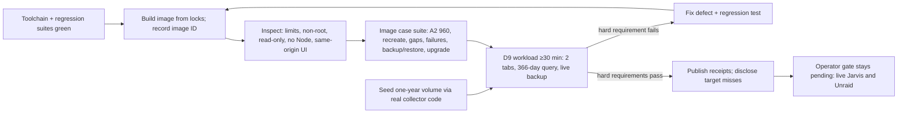

# Qualify the complete release locally (Delivery 4)

## 1. Human-review summary

### Summary
- Outcome: one production image, identified by its image ID, is built from the locked inputs and run under the real 256 MiB / 0.5 CPU limits. It passes the integrated end-to-end cases (normal accounting, recreation, gaps, restarts, failures, backup/restore, upgrade) and the exact specification D9 workload for at least 30 minutes. Every measurement, any target miss and the still-pending operator gate are published in `docs/delivery-4-status.md`, with raw receipts under `docs/receipts/delivery-4/`.
- Scope: container qualification tooling in `scripts/` and `tests/fixtures/`, a deterministic one-year history seeder, fixes for the packaging and documentation defects found below, final build/run/upgrade/backup/restore/Unraid and live-check instructions, and evidence publication. Application code changes only when qualification exposes a defect. Out of scope: any Jarvis/Unraid access or deployment (Delivery map step 5), raising limits, cross-browser coverage and human visual/assistive-technology review.
- Readiness: execution-ready. No major decision is open. External prerequisites for the executing host: Docker Engine with Compose v2 on cgroup v2, with memory and CPU controllers enforced for the container, plus registry/npm access for the image build. This workstation has none of these runtimes as of 2026-10-26. Image-dependent steps stay pending until a runtime is provided; they are never replaced by a host-process run.

### Explain like I'm five
Deliveries 1–3 proved each part on the development host, but nobody has run the real image. This delivery builds that image once and treats it as the release candidate. A harness starts it with the production Compose file, adding only a test override that points it at a local fake Jarvis. It replays the numeric accounting story, then breaks the system on purpose: it stops the container, cuts off the fake upstream, simulates a restart, fills the disk, starts a second copy, backs up while collecting, restores and upgrades. Each time it checks that the database, the API and the browser show the same numbers. Next, a year of history is seeded through the real collector code. The container runs for at least 30 minutes with two dashboard tabs open, a 366-day query and a live backup, while a sampler records memory, CPU, threads, connections, commit continuity, database growth and latency from outside the container. Any broken hard requirement is fixed, the image is rebuilt and the run is repeated. Misses against preferred targets are reported with exact numbers. The real NAS check remains a separate, explicitly pending gate.

### Target flow


### Affected code
```text
/                                   — compose.yaml: SOURCE_ID mapping fix, runtime user; README release status
├── scripts/                        — new qualification harness, seeder, workload runner; smoke.py scenario 8 race fix
├── tests/                          — regression tests only for defects qualification exposes (conditional)
│   └── fixtures/                   — fixture bind host + clock-derived uptime; new test-only Compose override
├── src/jarvis_dashboard/           — defect fixes only if qualification exposes them (conditional)
└── docs/                           — deployment/Unraid/live-check instructions, Delivery 4 status, map updates, this plan
    └── receipts/
        └── delivery-4/             — new: raw samples, logs, inspections, screenshots from executed runs
```

### Assumptions
- The working tree is the baseline for Delivery 4: HEAD `249a741` plus the uncommitted Delivery 2/3 changes. Commits are made separately from this plan. Every receipt records HEAD, the dirty-file list and a digest of `git diff HEAD`, so the qualified source state can be identified.
- "Local qualification" means a host that the executing agent controls and that has a container runtime. That host need not match the NAS. Target-host fit stays with the operator gate (MAP3).
- The spec D9 phrase "useful margin" needs a measurable bar. This plan selects the bar in D7. A reviewer who wants a different number should change D7 before execution; changing it later would be after-the-fact goalpost movement.
- Cross-browser checks and human review of visual quality and screen-reader behavior remain open. The specification requires a real browser, not several, and an agent cannot provide human judgment.

## 2. Scope and acceptance criteria

**In scope**
- Repair the local toolchain and rerun all earlier regression suites against the current tree, including a fix for the known `scripts/smoke.py` scenario 8 race.
- Fix the known packaging defects (D4, D10) before the image is qualified.
- Build and inspect the production image, then run integrated end-to-end cases on that image: fixture → collector → SQLite → API → browser at 390px and 1440px.
- Seed a deterministic synthetic year of history and run the exact spec D9 workload under enforced limits with full measurement.
- Finalize build, run, upgrade, backup, restore and Unraid instructions, plus the AC8 live-check procedure for the operator.
- Publish `docs/delivery-4-status.md`, raw receipts, delivery-map coverage updates and README status.

**Out of scope**
- SSH, deployment or network changes on Jarvis or Unraid, restarting Radiance, and any live receipt (delivery map step 5).
- Raising the 256 MiB / 0.5 CPU limits or changing product scope, counter semantics or inference configuration.
- New product features, plus cross-browser runs and human visual/assistive-technology review (reported as open).
- Installing a container runtime on a host without the user's authorization. The plan names it as a prerequisite.

**Acceptance criteria**
- AC1 (image identity and constraints): `docker compose build` builds the image from `uv.lock` and `frontend/package-lock.json` with pinned base digests, and its image ID is recorded. The running container must meet all of these conditions:
  - cgroup `memory.max` = `268435456`, `cpu.max` = `50000 100000`, `pids.max` = `128`;
  - read-only root filesystem, a non-root process whose UID/GID equals the configured runtime user, no Node.js binary and one Python serving process;
  - logs capped by `json-file` at 5m × 3;
  - `/api/v1/status` reports the configured non-default source ID.
- AC2 (integrated accounting): on the final image, fixture `1000/100 → 1600/140 → 1900/160` produces input `900`, output `60` and processed `960` in SQLite, the API and the DOM at 390px and 1440px. After `docker compose down` and `up` on the same volume, the totals are still `960`. The next unchanged sample adds `0`. Browser traffic stays same-origin, and the browser console shows no errors.
- AC3 (gaps and continuity on the image):
  - Collector downtime and an upstream outage with compatible uptime credit the delta once, with gap and approximate-time flags and a null rate.
  - Changed uptime evidence baselines and credits nothing.
  - During an upstream outage, `/health/ready` stays `200`, Docker health stays `healthy` and the status becomes `offline`.
  - For the seeded midnight cases, the 00:00 UTC hour contains the recovered delta, the gap-only hour is null and the changed-evidence case has a new epoch. API and browser agree on all three.
- AC4 (ownership and failure on the image):
  - A second container on the same volume exits `3` with `volume_locked`.
  - Missing `/data` mount, unwritable mount, corrupt database and newer-schema database each fail with a distinct exit code and log code. Existing files stay byte-identical, and no replacement database is created.
  - When `/data` fills, readiness becomes `503` and the persisted baselines do not advance.
  - `docker compose stop` returns exit code `0` within 15 s.
- AC5 (backup, restore and upgrade on the image, using the documented commands verbatim):
  - An online backup taken during collection passes `integrity_check` and satisfies the snapshot ledger identity (D6).
  - Restoring into a fresh stopped volume serves API totals equal to the snapshot, then continues without replay. A restore into a running target is refused.
  - A database created by the Delivery 1 commit's collector (`ad5556c`) upgrades to schema 2 with a verified pre-migration snapshot and unchanged totals. A deliberate endpoint change preserves totals and opens an `endpoint_change` epoch.
- AC6 (spec D9 workload): the run lasts at least 30 measured minutes after a 5-minute warm-up and includes:
  - one series with four counters and 15 s polls;
  - the seeded year;
  - two browser tabs on the 30-day view;
  - a 366-day query every 30 s;
  - one online backup during collection.

  It records host, image and dependency versions, RSS, cgroup `memory.current`/`memory.peak`/`memory.stat`/`memory.events`, `docker stats`, OOM events, CPU and throttling, threads, file descriptors, sockets, browser timers and canvases, commit continuity, DB/WAL size and p95 latency. All D7 hard requirements pass. Preferred targets are reported as pass or miss with exact values.
- AC7 (growth): database growth is measured as bytes per retained sample and per hourly row. It is extrapolated to steady state at 15 s polls, 30-day retention, and 1 and 5 years of hourly history, with the method and assumptions stated.
- AC8 (instructions and evidence):
  - `docs/deployment.md` contains executable build, run, upgrade, backup, restore and Unraid instructions, plus the AC8 live-check procedure, with no stale delivery text.
  - `docs/delivery-4-status.md` reports only executed results.
  - Every delivery-map AC and scenario row has a receipt or an explicitly pending gate.
  - `pytest`, `scripts/smoke.py` and `scripts/smoke_frontend.py` pass on the final tree.

## 3. Design decisions

### Repository findings (verified by inspection on 2026-10-26)
- Workstation: `/sys/fs/cgroup` is `cgroup2fs` with `cpuset cpu io memory hugetlb pids` controllers; `/usr/bin/chromium`, `node` and `npm` are present; `docker`, `podman` and `uv` are not on `PATH`. `.venv/pyvenv.cfg` points at `/home/node/.pi/agent/extension-data/uv/python/cpython-3.13-linux-x86_64-gnu/bin`, which is missing, so `.venv/bin/python` fails and the recorded Delivery 3 commands cannot currently run.
- `compose.yaml:32` passes `JARVIS_SOURCE_ID`, but `config.py:145` reads only `SOURCE_ID`, so an operator's source ID is silently ignored and defaults to `jarvis`. This is a defect.
- `compose.yaml:13-18` and `Dockerfile:47-51` bake UID/GID in as build args, so the image ID depends on the operator's UID. The delivery map step 5 says "deploy the qualified image", which this blocks.
- `docs/deployment.md` has stale and incorrect text:
  - `:3` says "Backend-only delivery".
  - `:162-167` says "Delivery 9 … 24 h soak", which conflicts with spec D9 and delivery-map step 4.
  - `:19-20` uses `/srv/appdata` instead of the spec D8 Unraid pool path.
  - There is no Unraid section and no AC8 live procedure.
  - Every Compose command interpolates the `:?`-required variables (`compose.yaml:17,18,27,29,31`), so `stop`/`exec`/`down` fail unless those variables are exported. A `.env` file is not documented.
- `api.py:32` sets `READ_CAPACITY = 4`, which matches spec D1. `docs/delivery-3-status.md:153` claims "the server admits 8 concurrent readers", which is incorrect.
- `scripts/smoke.py` scenario 8 has a test-orchestration race (`docs/delivery-3-status.md:133-142`): it asserts a busy restore before the collector holds `<db>.lock`.
- `tests/fixtures/fixture_server.py:156` always binds `127.0.0.1:0`, and `FixtureState.uptime_s` is a static float that test code advances, so a container cannot reach the fixture.
- `Collector(config, conn, *, wall_clock, monotonic, …)` and `Collector.poll_once(poll_id)` are injectable and public (`collector.py:43-216`). Periodic maintenance is the private `_maintenance()`, built from the public `storage.drain_gap_materialization` and `storage.purge_expired`.
- `scripts/browser_driver.py` provides `Browser.new_page()` (`Target.createTarget`), `Page.evaluate/screenshot/set_viewport`. `scripts/smoke_frontend.py` injects `window.__probe` (timers, fetch log) and has page-level phase functions taking `(page, …)`, guarded by `if __name__ == "__main__"`.

### Decisions
- D1: Qualification runtime is Docker Engine + Compose v2 on cgroup v2. Reason: production uses Docker/Compose, and spec D9 requires cgroup `memory.current`/`memory.peak` and enforced limits. Contract: the harness preflight records versions and refuses to start measurement unless the container's own cgroup shows `memory.max = 268435456` and `cpu.max = 50000 100000`, whether the engine is rootful or rootless with delegation. It exits non-zero and lists exactly what is missing. No step substitutes a host `serve` process for an image gate.
- D2: The production `compose.yaml` runs unchanged, with only a test override added: `tests/fixtures/compose.qualification.yaml`. Reason: the qualified configuration must be the shipped one. Contract:
  - The override may set only `DASHBOARD_BIND_ADDRESS=127.0.0.1`, a free host port, `JARVIS_APPDATA_DIR`, `RADIANCE_BASE_URL`, `JARVIS_SOURCE_ID=qual-jarvis`, `POLL_INTERVAL_SECONDS` (`5` for the case suite, `15` for the workload) and attachment to the qualification network.
  - It never changes limits, `read_only`, `tmpfs`, logging, the healthcheck, `cap_drop` or `security_opt`.
  - The harness compares `docker inspect` for these fields against the expected production values.
- D3: The fixture is reachable only on a harness-created user-defined bridge network. Reason: the container cannot reach host loopback, and binding `0.0.0.0` would expose the fixture to the LAN. Contract:
  - `FixtureServer(host="127.0.0.1", port=0, …)` keeps its current default.
  - The harness creates `jarvis-qual` with a fixed private subnet and binds the fixture to that network's gateway address.
  - `FixtureState` gains an optional uptime origin: when set, `/stats` reports `uptime_s = clock() − origin` from an injectable clock, so a simulated or real process-start time stays consistent across seeding and live runs. Existing callers are unaffected.
- D4: The runtime user is set in Compose with `user: "${JARVIS_UID:?…}:${JARVIS_GID:?…}"`, and the UID/GID build args are removed from `compose.yaml`. The Dockerfile keeps its `10001` default `USER` for direct `docker run`. Reason: one image ID can then be qualified once and deployed for any appdata owner, while the process stays non-root and numeric (spec D8). Contract: qualification runs with the host user's UID/GID, which must not be `10001`, to prove the override. The documented restore `docker run` passes the same `--user`.
- D5: The synthetic year is produced by `scripts/seed_history.py`, which drives the real `Collector.poll_once` against an in-process fixture on a simulated UTC clock. Reason: hand-written SQL rows could diverge from writer invariants such as coverage metadata, gap rows and the latest interval. Contract:
  - **Window and cadence:**
    - The simulated clock runs from UTC midnight 367 days before the run to the real current time.
    - It polls every 300 s (`POLL_INTERVAL_SECONDS=300`) until day −30, then every 15 s.
    - Base URL and `SOURCE_ID` equal the container's, so no endpoint-change epoch is created.
  - **Traffic:** a deterministic diurnal pattern with a recorded PRNG seed, including idle hours.
  - **Designed cases:**

    | Day | Case | Required visibility |
    |---|---|---|
    | Most recent UTC midnight | Outage across midnight, recovered with compatible uptime | 24h view |
    | Previous UTC midnight | Outage across midnight with changed uptime evidence | 24h/7d views |
    | Fixed day | Primary counter reset | — |
    | Fixed 6-hour window | Stats-only outage | — |
    | Fixed 7 days | Request counters absent | — |
    | Fixed day | Fully idle | Valid zero strings |
    | Fixed day | Collector downtime | Gap-only null day |

  - **Finish:** drain gap materialization, run `storage.purge_expired` at the real `now − 30 d` cutoff, checkpoint and `integrity_check`.
  - **Manifest:** expected lifetime/day totals per counter, final counters, the process-start origin and the designed case timestamps.
  - Seeding may set `PRAGMA synchronous=OFF` on its own connection for speed, because the result is verified before use.
  - Seeding is never part of the measured window.
- D6: Workload and sampling follow spec D9 exactly. Measurement uses host-side, read-only sources so that sampling adds no processes to the measured cgroup. Contract:
  - **Load:**
    - Fixture counters advance continuously from the manifest's final values.
    - Two browser windows each open the dashboard with the 30d preset, producing summary + 30-day daily history every 15 s while visible.
    - The harness issues `GET /api/v1/history?bucket=day` over 366 aligned days every 30 s, one request at a time.
    - At minute 15 of the measured window it runs one online backup with the documented `docker compose exec … backup` command. The backup's memory counts against the container, as it would in production.
  - **Samplers** (every 5 s unless noted):
    - Cgroup files located through `/proc/<State.Pid>/cgroup`: `memory.current`, `memory.peak`, `memory.stat`, `memory.events`, `cpu.stat`, `pids.current`.
    - `/proc/<pid>/status` (`VmRSS`, `VmHWM`, `Threads`) and fd count for the serving process.
    - Established TCP sockets from `/proc/<pid>/net/tcp*`.
    - `docker stats --no-stream` every 30 s.
    - `docker inspect` health/restart/OOM state every 30 s.
    - DB/WAL/SHM file sizes every 60 s.
    - Per tab every 60 s: live poll timers and canvas count from `__probe`, JS heap via `Performance.getMetrics`, and resource timings, which are then cleared.
    - `docker events --filter event=oom` throughout.
  - **Latency sources:** p95 summary latency comes from the tabs' resource-timing `duration` for `/api/v1/summary`. p95 366-day latency comes from harness wall time per request. The sample count is reported with each p95.
  - **Ledger identity:** if no new epoch opens during the live run, then for both the backup snapshot and the final database: `lifetime = manifest lifetime + (persisted primary baseline − manifest final baseline)`, per primary counter.
- D7: Pass/fail classification. Reason: delivery map step 4 requires hard failures to be fixed before qualification is claimed, and preferred-target misses to be disclosed.
  - **Hard requirements:**
    - zero `oom`/`oom_kill` in `memory.events`, no Docker OOM event and `OOMKilled=false`;
    - no restart, crash or unhealthy status;
    - limits unchanged;
    - sampled maximum of non-reclaimable memory ≤ **192 MiB** (75 % of the limit, leaving 64 MiB of headroom). This sums `memory.stat` `anon + shmem + kernel`, or `kernel_stack + slab_unreclaimable + sock` when `kernel` is absent;
    - exact `memory.peak` and `memory.events max` reported;
    - **no accumulation:** after warm-up, the maximum threads, fds, established sockets, per-tab live poll timers (must stay 1) and canvases (must stay 1) in the last 10 minutes do not exceed the maximum seen in measured minutes 0–20;
    - **commit continuity:** no gap between consecutive committed samples larger than 2 × poll interval within the measured window, zero `skipped … missed poll slot` log lines, and committed sample count within ±1 of fixture `/metrics` requests;
    - zero `5xx` responses, including `read_capacity_exceeded`, during the workload. At most three reads are in flight by construction;
    - a backup that exits `0`, passes `integrity_check` and satisfies the ledger identity.
  - **Targets** (optimize, then disclose without raising limits): median steady `VmRSS` < 100 MiB over the measured window; p95 summary and p95 366-day history < 1 s on the recorded machine.
- D8: Evidence layout. Contract:
  - Raw outputs go under `docs/receipts/delivery-4/<run-id>/`: `environment.json`, `samples.jsonl`, `tabs.jsonl`, `latency.jsonl`, `inspect.json`, container logs, harness stdout and screenshots.
  - `docs/delivery-4-status.md` is written only from executed outputs. It covers the environment, commands with exit codes, the AC table, failures and reruns, the final qualified image ID, open items and the correction of `delivery-3-status.md:153`. Historical status files are not rewritten.
  - Receipts from a superseded image are kept and labeled superseded.
- D9: Defect loop. Contract:
  - A failure is fixed in its owning area with a behavioral regression test where a plausible consumer-visible bug exists.
  - Any change to an image input (`src/`, `frontend/`, `Dockerfile`, locks, `compose.yaml`) invalidates earlier image receipts. Both the case suite (Step 6) and the workload (Step 7) then rerun against the new image ID.
  - Only the last complete passing pair qualifies the release.

## 4. Implementation steps

### Step 1: Restore the toolchain and the regression baseline
- **Code area:** `scripts/smoke.py` (scenario 8), local environment (not committed).
- **Change:**
  - Install `uv` 0.13.5, matching the pin recorded in Deliveries 1/2 and the Dockerfile, and rebuild `.venv` with `uv sync --frozen`.
  - Fix scenario 8 so the busy-restore assertion runs only after the started collector holds `<db>.lock`. Detect this with the same `fcntl.flock` non-blocking probe that `docs/delivery-3-status.md:141` describes, or with the collector's readiness line, bounded by the existing `wait_for` timeout.
  - Do not change product code; the restore refusal contract is already correct.
- **Depends on:** None.
- **Verification:** All three suites pass, run three times for `smoke.py` to confirm the race is gone (AC8):
  - `.venv/bin/pytest -q`: exit 0, with the test count recorded.
  - `.venv/bin/python scripts/smoke.py`: exit 0 on each of three consecutive runs, with scenario 8 showing `restore refuses a running target: 3`.
  - `.venv/bin/python scripts/smoke_frontend.py`: `FRONTEND SMOKE PASSED`.

### Step 2: Fix the source-ID mapping and make the runtime user a Compose setting
- **Code area:** `compose.yaml`, `docs/deployment.md` (restore command only; full doc pass is Step 5).
- **Change:**
  - Pass `SOURCE_ID: "${JARVIS_SOURCE_ID:-jarvis}"` instead of `JARVIS_SOURCE_ID`.
  - Implement D4: add `user: "${JARVIS_UID:?…}:${JARVIS_GID:?…}"` and remove the `build.args` block, so `docker compose build` produces one UID-independent image.
  - Keep `Dockerfile` `ARG APP_UID/APP_GID` defaults and `USER` as the image default; no Dockerfile change is needed.
  - Add `--user "$JARVIS_UID:$JARVIS_GID"` to the documented restore `docker run`.
- **Depends on:** None.
- **Verification:** Before a runtime exists, parse `compose.yaml` with Python: `environment.SOURCE_ID` is present, `JARVIS_SOURCE_ID` is not an environment key, `user` is present and `build.args` is absent. On the image (Step 5): `/api/v1/status` shows `qual-jarvis`, and the process UID/GID equals the host user's, not `10001` (AC1).

### Step 3: Container qualification harness and fixture networking
- **Code area:**
  - `tests/fixtures/fixture_server.py`: `host` parameter, injectable clock and uptime origin (D3).
  - `tests/fixtures/compose.qualification.yaml` (new, D2).
  - `scripts/qualify_common.py` (new; name proposed).
- **Change:** Shared harness module used by Steps 4–7:
  - **Preflight:** record OS, kernel, CPU model/cores, RAM, filesystem type of the appdata directory, Docker/Compose versions and cgroup driver, Chromium version, `uv.lock`/`package-lock.json` SHA-256, and git HEAD with the dirty list and diff digest. Fail with an exact missing-prerequisite list (D1).
  - **Network:** create or remove the `jarvis-qual` network and resolve its gateway.
  - **Compose wrappers:** project-scoped `docker compose -f compose.yaml -f tests/fixtures/compose.qualification.yaml` with per-case env, plus free-port selection and a per-case appdata directory under a temporary root.
  - **Inspection:** `docker inspect` assertions against D2's production field values; cgroup path resolution from `State.Pid`.
  - **Samplers and receipts:** D6 samplers, and receipt writers using the existing `check`/`receipt` output convention from `scripts/smoke.py`.
  - **Teardown:** always remove the containers, network and fixture it created, including after failures; never `down -v` on a non-temporary directory.
- **Depends on:** Step 2.
- **Verification:**
  - `.venv/bin/pytest -q`: still green, because the existing fixture callers keep the default host.
  - `python scripts/qualify_common.py --preflight` on a host without Docker exits non-zero, naming `docker` and `docker compose`. With Docker present it writes `environment.json` and confirms the fixture on the gateway answers `/metrics` from a short-lived container on `jarvis-qual` while `127.0.0.1`-only callers keep working.

### Step 4: Deterministic one-year history seeder
- **Code area:** `scripts/seed_history.py` (new; name proposed).
- **Change:** Implement D5. Inputs:
  - `--db`, `--base-url`, `--source-id`, `--seed`;
  - `--end` (default: now, UTC);
  - `--manifest` output path.

  Sequence:
  1. Open storage through `storage.open_storage`.
  2. Run the in-process fixture bound to the `--base-url` host and port.
  3. Construct `Collector` with simulated `wall_clock`/`monotonic` for each cadence phase, and call `poll_once` once per simulated poll.
  4. Advance fixture counters and the uptime origin per the traffic model and designed cases.
  5. After designed gaps, call `storage.drain_gap_materialization` until it returns 0.
  6. Finish with `storage.purge_expired(now − 30 d)`, a `wal_checkpoint(TRUNCATE)` and `integrity_check`.
  7. Write the manifest (D5) and record seeding duration.
- **Depends on:** Step 3 (fixture host/clock/uptime origin).
- **Verification:** Run the seeder into a temporary path, then check:
  - API lifetime, served by the real `serve` from the same tree, equals the manifest per counter.
  - Daily history for the most recent 366 days equals the manifest's per-day sums: null on the collector-downtime day, `"0"` strings on the idle day.
  - The hourly API around the most recent midnight shows a null gap-only hour and the recovered delta in the 00:00 hour with `collection_gap` + `time_attribution_approximate`.
  - The previous midnight shows a `restart_evidence` epoch and no credit.
  - Raw samples older than 30 days count `0`, and `integrity_check` reports `ok`.

  These checks precondition AC3 and AC6.

### Step 5: Build and inspect the production image; finalize operations instructions
- **Code area:** `docs/deployment.md`, `README.md`, `scripts/qualify_image.py` (new; name proposed, inspection phase).
- **Change:**
  - **Build and inspect:** build with `docker compose build` and record the image ID, size and the in-image SQLite/Python/distribution versions, captured from a one-off `docker run --rm --entrypoint python …` outside any measured window. Assert AC1 on a running container. Use the configured UID/GID in `/proc/1/status` inside the container namespace via `docker top`. Check `shutil.which("node") is None`, and confirm a write to `/opt` fails with a read-only filesystem error via a one-off `docker exec` before measurement. Check `HostConfig.LogConfig`, cgroup limits and `/api/v1/status` source ID.
  - **Deployment documentation** — rewrite `docs/deployment.md` so that:
    - stale text (`:3`, `:162-167`) is removed;
    - it documents a `.env` file next to `compose.yaml` so `stop`, `exec` and `down` work;
    - the runtime user (D4) is explained;
    - it has an **Unraid** section covering:
      - a dedicated pool path `/mnt/<pool>/appdata/jarvis-token-dashboard` with a primary-pool-only share, no secondary storage and no mover, on no SMB/NFS path;
      - ownership preparation with `install -d -o UID -g GID -m 0750`;
      - a private bind address and the absence of a login;
      - Compose v2 availability as an operator prerequisite;
      - moving the exact qualified image by ID with `docker save`/`docker load` instead of rebuilding on the NAS;
      - log-rotation inspection;
    - it has an **AC8 live check** procedure covering:
      - fetching `/metrics` and `/stats` from the NAS network, confirming the four metric names, actual labels and `uptime_s`;
      - recording raw counters, sending one small known request directly to Jarvis with no other traffic, waiting two polls and comparing raw counter differences with dashboard deltas, noting that prefill can differ from the request prompt count because of caching;
      - restarting only the collector container and confirming continuity;
      - checking the non-root process, rotated logs, retained volume after recreation, and private-binding reachability from an allowed and a disallowed client;
      - Radiance restarts are excluded without separate authorization;
    - its upgrade, backup and restore command lines are the exact strings Step 6 executes.
  - **README:** update the release status so it claims no qualification until Step 9.
- **Depends on:** Steps 1–3.
- **Verification:** The `qualify_image.py` inspection phase prints `[ok ]` for every AC1 field and records the image ID (AC1). A doc-consistency check in the same script extracts the backup, restore and upgrade command blocks from `docs/deployment.md` and fails if they differ from the commands Step 6 runs (AC8).

### Step 6: Image end-to-end case suite
- **Code area:** `scripts/qualify_image.py` (cases phase); page-level phases imported from `scripts/smoke_frontend.py`.
- **Change:** Each case uses a fresh temporary appdata directory unless stated, with `POLL_INTERVAL_SECONDS=5`. Cases run in order:

  | # | Case | Proves |
  |---|---|---|
  | 1 | A2 sequence through fixture → SQLite (read-only host query after stop or via snapshot) → API → browser. Reuse `dom_basics`, `ranges`, `theme_and_a11y`, `poll_lifecycle`, `network`, `offline` from `smoke_frontend.py` at 1440px; screenshots at 390px and 1440px for normal, stale, offline and empty states, the empty state coming from a second fresh volume. | AC2; scenarios 1–3, 31, 32 |
  | 2 | `docker compose down` → `up` on the same volume: `960` preserved; the next unchanged sample keeps `960`. Time `docker compose stop` and read `State.ExitCode`. | AC2, AC4; scenarios 24–26 |
  | 3 | Collector downtime longer than 2 polls with compatible uptime: credited once, flags set, null rate. Upstream `/metrics` 500 for longer than 2 polls, then compatible recovery: same result; readiness `200`, Docker health `healthy` and status `offline` during the outage. Changed uptime evidence on recovery: new epoch, nothing credited. | AC3; scenarios 7, 9–14 |
  | 4 | Seeded copy from Step 4, with the browser 24h view at 1440px plus the API: the midnight cases render as in Step 4, and the gap-only bucket is drawn as no data, not a zero bar. | AC3; scenarios 17–19, 23 |
  | 5 | A second `docker run` on the same volume exits `3` with `volume_locked`. Missing mount (no `/data` bind), a mode-`0555` directory, a corrupted DB copy and a `user_version=99` copy each exit non-zero with distinct log codes. SHA-256 of pre-existing files is unchanged, and no new `dashboard.sqlite3` is created. | AC4; scenarios 27–28, 30 |
  | 6 | `/data` on a small tmpfs mount, filled to ENOSPC by a one-off `docker exec python` writer: readiness `503` with a `storage_*` code, Docker health becomes `unhealthy`. After the filler is removed and the container restarts, totals equal the last committed baseline and no increment is duplicated. | AC4; scenario 28 |
  | 7 | Run the documented backup command during collection: integrity `ok`; snapshot ledger identity holds. Run the documented restore into a fresh stopped volume, then start the container with the fixture returning 500: API totals equal the snapshot. Restore the fixture: continuation adds exactly the new counter difference. Run the documented restore against a running target: exit `3`. | AC5; scenarios 29, 30 |
  | 8 | `git worktree add` `ad5556c` (Delivery 1); its own collector creates a schema-1 volume to `960`. Start the final image on it: `.pre-migration-2.sqlite3` is created and verified, totals are `960`, schema is `2`. | AC5; scenario 30 |
  | 9 | Restart with a different fixture port under the same `SOURCE_ID`: an `endpoint_change` epoch opens, lifetime is preserved and the opening balance is excluded. | AC5; scenario 30 |

  Additionally: container logs contain no metric payload lines (`# TYPE`, counter names with values), and their size respects the `json-file` limits.
- **Depends on:** Steps 4–5.
- **Verification:** `.venv/bin/python scripts/qualify_image.py` exits 0 with every check `[ok ]`. Receipts and screenshots go to `docs/receipts/delivery-4/<run-id>/`, all tied to the recorded image ID (AC2–AC5).

### Step 7: Spec D9 resource workload
- **Code area:** `scripts/qualify_resources.py` (new; name proposed).
- **Change:** Implement D6 and D7 end to end:
  1. Seed with Step 4, using the workload's base URL, `qual-jarvis` and `POLL_INTERVAL_SECONDS=15`.
  2. Start the container through Compose with the override.
  3. Start the live fixture from the manifest's final counters and uptime origin, advancing counters continuously.
  4. Open two independent browser windows and select 30d in each. Verify that each tab's summary fetch cadence is about 15 s, because a backgrounded headless target may report itself hidden. If a tab is paused, fail the run instead of counting it.
  5. Run the 366-day query loop and the minute-15 backup.
  6. Sample per D6 for the 5-minute warm-up plus at least 30 measured minutes (`--duration-minutes`, default 30, minimum 30).
  7. Stop with timed `docker compose stop`.
  8. Compute the D7 verdicts, p50/p95/max latencies with sample counts, CPU average/p95/max over 5 s windows with `nr_throttled`/`throttled_usec`, the `memory.stat` breakdown at peak, the anon-memory slope over the measured window, Chromium total RSS and per-tab JS heap (reported separately from NAS memory), and DB/WAL/SHM maxima.
  9. For AC7, `VACUUM INTO` a scratch copy of the stopped database. Measure per-table bytes with `dbstat` if the in-host SQLite provides it; otherwise measure the size difference after deleting the table's rows and vacuuming. Derive bytes per sample and per hourly row, and extrapolate with the stated assumptions.
- **Depends on:** Steps 4–6 (case suite green on the same image ID).
- **Verification:** `.venv/bin/python scripts/qualify_resources.py --duration-minutes 30` exits 0 only when every D7 hard requirement passes. It writes `samples.jsonl`, `tabs.jsonl`, `latency.jsonl`, the verdict table and the growth extrapolation. A target miss sets a distinct non-failing `TARGET MISS` line with the exact value (AC6, AC7).

### Step 8: Remediate qualification failures
- **Code area:** the owning area of each failure. Expected candidates are `src/jarvis_dashboard/` (connections, caches, query plans, thread pool), `frontend/src/` (timers, chart lifecycle) and `tests/`. Only areas with an observed failure change.
- **Change:** Apply D9. For a target miss such as RSS or p95, first bound the cause: per-connection cache, read-connection lifetime, the Uvicorn/AnyIO thread-pool size, index use for the 366-day query, or `memory.stat` file/anon split. Record the before and after measurements. A remaining miss is disclosed with the tradeoff; limits are never raised.
- **Depends on:** Steps 6–7 (only if they fail or miss targets).
- **Verification:** The new regression test fails before the fix and passes after it. On the rebuilt image ID, Steps 6 and 7 both pass again (AC1–AC7).

### Step 9: Publish evidence and update the delivery map
- **Code area:** `docs/delivery-4-status.md` (new), `docs/receipts/delivery-4/`, `docs/delivery-map.md`, `README.md`.
- **Change:** Write the status file from the executed outputs (D8):
  - environment;
  - image ID and dependency versions;
  - commands with exit codes;
  - an AC1–AC8 table with exact measurements: RSS median/max, `memory.peak`, the non-reclaimable maximum, `docker stats`, OOM counts, CPU, threads/fds/sockets/timers/canvases, commit continuity, DB/WAL sizes, p95 values with n, and growth extrapolation;
  - target misses with tradeoffs and superseded runs;
  - the `READ_CAPACITY` documentation correction;
  - open items: operator gate with its exact missing prerequisites, cross-browser, and human visual/assistive-technology review.

  Then update `docs/delivery-map.md`: add a Step 4 executed/not-executed disclosure, add Delivery 4 receipts to every ownership row whose final gate is Delivery 4, and keep AC8, scenario 34 and target-host AC6/scenario 33 evidence as pending operator gates. Update the README status and links.
- **Depends on:** Steps 6–7, and Step 8 if it ran.
- **Verification:** Every number in `delivery-4-status.md` appears in a receipt file under `docs/receipts/delivery-4/` for the final image ID. Each map row from AC1–AC8 and scenarios 1–34 cites a receipt or an explicitly pending gate. The final tree passes `pytest -q`, `scripts/smoke.py` and `scripts/smoke_frontend.py` (AC8; MAP1–MAP3).

## 5. End-to-end verification

- **Release path on the final image ID:** fixture `1000/100 → 1600/140 → 1900/160` → container (production Compose plus override) → SQLite → `/api/v1/summary` → browser at 390px and 1440px shows `900/60/960`. Run `docker compose down`/`up`; the next unchanged sample keeps `960`. Network capture shows same-origin requests only, and the console has zero errors (AC1, AC2).
- **Midnight and continuity:** the seeded volume served by the image shows the compatible midnight recovery in the 00:00 UTC hour with approximate-time and gap flags and a null gap-only hour, and the changed-evidence midnight as a new epoch with no credit. API hourly buckets and the browser 24h view agree (AC3).
- **Recovery under load:** during the D9 run, the minute-15 online backup satisfies the ledger identity against its own snapshot. Step 6 case 7 shows that restore, start and continue reproduce snapshot totals without replay (AC5, AC6).
- **Resource verdict:** `qualify_resources.py` produces the D7 hard-requirement table and the target lines from at least 30 measured minutes under verified `memory.max = 268435456` and `cpu.max = 50000 100000`. If any of D1's prerequisites is missing, the status file records the image and workload gates as not executed, with the exact missing items, and claims no local qualification (AC6, AC7; MAP3).
- **Regression and documentation:** the final tree passes `pytest -q`, `scripts/smoke.py` (scenario 8 included) and `scripts/smoke_frontend.py`. The documented backup, restore and upgrade commands are the ones executed. The map has no row lacking a receipt or a named pending gate (AC8).

## 6. Risks and open decisions

- **Risks:**
  - **No container runtime on this workstation.** Image gates cannot run here. Mitigation: D1 preflight refusal; run on a Docker host the user provides; never substitute host processes; disclose pending gates verbatim.
  - **Headless background tabs may count as hidden** and pause polling, so the run would have fewer than two refreshing tabs. Mitigation: two separate windows and per-tab cadence verification that fails the run (Step 7).
  - **Page cache inflates `memory.current` towards the limit without real risk.** Mitigation: D7 judges margin on non-reclaimable memory and reports `memory.peak`, `memory.events max` and the file/anon split, so cache pressure is visible rather than hidden.
  - **Seeder realism.** Older history uses a 300 s cadence, so pre-retention raw volume differs from production. Mitigation: hourly rows, which reads depend on, are complete. The last 30 days use 15 s cadence. Growth is extrapolated from measured per-row bytes, not seeded file size.
  - **The development host is not the NAS.** CPU, disk and kernel differ. Mitigation: record the host, label every result as local and leave target-host fit to the operator gate (MAP3).
  - **Fix loops invalidate receipts.** Mitigation: D9 ties every receipt to an image ID; only the last complete pair qualifies.
  - **The D4 runtime-user change could break a path that needs a passwd entry.** Mitigation: qualification deliberately runs with a UID other than `10001`, and the case suite exercises serve, backup and restore under it.
- **Open decisions:** None blocking. The 192 MiB margin bar (D7) is a selected value the reviewer may change before execution. Providing a Docker host, and authorizing installation on this workstation if desired, is an environment prerequisite owned by the user, not a design decision.
