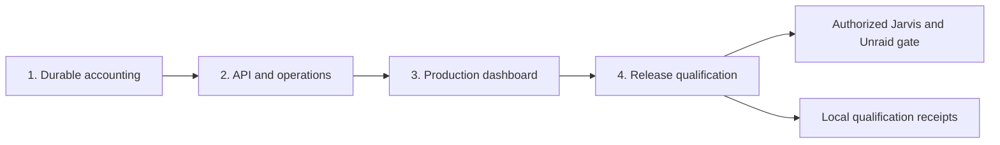

# Jarvis Token Dashboard — delivery map

## 1. Human-review summary

### Summary
- Outcome: implement and qualify the complete specified application through four cumulative, independently verifiable deliveries, then a separately authorized live deployment gate.
- Scope: one master roadmap; detailed execution plans per delivery. This document does not replace the authoritative [specification](specification.md) or [acceptance scenarios](acceptance-scenarios.md).
- Readiness: execution-ready for local implementation. Live Jarvis/Unraid verification requires operator access and authorization; local results cannot satisfy that gate.

### Explain like I'm five
Prove that the collector saves the right numbers first. Put a bounded API and recoverable container around that durable core, then build the real dashboard on its contract. Finally measure the complete production image under the specified workload. Each delivery extends the same application; none is a disposable prototype or a substitute for the final scope.

### Target flow


### Affected code
Delivery 1's collector, storage, migrations, fixtures and smoke tools and Delivery 2's API/lifecycle/recovery/packaging now exist; see their [status receipts](delivery-1-status.md) and [Delivery 2 status](delivery-2-status.md). The tree below describes the cumulative target footprint; frontend and qualification additions remain planned.

```text
/                                  — existing Python manifests/lock; new Dockerfile/Compose; update README
├── src/jarvis_dashboard/           — existing collector/accounting/storage/CLI; add API/lifecycle
│   ├── migrations/                — existing initial schema; add numbered migrations as needed
│   └── static/                    — generated production frontend assets
├── frontend/                      — new npm lock/manifests and TypeScript/Vite configuration
│   └── src/                       — new Vue dashboard, API types, components and styles
├── tests/                         — existing core behavior; add API/recovery coverage
│   └── fixtures/                  — existing controlled HTTP upstream; add synthetic datasets
├── scripts/                       — existing collector smoke; add container/qualification tools
└── docs/                          — plans, operations and measured verification receipts
```

### Assumptions
- The user wants the complete specification, not a smaller MVP; delivery boundaries change sequencing, not acceptance criteria.
- Delivery 1 is implemented; later deliveries must inspect and extend its actual contracts. Continue with the selected Python 3.13/FastAPI/SQLite and Vue/Chart.js stack without an architecture-selection phase.
- Keep authoritative documents at their current paths here. If the packet is moved into another repository, move it as a unit and preserve relative links.

## 2. Scope and acceptance criteria

**In scope**
- Durable collection, bounded read-only API, production dashboard, single-container operations, backup/restore, qualification and documented live checks.
- A primary owner and final verification gate for all eight specification acceptance criteria and all 34 companion scenarios.

**Out of scope**
- Implementing application code as part of writing these plans.
- Changes to the specification's product scope, inference configuration or resource limits.
- Unauthorized deployment, SSH access, inference-server restarts or host/network changes.

**Acceptance criteria**
- MAP1: every specification AC and companion scenario has an explicit implementation owner and final proof gate below.
- MAP2: every delivery has runnable exit evidence and named dependencies; unfinished future deliveries are reported as such, not as a completed application.
- MAP3: local fixture/resource results remain explicitly distinct from live compatibility and target-host qualification.

## 3. Design decisions

- D1: Use one master roadmap with four cumulative delivery plans. Reason: accounting, integration, UI and qualification have different evidence requirements. Contract: this map owns sequencing and coverage; each detailed plan owns concrete implementation steps. The specification wins on conflict; revise the plan rather than silently narrowing behavior.
- D2: Complete accounting and durable state before API/UI work. Reason: a visually plausible dashboard cannot establish correct token history. Contract: opening balances never count as observed work, gaps are not zeros, request counters remain separate, and all reporting uses UTC.
- D3: Pull operational implementation into Delivery 2. Reason: storage ownership, recovery and shutdown must work before frontend completion. Contract: final backend/runtime dependencies and image versions are locked/pinned here; delivery 3 adds a locked frontend build to that same image. No Node.js runtime or temporary fake production frontend.
- D4: Freeze boundary contracts through versioned code and behavioral examples, not a parallel schema maintained in prose. Contract: Delivery 1 defines validated observations, durable transition state, quality flags and hourly coverage; Delivery 2 defines exact response models/OpenAPI and schema version 1; Delivery 3 generates or mechanically checks TypeScript compatibility with those models.
- D5: Introduce fixtures in Delivery 1 and reuse them throughout. Reason: accounting, API, browser and container receipts must exercise the same numeric examples. Contract: test traffic goes to controlled local HTTP endpoints, never to Jarvis by default.
- D6: Measure limits early, qualify them late. Contract: run container smoke under 256 MiB/0.5 CPU from Delivery 2 onward; only the complete Delivery 4 workload establishes local resource qualification. Preferred RSS below 100 MiB is not the hard cgroup limit.
- D7: Maintain evidence per delivery in `docs/`, including commands, environment, expected/actual outcomes and failures. Contract: a pending receipt is not a passing result; operator-only criteria remain pending without access. No empty results documents that imply execution.

### Specification acceptance-criterion ownership

| Specification criterion | Implementation owner | Final proof gate |
|---|---|---|
| AC1 — independent canonical series and counter semantics | Delivery 1 | Delivery 1 parsing/accounting receipts; Delivery 4 integrated regression |
| AC2 — baseline, zero, gaps, resets and continuity | Delivery 1; presentation in Deliveries 2–3 | Delivery 1 state/persistence proof; Delivery 4 API/browser agreement |
| AC3 — restart safety, migrations and retention | Delivery 1 durable core; Delivery 2 container recovery | Delivery 2 recreation/migration receipts; Delivery 4 integrated recovery |
| AC4 — UTC API/UI agreement and responsive states | Delivery 2 API; Delivery 3 UI | Delivery 3 production-browser receipts; Delivery 4 integrated checks |
| AC5 — self-contained production image, no proxy | Delivery 2 runtime; Delivery 3 bundled frontend | Delivery 3 image/browser network inspection; Delivery 4 final image |
| AC6 — bounded measured resource workload | Delivery 4, with early smoke in Delivery 2 | Delivery 4 local workload; target NAS fit recorded separately at operator gate |
| AC7 — consistent restore and failed-write safety | Delivery 1 failed-write safety; Delivery 2 backup/restore/readiness | Delivery 2 live-backup/restore proof; Delivery 4 concurrent-workload recovery |
| AC8 — real metric discovery and known-generation comparison | Delivery 4 operating instructions | Authorized live operator gate; cannot pass using fixtures |

### Companion scenario ownership

Scenario numbers refer to [acceptance-scenarios.md](acceptance-scenarios.md). Later deliveries rerun relevant earlier checks; primary ownership does not excuse integration regressions.

| Scenarios | Primary implementation and first proof | Remaining integration or live proof |
|---|---|---|
| 1–6: opening, deltas, zero, identities, optional counters | Delivery 1 state and database behavior | Delivery 2 serialization; Delivery 3 visible semantics |
| 7–16: resets, stats, outages, disappearance, clock regression | Delivery 1 fixture/process behavior | Delivery 2 status/rates; Delivery 3 stale and diagnostic states |
| 17–19: attribution, midnight gaps, null versus zero | Delivery 1 hourly storage and coverage | Delivery 2 ranges/rollups; Delivery 3 charts/cards |
| 20: API range contract/current bucket | Delivery 2 HTTP contract | Delivery 3 visibly incomplete current bucket |
| 21–23: parser, precision, retention | Delivery 1 exact parsing and durable sums | Delivery 2 decimal-string JSON; Delivery 3 BigInt labels and retained-history view |
| 24–26: commit crashes, replay, unchanged observations | Delivery 1 subprocess fault/restart proof | Delivery 2 container recreation; Delivery 4 integrated recovery |
| 27–28: second writer and storage failure | Delivery 1 process lock and durable failure behavior | Delivery 2 readiness and production mounts; Delivery 4 final image |
| 29: backup consistency | Delivery 2 online backup and snapshot comparison | Delivery 4 concurrent production workload |
| 30: restore, migration, endpoint change | Delivery 1 migration/endpoint semantics; Delivery 2 full restore | Delivery 4 final production recovery |
| 31: real production UI | Delivery 3 production container/browser | Delivery 4 final image smoke |
| 32: frontend lifetime and races | Delivery 3 browser lifecycle scenarios | Delivery 4 two-tab workload |
| 33: resource qualification | Delivery 4 | Operator gate adds target-host evidence if local machine differs |
| 34: Unraid and real Radiance | Delivery 4 instructions only | Authorized operator gate |

## 4. Implementation steps

### Step 1: Deliver durable collection and accounting
- **Code area:** root Python files; `src/jarvis_dashboard/`, `src/jarvis_dashboard/migrations/`, `tests/`, `tests/fixtures/`, `scripts/`, `docs/`, README.
- **Change:** Execute the [detailed Delivery 1 plan](delivery-1-implementation-plan.md). Produce a real collector command, exact state transitions, durable hourly summaries, migration safeguards, bounded polling and retention, fixture controls and failure/process smoke tools. Establish storage contracts consumed by later deliveries.
- **Depends on:** None.
- **Verification:** Run fixture HTTP → actual collector process → SQLite inspection. Demonstrate 900 input/60 output/960 processed, unchanged totals after restart, recovery versus rebaseline, atomic failure and retention invariants. Record the covered scenario IDs and remaining API/UI obligations (MAP1–MAP2).

### Step 2: Deliver bounded APIs and operational recovery
- **Code area:** root Docker/Compose/Python files, `src/jarvis_dashboard/`, `tests/`, `tests/fixtures/`, `scripts/`, `docs/`, README.
- **Change:** Execute the [detailed Delivery 2 plan](delivery-2-implementation-plan.md) against Delivery 1's actual contracts, repairing missing downstream metadata/readiness/snapshot guarantees first. Implement all D6 routes/models, strict ranges/cursors, decimal-string counts, null/zero/partial coverage, four-read concurrency cap and health semantics. Add production non-root runtime/Compose, graceful shutdown, online backup CLI and stopped-volume restore procedure. Reuse and harden Delivery 1's pre-migration snapshot implementation. At this delivery the image serves the backend; the frontend is explicitly not yet delivered, rather than represented by a placeholder.
- **Depends on:** Step 1.
- **Verification:** Real HTTP checks match database values and errors. A second process refuses the volume, storage failure makes readiness fail, Jarvis outage alone does not. Back up during collection, restore a fresh stopped volume and compare the committed snapshot. Recreate the limited container and preserve 960; prove shutdown within 15 seconds. Record remaining frontend/final qualification work (MAP1–MAP2).
  Executed locally on 2026-10-25 — see [Delivery 2 status](delivery-2-status.md). The container build, constrained-container recreation and 256 MiB / 0.5 CPU enforcement were not executed in that environment (no container runtime) and stay open for Delivery 4/the operator gate.

### Step 3: Deliver the bundled production dashboard
- **Code area:** `frontend/`, `frontend/src/`, generated `src/jarvis_dashboard/static/`, backend static serving, Dockerfile, `scripts/`, `docs/`, README.
- **Change:** Write and execute the Delivery 3 plan against real API response models. Implement all D7 states, accessibility, UTC controls, exact formatting, selected-series consistency and bounded polling lifecycle. Add locked frontend build and self-hosted hashed assets to the existing image; implement static caching without caching API responses.
- **Depends on:** Step 2.
- **Verification:** Use the production image and controlled HTTP fixture in a real browser at 390px and 1440px. Capture relevant states and exact 960 total; inspect requests/console, theme/keyboard behavior, timers/charts, selection races and tab visibility. No CDN or direct upstream browser traffic. Distinguish screenshots/smoke from the still-pending resource run (MAP1–MAP2).

### Step 4: Qualify the complete release locally
- **Code area:** `scripts/`, `tests/fixtures/`, `docs/`, README; implementation areas only where qualification exposes defects.
- **Change:** Write and execute the Delivery 4 plan. Run the final image through end-to-end normal/restart/gap/recovery cases and the exact D9 workload. Finalize build/run/upgrade/backup/restore/Unraid instructions and evidence. Fix failed hard requirements before claiming local qualification; disclose preferred-target misses and measured tradeoffs without raising limits.
- **Depends on:** Step 3.
- **Verification:** At least 30 minutes with one selected series/four counters, 15-second polls, a synthetic year of hourly history, two refreshing browser tabs, a 366-day query and online backup, under 256 MiB and 0.5 CPU. Record host/image/dependencies, RSS, cgroup/Docker memory, peaks/OOM, CPU, threads/connections/timers, commit continuity, DB/WAL growth and summary/history p95. Compare against specification D9; publish exact results and outstanding operator gate (MAP1–MAP3).

### Step 5: Execute the authorized operator gate
- **Code area:** `docs/`, README; configurable deployment inputs, not hardcoded machine substitutions.
- **Change:** With separate authorization and access, verify actual metrics/labels and uptime from the NAS network, prepare local pool ownership/private binding, deploy the qualified image and execute the documented known-generation and persistence checks. Do not restart Radiance without separate authorization.
- **Depends on:** Step 4; operator-provided host/pool/binding/UID/GID and authorized network/deployment access.
- **Verification:** Record live raw-counter differences versus dashboard observations, collector restart continuity, retained volume, log rotation, non-root process and private access behavior. Identify which resource measurements were made on the target host. If access is unavailable, leave this gate pending with exact missing prerequisites, without downgrading locally completed evidence (MAP3).

## 5. End-to-end verification

- Trace the normative 1000/100 → 1600/140 → 1900/160 sequence through fixture, database, HTTP and production dashboard: observed values must agree at 900/60/960. Recreate the image against the same volume; the next unchanged sample leaves totals at 960.
- Cross midnight during an outage; recover once with matching uptime evidence and once with changed evidence. Verify recovered approximate deltas versus excluded fresh baseline, gap-only null buckets and preserved historical sums at all available layers.
- Back up while polling and restore to a fresh stopped volume; compare the backup snapshot, not a later live database. Continue without replaying committed increments.
- Review the ownership tables against all eight ACs and scenarios 1–34; every row must have the appropriate receipt or a clearly pending gate. Delivery acceptance is not final-product acceptance (MAP1–MAP2).
- Execute the final production-browser and resource workload before local release qualification. Keep the authorized live receipt separate; never infer compatibility, deployment or target NAS fit from synthetic/local success (MAP3).
- Deliveries 1 and 2 record executed local receipts ([Delivery 1](delivery-1-status.md), [Delivery 2](delivery-2-status.md)); the browser, resource-workload and live checks below remain planned, and this map records no application execution of its own.

## 6. Risks and open decisions

- **Accounting-first risk:** UI work may expose missing coverage semantics. Mitigation: define per-counter coverage and diagnostic contracts in Delivery 1 and concrete response models before frontend work.
- **Late qualification risk:** adding browser traffic/backup can change memory and latency. Mitigation: constrained container smoke in Delivery 2; exact final workload in Delivery 4, including filesystem cache/tmpfs.
- **Operational risk:** restore/migration mistakes can lose history despite correct counter arithmetic. Mitigation: early migration snapshots, stopped-volume restore, production snapshot comparisons and explicit WAL handling.
- **Evidence risk:** successful fixtures can be mistaken for a working NAS deployment. Mitigation: separate operator gate and explicit receipt environments.
- **Open decisions:** no blocking product/architecture decisions. Deployment values and authorized live access remain operator inputs; they do not block local deliveries.
