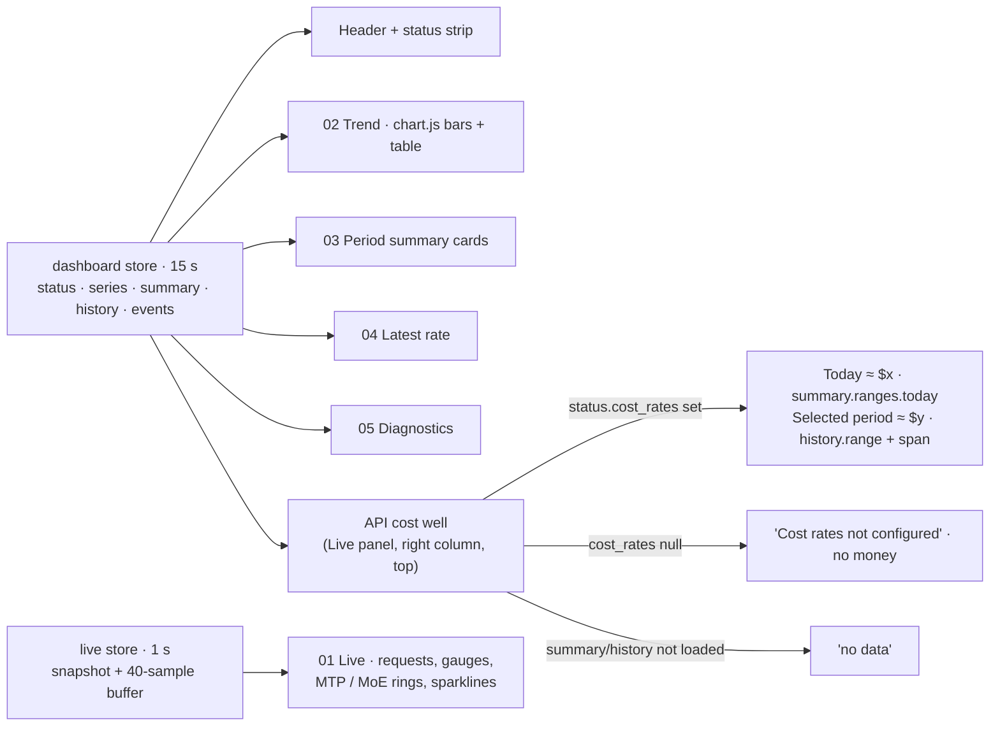

# HUD dashboard redesign with live API-cost panel

## 1. Human-review summary

### Summary
- Outcome: the Vue dashboard looks and behaves like `docs/mockups/hud-dashboard-qwen.html`, a dark Tokyo Night Storm HUD with seven stacked panels: header, status strip, Live, Trend, Period summary, Latest rate, Diagnostics. It runs on real API data. One change from the mockup: the Live panel's "Signal history" well is gone. The top of the Live panel's right column now holds an **API cost** well showing the API-equivalent cost for **today (UTC)** and for the **period selected in Trend**.
- Scope: frontend markup, styles and tokens; the live store's in-browser sample buffer; the token contract test; the frontend smoke script; the specification D7 text, acceptance scenario 31, README links and a status/receipts set. No backend, API, OpenAPI or schema change, and no new HTTP request. Not carried over from the mockup: simulated data, review controls, debug/self-test hooks, disclaimers, and the per-bucket cost line the API cannot feed.
- Readiness: execution-ready. Theme (dark-only), layout (responsive around the 1080×1920 design) and the dropped per-bucket cost line were decided by the user on 2026-10-27.

### Explain like I'm five
The page keeps its two existing data loops. The 15 s loop reads status, series, summary, history and events. The 1 s loop reads the live snapshot. Only the presentation changes. Every panel becomes a chamfered HUD frame. Live numbers get gauges, concentric ratio rings, segment bars and short sparklines, all drawn from samples the browser actually received. The new API cost well reads two figures the page already loads: today's API-equivalent amount from the summary and the selected range's amount from the history response. If cost rates are not configured it says so instead of showing money. If nothing is loaded yet it says `no data`. On a 1080×1920 portrait screen the page fills the display without scrolling, exactly like the mockup. Smaller screens stack the same panels and scroll.

### Target flow


### Affected code
```text
README.md                         — plan/status links for this change
docs/                             — specification D7 revision, acceptance scenario 31, this plan, new hud-dashboard-status.md
└── receipts/
    └── hud-dashboard/            — (new) smoke transcript and 1080×1920 / 1440 / 390 screenshots
frontend/                         — index.html: color-scheme dark
└── src/                          — main.ts: theme bootstrap removed; App.vue: HUD grid and new panel order
    ├── lib/                      — live.ts sample buffer + peaks; new hudGeometry.ts (approximate name); chart.ts restyle; format.ts span/compact helpers
    ├── components/               — new HudPanel, StatusStrip, ApiCostWell, Gauge, RatioRings, Sparkline, SegmentBar (approximate names);
    │                               restyled header/live/trend/summary/rates/diagnostics/skeleton/empty; banners and unused primitives deleted
    └── styles/                   — dark-only tokens.css; app.css rewritten as the HUD stylesheet
tests/                            — test_ui_tokens.py: single-theme token contract
scripts/                          — smoke_frontend.py: theme phase removed, focus order, labels, live slots, cost well, portrait no-scroll
```

### Assumptions
- "Top of the right column" means the right column of the Live panel, where "Signal history" sat. The API cost well becomes the first well in that column. The MoE well and the live note stay below it.
- "Selected period" means the range the Trend panel currently shows (`history.range`). Its label comes from the loaded history payload, not the preset button. During an invalid custom-range entry the well therefore never claims a range it has not priced.
- Every amount is the existing API-equivalent estimate (`≈ $x`), hidden when cost rates are unset, matching the summary cards (spec D11).
- "Obvious mockup elements" means: the `SIMULATED` tag, the `STATE ▾` menu and `s` hotkey, `data-state` review switching, the `#debug` audit overlay, the `#test` self-test and `__reviewHooks`, the simulated fixtures and jitter, the fabricated sparkline seed (`seedHist`), the per-series `_k` scale constants, the "design mockup (simulated data)" title, and the file-header disclaimer. The HUD aesthetics stay as design: grid, scanlines, vignette, corner brackets, live sweep, status pulse.
- The mockup's MTP (70 / 50 / 35 %) and MoE (85 / 60 / 40 %) colour bands are display-only. The text value is always shown, so colour only reinforces it.
- The live note copy is rewritten to match real behaviour. A failed or stale poll shows `-`. The mockup's "frozen at the last accepted sample" wording is not used.
- The Diagnostics panel keeps the app's five existing blocks and their testids, laid out as the mockup's five-column grid.
- The series picker still appears only with more than one series (spec D7). The mockup's always-visible picker is not adopted.

## 2. Scope and acceptance criteria

**In scope**
- HUD frame, palette, typography, overlays and panel order (Live → Trend → Period summary → Latest rate → Diagnostics) from the mockup.
- Header brand block, series subtitle, conditional series picker, "Last successful update · UTC" box and status badge. No theme toggle.
- A single status strip that replaces the separate offline and API-error banners and carries the visible `role="status"` line.
- A Live panel with request segment bars, prefill/decode gauges, MTP/MoE ratio rings, sparklines and the live note. The API cost well replaces Signal history.
- Trend restyle: preset buttons, inline custom range, notes row, HTML legend, and a table that replaces the chart in place.
- Restyled summary cards (split bar, cache donut), rate wells (segment meters) with request-accounted disclosure, diagnostics, skeleton and empty state.
- A dark-only token set and its contract test. Smoke, spec and docs migration.

**Out of scope**
- Any backend/API/OpenAPI/schema change, including a per-bucket cost field.
- A light theme or theme toggle.
- New API calls or changed poll cadence: 15 s dashboard, 1 s live, the same visibility and focus rules.
- A frontend unit-test runner (none exists; behaviour is proven by the browser smoke).
- Editing the mockup file or historical delivery status/receipt documents.

**Acceptance criteria**
- AC1: At a 1080×1920 viewport the seven panels fill the screen with `documentElement.scrollHeight ≤ 1920` and `scrollWidth ≤ 1080`. At 1440×900 and 390×844 the page scrolls vertically only, and the live panel's right edge stays within the viewport at 390 px.
- AC2: The Live panel's right column starts with the API cost well. With rates configured, `cost-today` text equals the `today-cost` card text, and `cost-period` text equals the amount inside the `trend-cost` line. After a preset change, `cost-period` and `cost-period-span` follow the new history response. No "Signal history" element exists.
- AC3: With `status.cost_rates` null the well shows "Cost rates not configured" and contains no `$`. Before summary/history arrive, each missing figure reads `no data`. After a series switch, both figures read `no data` until the new series' responses land.
- AC4: The served page contains none of: `SIMULATED`, `STATE`, `design mockup`, the `s` hotkey handler, `#debug`/`#test` handling, simulated values, or a cost line or right axis on the trend chart.
- AC5: There is no theme toggle and no `data-theme` or `jarvis-theme` handling. `tokens.css` defines one dark palette whose text and series pairs pass the contrast test.
- AC6: Existing contracts hold: every smoke testid listed in D7 below, `-` live placeholders, `no data`/`N/A` semantics, exact token strings, one 15 000 ms and one 1 000 ms timer paused when hidden, the same set of fetched API paths, the accessible chart table, and the diagnostics content.
- AC7: Gauges, rings, segment bars and sparklines render only received values. A failed poll and a hidden-tab period each break the sparkline instead of joining across them. With `prefers-reduced-motion: reduce` no animation runs.
- AC8: The custom range's end input is labelled "UTC end (inclusive)". Picking day D still sends `to = D+1 00:00:00Z`.

## 3. Design decisions

- D1: Dark-only HUD palette (user decision). Reason: the mockup is a single dark design, and its report calls a light theme a second design. Contract: `tokens.css` has one `:root` block with `color-scheme: dark`. The existing names `--bg --panel --fg --fg-muted --border --accent --series-input --series-output --warning --error` are remapped to the mockup values (`--bg #10131f`, `--panel #1c2135`, `--fg #c0caf5`, `--fg-muted #8892b8`, `--series-input #7aa2f7`, `--series-output #ff9e64`, `--warning #e0af68`, `--error #f7768e`, …). New tokens: `--panel-2`, `--sunk`, `--line`, `--cyan`, `--magenta`, `--green`, `--teal`, `--ok`, `--caution` (orange band), `--cost`, `--font-mono`, `--cut`. Alpha variants in `app.css` use `color-mix(in srgb, var(--token) N%, transparent)`, so `app.css` stays free of raw hex/rgb. Delete the `AppHeader` theme code, the `main.ts` bootstrap and every `data-theme` selector. `index.html` sets `color-scheme` to `dark`.
- D2: The layout is responsive around the mockup (user decision). Reason: the 1080×1920 portrait design stays pixel-faithful without breaking the 1440/390 smoke views. Contract: a single column, `max-width: 1080px`, centred, 16 px padding, 10 px gap. Under `@media (min-width: 1080px) and (min-height: 1920px)` the grid is `height: 100vh` with the mockup's rows (92 / 44 / 454 / `1fr` trend / 452 / 212 / 158 px). Each panel clips, and its disclosures scroll inside the panel as in the mockup. Below that media query, rows size to content. The trend chart uses `--chart-height`. Live grid columns are 252 px / 1fr / 296 px at ≥ 1000 px, two columns (right column spanning) from 700 to 999 px, and one column below 700 px. Summary cards go from 3 columns to 1 below 900 px. Diagnostics goes 5 → 2 → 1.
- D3: The API cost well is a new component that reads only `dashboard.state`. Reason: it must update with the 15 s data that carries prices, never with the 1 s live tick, and must add no request. Contract:
  - Placement: rendered by `LivePanel` as the first child of the right column (`grid-template-rows: auto 1fr auto` → cost, MoE, note). It is not a `.live-cell`, so the live tile count stays 5.
  - Today: `formatAmount(summary.ranges.today.api_equivalent.amount)` as testid `cost-today`, plus `formatCoverage(...)` and `formatCostFlags(...)` as text lines when non-empty. A baseline-only series (the same rule as `SummaryCards.baseline`) reads `no data`.
  - Selected period: `formatAmount(history.range.api_equivalent.amount)` as `cost-period`, plus coverage/flag lines. Span text (`cost-period-span`) comes from a new `format.ts` helper. Hour buckets read `24 h · 2026-10-26 15:00 UTC → 2026-10-27 15:00 UTC`. Day buckets read `7 days · 2026-10-21 → 2026-10-27 UTC`, where the end day is `to − 1 day`, i.e. inclusive.
  - Rates unset (`status.cost_rates == null`): one note "Cost rates not configured" (testid `cost-unpriced`). `cost-today` and `cost-period` are not rendered.
  - Testids: `cost-panel`, `cost-today`, `cost-period`, `cost-period-span`, `cost-unpriced`. None starts with `card-`, because the smoke counts `[data-testid^="card-"] == 3`.
  - No `aria-live`. Amounts use the `--cost` colour plus the `≈` text, so colour is never the only signal.
- D4: Every testid the smoke reads keeps its element and exact text, except the MTP/MoE slots, which move to per-window testids. Reason: the joined `a / b / c / d` string has no visible home in a ring-plus-rows design, and a hidden duplicate node would be test scaffolding (Delivery 3 D10). Contract:
  - `live-requests` textContent stays `joinSlots([active, queued])`, e.g. `3 / 1`. The waiting part is styled smaller via a span without changing the text.
  - `live-prefill` stays `formatTps(...)` (`1,240 tok/s` / `-`). `live-decode` stays `` `${formatTps} · ${formatPerRequest}` `` (`180 tok/s · 60/req`). In both, the unit sits inline in a smaller span.
  - `live-mtp` and `live-moe` move to the wells. Each visible ratio value carries `live-mtp-5s | live-mtp-1m | live-mtp-30m | live-mtp-life` and `live-moe-5s | live-moe-1m | live-moe-30m`, with text `formatRatio(...)`.
  - Chip, badge and label case comes from CSS `text-transform`. `live-state`, `status-badge` and every other text node keep their current strings.
  - `product-name` sits on a visually hidden span inside the `<h1>` with text "Jarvis Token Dashboard". The visible `JARVIS·TOKEN//HUD` brand mark is `aria-hidden`.
  - `last-update` moves to the value inside the "Last successful update · UTC" box (`formatUtc(...)` / `no data`).
  - Unchanged: `api-error`, `stale-notice`, `offline-banner`, `range-*`, `custom-*`, `incomplete-note`, `trend-cost` (same text, with the amount wrapped in a styled span), `chart-canvas` (exactly one), `chart-disclosure`, `chart-table`, `range-error`, `card-*` and every `*-total/-input/-output/-cost/-cache/-cost-coverage/-cost-flag/-flag`, `lifetime-start`, `baseline-note`, `cost-rates-footnote`, `rates-panel`, `rate-input-value`, `rate-output-value`, `requests-disclosure`, `requests-summary`, `unavailable-note`, `diagnostics-*`, `skeleton`, `empty-state`, `series-name`, `series-picker`, `series-option`, `live-panel`, `trend-panel`.
- D5: The status strip replaces both banners. Reason: the mockup has one 44 px strip, and the header badge already shows the collection status. Contract: `StatusStrip.vue` renders exactly one message, in this priority: API error (`api-error`, `role="alert"`, `rangeErrorText`, plus `stale-notice` "Showing data from …"), then offline (`offline-banner`, existing copy), then series stale (`summary.state === "stale"`), then starting, then loading ("Loading dashboard…"), then empty (existing empty copy), then nominal: "Collection healthy · live 1 Hz · collector polls every {status.poll_interval_seconds}s · raw retention {status.raw_retention_days} days". The strip's right side shows the polite `role="status"` line App.vue computes today, moved from its visually hidden `<p>`. Delete `OfflineBanner.vue` and `ApiErrorBanner.vue`. The strip renders before the rates panel, so `querySelector('[data-testid="stale-notice"]')` keeps resolving to the API-error notice first.
- D6: Live visuals only use received samples. Reason: the live store must never fabricate values (live-panel plan D6/D7), and the spec forbids joining across missing data. Contract:
  - `live.ts` gains `samples: { prefill: (number|null)[]; decode: (number|null)[]; mtp5s: (number|null)[] }`, capped at 40 entries. Each completed tick appends one entry per series; a failed tick appends `null`. Resuming from a hidden tab appends one `null` break first.
  - `peaks: { prefill: number | null; decode: number | null }` is the running maximum of received values since mount.
  - Gauge full scale is a nice ceiling of the peak (1/2/2.5/5 × 10ⁿ). The end label shows it compact (`18K`). With no peak, the gauge is an empty track and the value reads `-`.
  - Gauge hue is fixed (prefill `--green`, decode `--cyan`; `--fg-muted` when null), so an idle engine is never painted as an error.
  - MTP/MoE rows and rings use the assumed colour bands.
  - Request segment bars have 16 cells each, filled `min(16, n)`.
  - The sparkline helper emits one polyline per run of non-null values.
  - SVG visuals are `aria-hidden="true"`; the adjacent text carries the value.
  - Colours come from token CSS classes or `style="stroke: var(--token)"`, never hex in TS. The exception is chart.js, which needs resolved strings and reads tokens via `getComputedStyle`; its hard-coded fallbacks are updated to the new palette.
- D7: The trend chart stays chart.js bar-only. Reason: the smoke pins exactly one `chart-canvas`, and bar-only registration keeps the "one visual grammar" invariant now that the per-bucket cost line is dropped (user decision). Contract:
  - Datasets and the tooltip *content* are unchanged: bucket bounds, input, output, quality lines, `no data`. The mockup's per-bucket API-equivalent and cache rows are not added.
  - Restyle: token colours, dashed `--line` grid, mono ticks, compact y-ticks (`4.1M`), tooltip box with `--cyan` border on `--sunk`, chart.js legend off.
  - An incomplete bucket gets a hatched `CanvasPattern` fill. A partial (not incomplete) bucket gets a 1 px `--warning` border.
  - Below the chart, an HTML legend shows input/output swatches plus "hourly|daily buckets · from → to UTC".
  - When `chart-disclosure` is open, `.chart-shell` and the legend are hidden and the table fills the panel. The canvas stays in the DOM, and `chart.resize()` runs on close.
- D8: The custom range's end label changes to "UTC end (inclusive)". Reason: `paramsForRange` already treats the picked end date as inclusive (it sends the following midnight). The mockup's label matches that behaviour; the current "(exclusive)" label contradicts it. Contract: no change to `paramsForRange` or the wire `to`. The custom range stays a `<details data-testid="range-custom">`, whose summary is styled as the `CUSTOM · UTC` button, so keyboard focus and `open_details` keep working.
- D9: HUD motion stays, and reduced motion disables all of it. Reason: the live sweep, live-chip pulse and offline-badge blink are part of the mockup, and spec D7's "no gratuitous animation" clause is revised accordingly. Contract: the `prefers-reduced-motion: reduce` block sets `animation: none` on the sweep, pulse, blink and skeleton shimmer, in addition to the existing global duration reset. The sweep pauses when the live chip is not `Live`. Overlays use `pointer-events: none` and never cover focus outlines (`z-index` below the focused control's outline, or outline offset inside the panel).
- D10: Shared HUD primitives replace the old ones. Reason: there is one frame convention instead of per-panel copies. Contract:
  - `HudPanel.vue` takes props `index` (`"01"`…), `title`, optional `testid`, and an `ariaLabel` attribute; it has a `meta` slot and a default slot, and renders the chamfered `.pnl > .in` frame with corner brackets and the head rule.
  - `Card.vue` becomes the HUD summary card (title, UTC tag, `testid` prop kept).
  - `ControlRow.vue` and `LabelValue.vue` are deleted once no component imports them.

## 4. Implementation steps

### Step 1: Dark-only token set and its contract test
- **Code area:** `frontend/src/styles/tokens.css`, `frontend/index.html`, `frontend/src/main.ts`, `tests/test_ui_tokens.py`.
- **Change:** Implement D1.
  - Replace the two theme blocks with the single dark `:root` block. Add the new tokens, `color-scheme: dark`, and keep the spacing scale.
  - Remove the theme bootstrap from `main.ts`. Set `<meta name="color-scheme" content="dark">`.
  - Rewrite `test_ui_tokens.py` around one `tokens` fixture parsed from `:root`. Extend `COLOR_TOKENS` with the new colour tokens.
  - Extend the text pairs: `--fg` and `--fg-muted` on `--bg`, `--panel` and `--sunk`; `--warning`, `--error`, `--ok`, `--cost` and `--cyan` on `--panel`. Series pairs on `--panel` and `--sunk` at ≥ 3.0.
  - Drop the light/dark parametrisation and the "dark is not a copy of light" test. Keep the raw-hex test.
- **Depends on:** None.
- **Verification:** `PYTHONPATH=src .venv/bin/python -m pytest -q tests/test_ui_tokens.py` exits 0 (AC5).

### Step 2: HUD shell, panel frame, header and status strip
- **Code area:** `frontend/src/styles/app.css`, `frontend/src/App.vue`, `frontend/src/components/` (`HudPanel.vue` new, `StatusStrip.vue` new, `AppHeader.vue`, `OfflineBanner.vue` and `ApiErrorBanner.vue` deleted).
- **Change:**
  - Rewrite `app.css` as the HUD stylesheet: page background gradients, grid/scanline/vignette overlays, `.pnl/.in` chamfer frame, `.ph` head, chips, flags, wells, disclosures and the D2 grid/media queries. Use tokens and `color-mix` only.
  - Build `HudPanel.vue` (D10).
  - In `App.vue`, render header, `StatusStrip`, `LivePanel`, then either the skeleton, the empty state, or Trend → Summary → Rates → Diagnostics, keeping the existing `firstLoad`/`isEmpty` rules. The live panel always renders (spec D10).
  - Rebuild `AppHeader.vue` with the brand block (D4 `product-name`), `series-name` subtitle, conditional picker, last-update box and badge. Remove the theme toggle.
  - Build `StatusStrip.vue` per D5 and delete both banner components.
- **Depends on:** Step 1.
- **Verification:** `cd frontend && npm run typecheck && npm run build` exits 0. Serve the bundle against the fixture and open it at 1080×1920 and 390×844. The header, strip and panel frames match the mockup. Kill the API: the strip shows the API-error text and "Showing data from …" (AC4, AC6).

### Step 3: Live sample buffer, peaks and SVG geometry helpers
- **Code area:** `frontend/src/lib/live.ts`, `frontend/src/lib/hudGeometry.ts` (new, approximate name), `frontend/src/lib/format.ts`.
- **Change:**
  - Add `samples` and `peaks` to `LiveState` and append in `tick()` and `onVisibility()` per D6. Keep the one-in-flight rule and the single 1 s timer.
  - Add pure helpers: arc path for a gauge (−220° → 40°), concentric ring arcs, sparkline segments split at `null`, nice-ceiling scale, and compact number (`18K`, `4.1M`).
  - Add `formatHistorySpan(history)` (D3) and `formatCompact` to `format.ts`.
- **Depends on:** None.
- **Verification:** `npm run typecheck` exits 0. In the browser, after 10 s of live fixture data `live.state.samples.prefill.length === 10`. After one forced API failure the buffer's newest entry is `null` and the rendered prefill sparkline has two `<polyline>` runs (AC7).

### Step 4: Live panel redesign
- **Code area:** `frontend/src/components/LivePanel.vue`, new `Gauge.vue`, `RatioRings.vue`, `Sparkline.vue`, `SegmentBar.vue` (approximate names).
- **Change:** Rebuild the panel as `HudPanel` "01 Live" with meta "1 Hz · instantaneous", `observed <UTC>` and the `live-state` chip.
  - Left column: the Requests well (`live-requests`, 16-cell ACTIVE/WAITING bars) and the MTP well (4 rings, 4 rows with D4 per-window testids, MTP 5 s sparkline).
  - Middle column: the Prefill and Decode gauge wells (D4 texts, sparklines, "instantaneous" / "instantaneous · per running request" sub-lines).
  - Right column: a slot for the cost well (Step 5), the MoE well (3 rings, 3 rows), and the live note. Note copy: Live explains instantaneous rates and window ratios. Starting: "no engine sample accepted yet; every slot shows -". Stale/unavailable: "the engine has not answered within the stale window; unknown values show -".
  - The five metric wells carry `.live-cell`. The decorative sweep follows D9. Do not add the Signal history well.
- **Depends on:** Steps 2, 3.
- **Verification:** With the fixture live advancer, `live-requests` reads `3 / 1`, `live-prefill` reads `1,240 tok/s`, `live-decode` reads `180 tok/s · 60/req`, and `live-mtp-life` reaches `70%`. `[data-testid="live-panel"] .live-cell` counts 5. No element's text contains "Signal history" (AC2, AC6, AC7).

### Step 5: API cost well at the top of the Live panel's right column
- **Code area:** `frontend/src/components/ApiCostWell.vue` (new), `frontend/src/components/LivePanel.vue`.
- **Change:** Implement D3. Show "API cost" as the label, with meta "API-equivalent · UTC". Below it, two rows ("Today · UTC" and "Selected period") with the amount in `--cost` mono, the span line under the period amount, and coverage/flag lines. Add the rates-unset note branch. Mount the well as the first child of the right column.
- **Depends on:** Steps 3, 4.
- **Verification:** With rates configured, `cost-today` text equals `today-cost`, and `cost-period` equals the `≈ $…` substring of `trend-cost`. Click `range-7d`: once the new history lands, `cost-period-span` starts with `7 days ·`. With rates unset, `cost-unpriced` is visible and the well contains no `$`. On first load, before data, both figures read `no data` (AC2, AC3).

### Step 6: Trend panel and chart restyle
- **Code area:** `frontend/src/components/TrendPanel.vue`, `frontend/src/lib/chart.ts`.
- **Change:**
  - Wrap in `HudPanel` "02 Trend" with meta "{n} {bucket} buckets · from → to · model".
  - Preset buttons read `24H · hourly` / `7D · daily` / `30D · daily` with the same testids and `aria-pressed`. `range-custom` is the details-as-button with the inline fields and the D8 label. A UTC tag sits on the right.
  - Notes row: `incomplete-note`, `trend-cost` (same text; amount span styled `--cost`) and `range-error`.
  - Restyle the chart, legend and table-in-place per D7.
- **Depends on:** Step 2.
- **Verification:** The 24h/7d/30d clicks issue `bucket=hour|day|day`. A custom 40-day window sends midnight-aligned `from` and `to = day(1)`, and the page shows "UTC end (inclusive)". Opening "Show as table" hides the chart, keeps `count(chart-canvas) == 1` and shows the rows. Closing it redraws the chart at full width (AC6, AC8).

### Step 7: Period summary cards restyle
- **Code area:** `frontend/src/components/SummaryCards.vue`, `frontend/src/components/Card.vue`.
- **Change:**
  - Wrap in `HudPanel` "03 Period summary" with meta "model · engine N".
  - Each card shows: title plus UTC tag (`lifetime-start` "Collecting since …" in the lifetime header); "Processed total" with the big `*-total`; an input/output split bar with the `*-input` and `*-output` key values; a cache-share donut (SVG, `--teal`, no arc when the ratio is null) beside "Cache hits · `*-cache`".
  - When rates are set, show `*-cost` in `--cost`. When unset, show plain "cost rates not configured" text with no testid.
  - Then coverage, cost flags and quality flags as text chips. Keep `baseline-note` and `cost-rates-footnote`.
  - All existing computed logic (`baseline`, `flags`, `coverage`) stays unchanged.
- **Depends on:** Step 2.
- **Verification:** The fixture accounting phase shows `lifetime-total 960`, `lifetime-input 900` and `lifetime-output 60`. Exactly three `card-*` elements exist, each containing "UTC". With rates unset, `lifetime-cost` is not visible (AC6).

### Step 8: Latest rate panel restyle
- **Code area:** `frontend/src/components/RatesPanel.vue`.
- **Change:**
  - Wrap in `HudPanel` "04 Latest rate" with meta "over the last accepted interval" and the existing `stale-notice` as warning meta.
  - Two wells, each with: the big `rate-input-value` / `rate-output-value` (text unchanged), a 24-cell segment meter scaled to the per-series session peak of eligible rates (reset when `selectedSeriesId` changes), and the existing interval line. Series hue is fixed (input `--series-input`, output `--series-output`).
  - Restyle `requests-disclosure` inside the panel with the same content and testids.
- **Depends on:** Steps 2, 3.
- **Verification:** The request-accounted phases still find two `unavailable-note` elements in the absent-counter case and zero after republish. During a stale series, `stale-notice` reads "Rates are unavailable while the series is stale" (AC6).

### Step 9: Diagnostics, skeleton, empty state and primitive cleanup
- **Code area:** `frontend/src/components/DiagnosticsDisclosure.vue`, `SkeletonBlock.vue`, `EmptyState.vue`, `ControlRow.vue` / `LabelValue.vue` (deleted when unused), `frontend/src/styles/app.css`.
- **Change:**
  - Wrap diagnostics in `HudPanel` "05 Diagnostics" with meta "{events} events · {epochs} epochs · retention {d} d · {flags} flags". The summary reads "Collection diagnostics — gaps, epochs, quality flags, retention", the five existing blocks sit in the D2 grid, and the content and testids are unchanged.
  - Make the skeleton HUD shimmer blocks spanning the data rows (`skeleton`, hidden "Loading dashboard").
  - Make the empty state a centred HUD panel with the radar SVG (`aria-hidden`), the heading styled uppercase, and the existing sentence and `empty-state`/`role="status"`.
  - Delete `ControlRow.vue` and `LabelValue.vue` if no import remains.
- **Depends on:** Steps 2, 4, 6, 7, 8.
- **Verification:** `npm run typecheck && npm run build` exits 0 with no unused-component imports. A fresh empty database shows `empty-state`. Opening diagnostics shows "unobserved for" or "No collection" (AC6).

### Step 10: Frontend smoke migration
- **Code area:** `scripts/smoke_frontend.py`.
- **Change:**
  - Remove the theme assertions and `desktop-1440-dark.png`. Retarget the reduced-motion probe from `theme-toggle` to `range-24h`.
  - Set `FOCUS_EXPECTED = ["range-24h", "range-7d", "range-30d", "range-custom", "chart-disclosure", "requests-disclosure"]`.
  - Change the custom-label check to "UTC end (inclusive)" and rename the phase text.
  - Add a `live_slots(page, kind)` helper that joins `[data-testid^="live-{kind}-"]` texts with `" / "` in window order. Replace every `text_of(page, "live-mtp"|"live-moe")` with it.
  - In the cost phase, add: `cost-today == today-cost`, `cost-period` equals the amount in `trend-cost`, and the rates-free case has `cost-unpriced` visible and no `$` in `cost-panel`.
  - Add a portrait check at 1080×1920: `scrollHeight ≤ 1920` and `scrollWidth ≤ 1080`.
  - Add a page-text check that none of `SIMULATED`, `STATE`, `Signal history` or `design mockup` appear.
  - Write the new screenshots (`hud-1080x1920-live.png`, `hud-1080x1920-offline.png`, `hud-1440-normal.png`, `hud-390-normal.png`) to `docs/receipts/hud-dashboard/`.
- **Depends on:** Steps 1–9.
- **Verification:** `PYTHONPATH=src .venv/bin/python scripts/smoke_frontend.py` exits 0 and prints `FRONTEND SMOKE PASSED` with the new receipts (AC1–AC8).

### Step 11: Specification, scenarios, README and status evidence
- **Code area:** `docs/specification.md` (D7), `docs/acceptance-scenarios.md` (scenario 31), `README.md`, `docs/hud-dashboard-status.md` (new), `docs/receipts/hud-dashboard/` (new).
- **Change:**
  - Revise D7. Foundation: the dark-only Tokyo Night HUD palette, mono labels, the chamfered frame instead of the 12 px radius, and status motion that reduced motion disables. Layout: header without the theme toggle, then status strip, Live (five tiles plus the API cost well: today and selected period, hidden money when rates are unset), Trend, the primary summary row, Latest rate, Diagnostics. Responsive around the 1080×1920 portrait target. The custom end date is inclusive in the UI and exclusive on the wire.
  - Remove "switch theme" from scenario 31.
  - Add plan and status links to the README's document list.
  - Write the status file with the executed commands, exit codes, receipts and screenshot paths from Step 10.
- **Depends on:** Step 10.
- **Verification:** `grep -n "theme" docs/specification.md docs/acceptance-scenarios.md` returns no light/dark toggle requirement. The status file lists only commands that were actually executed, with their exit codes (AC5).

## 5. End-to-end verification

- Full browser path: `cd frontend && npm ci && npm run typecheck && npm run build`, then `PYTHONPATH=src .venv/bin/python scripts/smoke_frontend.py`. Expected: `FRONTEND SMOKE PASSED`. This run covers accounting totals, range presets and custom range with the inclusive label, chart table, diagnostics, empty/offline/API-failure states, the live phase with per-window slots, poll timers `[1000, 15000]` paused when hidden, the selection race, cost lines including the new cost well, keyboard focus order with 2 px outlines, no console errors, the local-only request set, and the 1080×1920 no-scroll check (AC1–AC8).
- Token contract: `PYTHONPATH=src .venv/bin/python -m pytest -q tests/test_ui_tokens.py` exits 0 (AC5).
- Whole suite regression: `PYTHONPATH=src .venv/bin/python -m pytest -q` exits 0 with no new failures. This change touches no backend code, so only the token test is expected to change.
- Portrait visual check: open the served page at 1080×1920 next to the mockup and compare the panel rows, live grid columns and cost well position. Then switch the fixture to offline and to API failure. The strip message changes, the badge blinks only when offline/storage is bad, the sweep pauses, and the page still does not scroll (AC1, AC4, AC7).
- Reduced motion: emulate `prefers-reduced-motion: reduce`. The computed `animation-name` of the sweep, chip dot and badge is `none` (AC7).

## 6. Risks and open decisions

- **Risks:**
  - Fixed portrait rows can clip long flag lists or error text. Mitigation: panels clip and their inner disclosures scroll (D2). The smoke portrait check runs in both the live and the offline states.
  - Chart.js inside a hidden container can keep a zero size. Mitigation: call `chart.resize()` when the table disclosure closes (D7). The step 6 check confirms full-width redraw.
  - `color-mix()` needs Chromium 111+, Firefox 113+ or Safari 16.2+. That is accepted for a LAN dashboard and adds no fallback layer.
  - Session-peak gauge and meter scales restart on reload and on series change, so early readings show near-full gauges. This is stated in the live note and spec text; no configured maxima are invented.
  - Overlays and scanlines lower effective contrast slightly. Mitigation: keep the mockup's low alphas, add `pointer-events: none`, and make the contrast test cover the base tokens. Visual check in Step 2.
  - Removing the theme toggle deletes a spec D7 feature. This was the user's decision, and spec, scenario and smoke are migrated in the same change.
- **Open decisions:** None.
