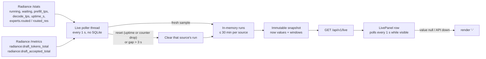

# Live usage panel and 512 MiB memory limit

## 1. Human-review summary

### Summary
- Outcome: the dashboard opens with one row of live tiles that refreshes every second. It shows requests (active / queued), prefill TPS, decode TPS (total · per request), MTP draft acceptance (5s / 1m / 30m / lifetime) and MoE GPU hit (5s / 1m / 30m). The page becomes the single tab kept open on a secondary screen. The container memory limit rises from 256 MiB to 512 MiB.
- Scope: a new in-memory live poller in the serving process, one new read-only API route, one new Vue panel, fixture/smoke/qualification updates, and the specification and documentation changes this scope expansion requires. The durable 15 s collector, SQLite schema, accounting, history and existing panels are unchanged. No live value is persisted.
- Readiness: execution-ready. Live Jarvis field presence (the `experts` block and draft counters) is an operator-gate check, not a design blocker. A missing field renders `-`.

### Explain like I'm five
While the server runs, a small background loop asks Radiance for `/stats` and `/metrics` once a second, independently of the 15 s history collector. It keeps only the last ~30 minutes of a few counters in memory. From these it computes the current numbers and the 5s / 1m / 30m ratios, so a window shows a value only once it holds a full span of samples. Nothing is written to the database; restarting the dashboard or Radiance clears the live data. The browser calls one new route every second and draws a row at the top of the page. Any value that is not known renders as `-`.

### Target flow


### Affected code
```text
compose.yaml                         — mem_limit 256m → 512m
README.md                            — 512 MiB budget, live panel, plan link
src/
└── jarvis_dashboard/                — new live poller module, /api/v1/live route + schema, serve wiring
docs/                                — specification, acceptance scenarios, deployment; new live-panel status file
└── receipts/
    └── live-panel/                  — (new) smoke transcripts, screenshots, resource results
frontend/
└── src/                             — App.vue: panel placement above the history views
    ├── api/                         — regenerated OpenAPI snapshot/types, fetchLive client
    ├── lib/                         — 1 s live store, number/ratio/placeholder formatters
    ├── components/                  — new LivePanel.vue
    └── styles/                      — live row layout (desktop row, 2-column wrap at 390 px)
tests/                               — live window/reset/staleness tests, /api/v1/live API tests
└── fixtures/                        — fixture /stats live fields + draft counters, representative payload size
scripts/                             — frontend smoke live phase + timer/traffic checks; 512 MiB qualification constants
```

### Assumptions
- "MoE cache GPU hit %" means the fraction of routed expert activations served by a VRAM-resident expert. That is Δ`experts.routed_res` ÷ Δ`experts.routed` from `/stats`, the same quantity Radiance's own "Routed to a resident expert" tile shows.
- "MTP lifetime" means since the current Radiance process started (`draft_accepted_total` ÷ `draft_tokens_total`), not since the dashboard was installed.
- Raising the hard limit to 512 MiB leaves the preferred steady-state RSS target (<100 MiB) and the 0.5 CPU limit unchanged. The user changed only the memory limit.
- Ratios display as whole percentages and rates as whole tokens per second. Finer precision is not useful on a glance screen.

## 2. Scope and acceptance criteria

**In scope**
- A 1 s live poller of `/stats` and `/metrics` in the `serve` process, running whether or not a browser is open.
- In-memory 5s / 1m / 30m windows for MTP acceptance and MoE GPU hit, plus MTP lifetime.
- Current-only requests, prefill TPS, decode TPS and decode TPS per request (total ÷ active).
- `GET /api/v1/live`, the `LivePanel` row, placeholders, stale marking and tab-visibility pausing.
- Memory limit 512 MiB everywhere the limit is declared, checked or documented as current.
- Specification amendments for the new scope (live engine stats, a second HTTP-only thread, 1 s upstream traffic).

**Out of scope**
- Persisting live values or showing live history after reload; windowed TPS or request tiles.
- Configurable live cadence or windows; a switch to disable live polling.
- Radiance's per-request table, KV-cache usage, prefix-cache hit rate, GPU card telemetry, alerts.
- Any change to durable collection, accounting, SQLite schema, existing API routes or existing panels' behavior.
- Rewriting historical delivery plans and status files. They remain records of what was qualified at 256 MiB.
- Live Jarvis/Unraid verification (operator gate).

**Acceptance criteria**
- AC1: With the fixture reporting `running=3`, `waiting=1`, `prefill_tps=1240.4`, `decode_tps=180.2`, the row shows `3 / 1`, `1,240 tok/s` and `180 tok/s · 60/req` within 2 s. With `running=0` the per-request slot shows `-`.
- AC2: When draft counters advance by a constant 7 accepted per 10 drafted each second, MTP shows `70%` in the 5s slot after ≥5 s, the 1m slot stays `-` until ≥60 s of continuous samples, and the 30m slot stays `-` until ≥1800 s (proven with an injected clock). Lifetime equals total accepted ÷ total drafted from the first sample.
- AC3: MoE GPU hit behaves like AC2 over `experts.routed_res` / `experts.routed` (5s / 1m / 30m, no lifetime). With no `experts` block in `/stats` every MoE slot is `-`.
- AC4: A window whose denominator did not advance (idle: nothing drafted or routed) shows `-`, never `0%` or a carried-over value.
- AC5: A Radiance restart (`uptime_s` decreases or any live counter decreases) or a gap of more than 3 s between a source's successful samples clears that source's windows. They then refill from `-`, and lifetime restarts from the new counters.
- AC6: If a source has had no successful sample for more than 3 s, its tiles show `-`. If both sources are stale, the row is marked stale. Durable collection, `/health/ready` and `/api/v1/status` are unaffected by live poll failures.
- AC7: No live value reaches SQLite. The database content and the request volume of the durable collector are unchanged by the feature.
- AC8: The browser keeps exactly one 1 s live timer and one 15 s history timer per tab. Both pause while the tab is hidden and resume when it becomes visible. The browser never contacts Radiance directly.
- AC9: `compose.yaml` declares `mem_limit: 512m`. The qualification harness expects `memory.max = 536870912` / `HostConfig.Memory = 536870912`. The specification, acceptance scenarios, deployment guide and README state 512 MiB as the hard limit.
- AC10: Under the specification D9 workload, extended with the live poller running and representative `/stats`/`/metrics` payloads, the container shows no OOM and stays under the 512 MiB limit with margin. Measured RSS and CPU are reported. This criterion is executed only on a host with a container runtime; otherwise it is recorded as not executed.

## 3. Design decisions

- D1: A dedicated live poller thread lives in a new module `src/jarvis_dashboard/live.py` (proposed `LiveMonitor`), owned by `run_serve`, separate from `Service`/`Collector`. Reason: the collector owns the SQLite writer and its 15 s schedule. The live loop must never block or be blocked by storage, and it must not touch readiness. Contract: started in `run_serve` before `server.run()`, after successful storage startup, and stopped together with `service.request_stop()` (signal path via `_ServingServer.handle_exit` and normal exit). The thread is a daemon with a stop event and a join budget of ≤1 s. `run_collect` does not start it. It uses its own `UpstreamFetcher` (same origin, no-redirect, 2 MiB cap).
- D2: Fixed cadence: 1 s schedule, one fetch in flight, `/stats` then `/metrics` sequentially, missed slots skipped (never queued), per-request timeout `min(HTTP_TIMEOUT_SECONDS, 0.9)` s. No new environment variables. Reason: this matches the user's "match Radiance's page" choice and the collector's skip-don't-queue rule, without configuration sprawl. Contract: a failure waits for the next slot, with no retry. Logging happens only on per-source state transitions (fresh→stale, stale→fresh, field missing/present), never per poll, so 1 Hz failures cannot flood the 3×5 MiB log cap.
- D3: Data sources per tile. Reason: `/stats` has no draft totals; `/metrics` has no expert routing; the gauges are equal in both. Contract:
  - `/stats` (JSON): `running`, `waiting`, `prefill_tps`, `decode_tps`, `uptime_s`, `experts.routed`, `experts.routed_res`.
  - `/metrics`: `radiance:draft_tokens_total`, `radiance:draft_accepted_total`, read with the existing line scanner (`_scan_sample_lines`) and exact integer lexeme parsing, with no full Prometheus family parse at 1 Hz. If either name has zero samples, or more than one sample (more than one label set), the MTP group is unavailable for that poll. Series are never summed (spec D3).
  - A field that is missing, of the wrong type, non-finite or negative makes only its own tile(s) null for that poll.
- D4: Window semantics, owned server-side and computed once per poll into an immutable snapshot that the API returns as-is. Reason: one implementation of the rule, testable with an injected monotonic clock; the API handler does O(1) work. Contract, per source:
  - A **run** is consecutive successful samples `(t_monotonic, counters…)` for that source. A run ends on `uptime_s` decrease, any live counter decrease, or a gap > 3 s since that source's previous success; a new run starts empty. Retention is ≤ 1800 s + 30 s of samples (bounded deque).
  - For window W ∈ {5 s, 60 s, 1800 s}, the baseline is the newest sample in the current run with `t_now − t_b ≥ W`. The value is `Δnumerator / Δdenominator` if a baseline exists, `t_now − t_b ≤ W + 2 s`, and `Δdenominator > 0`; otherwise null.
  - MTP lifetime = `draft_accepted_total / draft_tokens_total` from the latest sample, null when the denominator is 0. MoE has no lifetime value.
  - Decode per request = `decode_tps / running` when `running ≥ 1`, else null.
  - Freshness: a source's tiles are null when its latest success is older than 3 s.
- D5: Route `GET /api/v1/live` returns proposed model `LiveResponse`. It is an `async` handler that reads the latest snapshot reference and does no SQLite read, so it bypasses `ReadAdmission` and adds no read-capacity pressure. It keeps the existing envelope and `no-store`. Reason: the existing envelope/no-store conventions; the snapshot is already computed. Contract (rates in tokens/second, ratios 0..1, `null` = render `-`):
  ```json
  {
    "schema_version": 2,
    "generated_at": "2026-10-27T12:00:00.000Z",
    "state": "starting | live | stale | unavailable",
    "observed_at": "2026-10-27T11:59:59.812Z",
    "requests": { "active": 3, "queued": 1 },
    "prefill_tokens_per_second": 1240.4,
    "decode_tokens_per_second": 180.2,
    "decode_tokens_per_second_per_request": 60.07,
    "mtp_acceptance": { "window_5s": 0.70, "window_1m": null, "window_30m": null, "lifetime": 0.66 },
    "moe_gpu_hit": { "window_5s": 0.93, "window_1m": 0.91, "window_30m": null }
  }
  ```
  `state`: `starting` before any successful poll; `live` when at least one source is fresh; `stale` when both sources are stale after having been live; `unavailable` when the app has no live monitor (in-process test app / no `serve`). `schema_version` reuses the existing constant.
- D6: The frontend live store is separate from `dashboard.ts`, in a new `frontend/src/lib/live.ts`. Reason: the history store coalesces a multi-route read set on a 15 s cadence; a 1 s loop inside it would interleave with that coalescing. Contract: one `setInterval(…, 1000)`, at most one `fetchLive` in flight (a tick is skipped while one is pending), the same `visibilitychange` pause/resume as `dashboard.ts`, and abort on unmount. On API error or timeout, all tiles render `-` and the row shows the stale marker. The store never fabricates values.
- D7: `LivePanel.vue` is a single row of five tiles, always rendered at the top of `<main>`, independent of series selection, first load and empty state. Reason: the ambient view must work even before history exists. Contract:
  - Tiles: Requests `active / queued`; Prefill `N tok/s`; Decode `N tok/s · M/req`; MTP `a / b / c / d` labelled `5s · 1m · 30m · life`; MoE GPU hit `a / b / c` labelled `5s · 1m · 30m`. Every unknown slot is `-`, so a fully unknown MTP tile reads `- / - / - / -`.
  - A header chip shows Live / Stale / Starting.
  - Layout wraps to two columns at 390 px. Existing tokens, `Card`/`LabelValue` primitives and tabular numerals are reused.
  - No `aria-live` on the 1 s values, which would mean screen-reader spam every second. The status chip carries the state text.
  - Stable `data-testid`s for smoke.
- D8: The memory limit is 512 MiB (`mem_limit: 512m`, 536870912 bytes); qualification bars scale with it. Reason: user decision. Contract: `scripts/qualify_common.py` `MEMORY_MAX` and expected `HostConfig.Memory`, the compose check `"512m"`, `scripts/qualify_resources.py` `MEMORY_MAX_BYTES`, and the non-reclaimable bar at 75 % of the limit (384 MiB). Preferred RSS <100 MiB and 0.5 CPU are unchanged. The D9 workload gains the live poller and one live timer per tab.

## 4. Implementation steps

### Step 1: Live sampling and window engine
- **Code area:** `src/jarvis_dashboard/live.py` (new), `src/jarvis_dashboard/metrics.py` (reuse `UpstreamFetcher.fetch`, `_scan_sample_lines`, `parse_exact_integer_lexeme`), `tests/test_live.py` (new).
- **Change:** Implement D3 extraction as pure functions:
  - `/stats` bytes → stats sample or per-field nulls;
  - `/metrics` text → draft pair or unavailable.
  
  Implement D4 as a pure, clock-injected window engine: per-source runs, reset and gap detection, baseline selection with the 2 s tolerance, idle → null, freshness, lifetime and per-request division. It produces an immutable snapshot matching the D5 shape. Add `tests/test_live.py` covering:
  - the AC2 fill timeline at 5 s / 60 s / 1800 s via the injected clock (`-` one sample before full, value at full);
  - AC4 idle;
  - AC5 reset by uptime drop, by counter drop and by a 4 s gap;
  - AC6 freshness at 3 s;
  - D3 ambiguity (two draft label sets → null) and malformed field types.
- **Depends on:** None.
- **Verification:** `.venv/bin/python -m pytest -q tests/test_live.py` passes. The window-fill cases fail if the full-window rule or the tolerance is removed (AC2–AC6).

### Step 2: Poller thread and serve lifecycle
- **Code area:** `src/jarvis_dashboard/live.py`, `src/jarvis_dashboard/service.py` (`run_serve`, `build_server`, `_ServingServer.handle_exit`), `src/jarvis_dashboard/app.py` (`AppState` gains the live monitor reference), `tests/test_service.py`.
- **Change:** Implement D1/D2: `LiveMonitor` with `start()`, `request_stop()`, `join(timeout)` and `snapshot()`. The loop runs fetches per D2 and publishes a fresh snapshot reference after each poll. Wire it into `run_serve` only and stop it on every exit path. Add transition-only logging. Update service tests that assert thread sets/shutdown so the live thread is included and stops within the shutdown budget.
- **Depends on:** Step 1.
- **Verification:** `.venv/bin/python -m pytest -q tests/test_service.py tests/test_live.py` passes. In a throwaway run, `serve` against the fixture produces about one `/stats` and one `/metrics` fixture hit per second. SIGTERM stops the process within the existing budget. `/health/ready` stays 200 while the fixture `/stats` returns 500 (AC6).

### Step 3: `/api/v1/live` route and contract
- **Code area:** `src/jarvis_dashboard/schemas.py` (proposed `LiveResponse`, `LiveRequests`, `LiveMtp`, `LiveMoe`), `src/jarvis_dashboard/api.py` (`build_router`), `frontend/src/api/openapi.json` via `scripts/export_openapi.py`, `tests/test_api.py`.
- **Change:** Implement D5. Return `unavailable` with all-null fields when `AppState` has no live monitor. Keep the envelope and `no-store`. Regenerate the OpenAPI snapshot. Add API tests for the `unavailable` shape, a populated snapshot passed through unchanged (null preserved, not coerced to 0), `cache-control: no-store`, and the route working while the read-admission gate is saturated.
- **Depends on:** Step 2.
- **Verification:** `.venv/bin/python -m pytest -q tests/test_api.py` passes; `.venv/bin/python scripts/export_openapi.py --check` exits 0 (AC6, AC7).

### Step 4: Fixture support for live fields
- **Code area:** `tests/fixtures/fixture_server.py`.
- **Change:** Extend `FixtureState`:
  - `/stats` emits controllable `running`, `waiting`, `prefill_tps`, `decode_tps` and an optional `experts` block (`routed`, `routed_res`), shaped like the pinned Radiance `handle_stats`;
  - `/metrics` emits optional `radiance:draft_tokens_total` / `radiance:draft_accepted_total` with the series labels;
  - a helper advances these counters at a fixed per-second rate on a background tick, for smoke;
  - a "representative size" mode pads `/stats` with Radiance-shaped `experts.layer_units`/`layer_resident` arrays (48 layers × 128 experts) and `/metrics` with Radiance's histogram families, so resource runs parse realistic bodies. The size used is recorded as a receipt.
  
  Existing fixture behavior and defaults stay byte-identical when the new fields are unset.
- **Depends on:** None (parallel with Steps 1–3).
- **Verification:** The existing `.venv/bin/python -m pytest -q` suite still passes unchanged (fixture defaults preserved). A throwaway `curl` of fixture `/stats` and `/metrics` shows the new fields only when set.

### Step 5: Frontend live store, panel and placement
- **Code area:** `frontend/src/api/client.ts` (`fetchLive`, `LiveResponse` type), `frontend/src/api/schema.ts` (regenerated), `frontend/src/lib/live.ts` (new), `frontend/src/lib/format.ts` (`-` placeholder, whole-number tok/s, whole-percent ratio, slot joiner), `frontend/src/components/LivePanel.vue` (new), `frontend/src/App.vue`, `frontend/src/styles/app.css`.
- **Change:** Implement D6/D7. Mount `LivePanel` as the first element in `<main>` after the banners, outside the `firstLoad`/`isEmpty` branches. The live store mounts and unmounts with the app, beside `dashboard.mount()`.
- **Depends on:** Step 3.
- **Verification:** `cd frontend && npm run verify` (gen:types → typecheck → build) exits 0. The bundle lands in `src/jarvis_dashboard/static/` (AC1, AC8).

### Step 6: Frontend smoke: live phase and updated lifecycle/traffic checks
- **Code area:** `scripts/smoke_frontend.py`, `scripts/smoke.py` (only if its fixture-traffic assertions count `/metrics` hits).
- **Change:**
  - Add a live phase: initial `-` placeholders; AC1 values; per-request `-` at `running=0`; MTP and MoE 5s slots filled after ~6 s while 1m reads `-`; 1m filled after ~62 s; a fixture uptime drop resets slots to `-`; `/stats` 500 plus `/metrics` 500 → all `-` and a Stale chip within ~4 s; recovery; no `experts` block → MoE `- / - / -`. Take 1440 px and 390 px screenshots.
  - Update `poll_lifecycle` to expect two timers `{1000, 15000}`, both paused when hidden.
  - Update `network` so the fixture `/metrics` delta is checked against collector + live cadence (~1/s), and the browser still makes no fixture requests.
- **Depends on:** Steps 4 and 5.
- **Verification:** `.venv/bin/python scripts/smoke_frontend.py` exits 0 with `FRONTEND SMOKE PASSED`, and the new live checks appear in its transcript (AC1–AC6, AC8). `.venv/bin/python scripts/smoke.py` exits 0 with `SMOKE PASS` (AC7: durable totals unchanged, e.g. 960).

### Step 7: Raise the memory limit to 512 MiB
- **Code area:** `compose.yaml`, `scripts/qualify_common.py`, `scripts/qualify_resources.py`, `tests/fixtures/compose.qualification.yaml` (only if it restates the limit).
- **Change:** Implement D8:
  - `mem_limit: 512m`;
  - `MEMORY_MAX = "536870912"`, expected `HostConfig.Memory` 536870912 and the compose check `"512m"`;
  - `MEMORY_MAX_BYTES = 536870912` and `NON_RECLAIMABLE_BAR = 384 * MIB`;
  - the per-tab timer check becomes "one history timer and one live timer per tab";
  - the D9 workload runs the fixture in representative-size mode with live fields advancing.
- **Depends on:** Step 4.
- **Verification:** `.venv/bin/python scripts/qualify_image.py --docs-check` exits 0 after Step 8's doc changes (the compose `mem_limit` check expects `512m`) (AC9).

### Step 8: Specification, scenarios and operator docs
- **Code area:** `docs/specification.md`, `docs/acceptance-scenarios.md`, `docs/deployment.md`, `README.md`.
- **Change:**
  - **Specification:**
    - Add a new decision section "D10. Live usage panel" carrying D1–D7 contracts (sources, cadence, windows, nulls, no persistence, route, UI).
    - Amend the scope list: live Radiance-reported engine stats are in scope; host GPU/CPU telemetry stays out.
    - Amend D1 (a second, HTTP-only live thread; no SQLite).
    - Amend D2 (1 Hz live traffic to `/stats` + `/metrics` in addition to collection).
    - Amend D3 (draft counters are read live only, never accounted).
    - Amend D6 (`/api/v1/live`), D7 (live row ranks first on the screen), D8/D9/AC6 (512 MiB; D9 workload includes the live poller and payload sizes).
  - **Acceptance scenarios:** update scenario 33 to 512 MiB and add live-panel scenarios mirroring AC1–AC6.
  - **Deployment guide:** 512 MiB and the extra 1 Hz upstream traffic.
  - **README:** 512 MiB in the stack paragraph and the kickoff text, plus links to this plan and the status file.
  - Historical delivery plans and status files are not edited.
- **Depends on:** Steps 1–7 (documents the implemented contract).
- **Verification:** `.venv/bin/python scripts/qualify_image.py --docs-check` exits 0. A text search for `256 MiB`/`256m` outside `docs/delivery-*` and `docs/receipts/` finds no statement of the current limit (AC9).

### Step 9: Evidence and status
- **Code area:** `docs/live-panel-status.md` (new), `docs/receipts/live-panel/` (new).
- **Change:** Record the executed environment, commands with exit codes, the live smoke transcript and screenshots, the fixture payload sizes, and either the D9 resource results at 512 MiB (peak cgroup memory, steady RSS, CPU with the live poller) or an explicit NOT EXECUTED entry with the missing runtime prerequisites. List the operator-gate checks that remain: live `/stats` has `experts.routed`/`routed_res`, live `/metrics` has the draft counters, and real payload sizes.
- **Depends on:** Steps 1–8.
- **Verification:** The status file names every gate as executed (with a receipt link) or not executed (with the missing prerequisite). No resource or live claim lacks a receipt (AC10).

## 5. End-to-end verification

- Full live path: start `serve` against the fixture with live fields advancing (7/10 drafts per second, 93/100 routed per second, `running=3`, `waiting=1`) → open the built dashboard in Chromium at 1440 px → expect `3 / 1`, prefill/decode values, `60/req`, MTP `70% / - / - / 66%` → after ~62 s expect `70% / 70% / - / …` and MoE `93% / 93% / -`. Drop fixture uptime → slots return to `-` and refill. Stop both fixture endpoints → all `-`, Stale chip. Restore → Live (AC1–AC6). Covered by Step 6's smoke.
- The 30-minute fill boundary is proven by the injected-clock tests in Step 1, not by a 30-minute browser wait (AC2, AC3).
- Durable isolation: the same run's `scripts/smoke.py` and API totals match pre-feature values (960 scenario). `dashboard.sqlite3` has no new tables and the schema version is unchanged (AC7).
- Existing checks: `.venv/bin/python -m pytest -q`, `.venv/bin/python scripts/smoke.py`, `.venv/bin/python scripts/smoke_frontend.py`, `.venv/bin/python scripts/export_openapi.py --check` and `cd frontend && npm run verify` all exit 0. `.venv/bin/python scripts/qualify_image.py --docs-check` exits 0 (AC8, AC9).
- Resource: on a Docker/cgroup v2 host, `scripts/qualify_resources.py` runs the extended D9 workload under `memory.max = 536870912`, `cpu.max = 50000 100000` and reports peak/steady memory and CPU with the live poller active (AC10). Without a runtime this is recorded as not executed in Step 9.

## 6. Risks and open decisions

- **Risks:**
  - **CPU at 0.5 cores:** the 1 Hz `/stats` JSON parse of an unknown live size, plus the `/metrics` line scan, is new steady work in the single Python process. Mitigation: line-scan two names instead of a full Prometheus parse, a representative-size fixture, and measured CPU in Step 9. If the 0.5 CPU budget is exceeded, report it; do not silently slow the cadence.
  - **Live field presence:** the `experts` block appears only for MoE models with expert tiering, and draft counters only with speculation enabled. Absence renders `-` by design, but it is indistinguishable from "warming up" in the UI. The operator gate must confirm both on Jarvis.
  - **Upstream load:** 1 Hz polling doubles Radiance's dashboard-like traffic when Radiance's own page is also open. The `/stats` cost is borne by Jarvis. It is documented in deployment; no mitigation planned beyond skip-don't-queue.
  - **Reset detection limits:** a Radiance restart during an outage is caught by the >3 s gap rule, at the cost of refilling windows after any 3+ s outage. This is deliberate: it prefers `-` over a wrong ratio.
  - **Smoke timing:** the live smoke phase adds about 70 s and asserts 1 s-cadence values. Assertions use waits with tolerances, not exact sleeps, to avoid flakiness.
- **Open decisions:** None.
