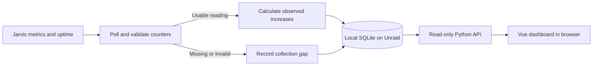

# Jarvis Token Dashboard — implementation specification

## 1. Human-review summary

### Summary
- Outcome: a small, attractive dashboard retaining Radiance token-processing history across collector and inference-server restarts, hosted entirely in one Docker container on Unraid.
- Scope: Python collector and read-only web API, SQLite, and a compiled Vue dashboard. No inference proxy, PostgreSQL, Grafana, Node.js runtime, or changes to inference clients.
- Readiness: execution-ready for implementation and synthetic verification in a new repository. Live Jarvis compatibility and Unraid resource qualification require operator access; neither has been tested by this specification.
- Resource target: operate under a **256 MiB container memory limit**, with a preferred steady-state process RSS below **100 MiB**. These are acceptance targets, not measured promises.

### Explain like I'm five
The NAS periodically asks Jarvis for its cumulative token counters. It saves the readings and the increases between them in a local database. Opening the dashboard reads that database, not Jarvis directly. Stopping the dashboard or losing the network does not interrupt inference. Gaps and uncertain restart boundaries remain visible rather than silently turning into zero usage or invented history.

### Target flow


### Affected code
This is a proposed greenfield footprint, not existing files. Copy this specification packet into the new repository's `docs/spec/`.

```text
/                           — new: pyproject, Python lock, Dockerfile, Compose, README
├── src/jarvis_dashboard/    — new: configuration, collector, accounting, storage, API, CLI
│   ├── migrations/         — new: numbered SQLite migrations
│   └── static/             — generated: production frontend assets in image/package
├── frontend/               — new: package manifest/lock, TypeScript and Vite configuration
│   └── src/                — new: Vue app, API types, theme, reusable panel/chart components
├── tests/                  — new: accounting, persistence, API and fixture HTTP server tests
├── scripts/                — new: reproducible container smoke and resource qualification
└── docs/                   — new: operations, verification receipts
    └── spec/               — copied: this specification, acceptance scenarios and kickoff
```

### Assumptions
- One configured Radiance server; historical models are retained when that server changes models. Multi-server management is not included.
- The user prioritizes low NAS RAM use and easy operation over billing-grade accounting or per-client attribution.
- Trusted LAN/tailnet access is sufficient. This is not an Internet-facing application.
- **UTC reporting** is deliberately selected: today, months and chart buckets all use UTC and are visibly labeled. Arbitrary reporting timezones are out of scope, avoiding DST and rollup ambiguity.
- The agent implementing this packet has no access to the original HQ repository or conversation. All required context is below.

## 2. Scope and acceptance criteria

**In scope**
- Fifteen-second polling, persistent restart-safe counter accounting, bounded raw retention and durable historical summaries.
- Observed computed-prefill and generated-output totals, separate optional request-usage accounting, history charts and collection status.
- A responsive dashboard with dark/light themes, explicit unavailable/stale/partial states and accessible controls.
- One non-root runtime container, durable appdata, backup/restore, upgrade migrations and measurable resource qualification.

**Out of scope**
- Request interception, prompts/responses, API keys per user, cost estimates, billing, provider routing, authentication accounts, GPU/CPU telemetry, alerts, multiple collectors or writable administration APIs.
- Retroactively recovering tokens lost before collection or during an unobserved Radiance restart.
- Kubernetes, Redis, Celery, an ORM, a separate database or web-server container, SSR and client changes.

**Acceptance criteria**
- AC1: primary counters are parsed and accumulated independently by canonical source/label identity; request counters never inflate engine totals.
- AC2: baseline, zero work, missing data, observed resets and ambiguous continuity have the deterministic behavior in `acceptance-scenarios.md`.
- AC3: a collector crash/restart or image recreation cannot duplicate committed increments; database migrations and retention preserve historical totals.
- AC4: dashboard cards, charts and API agree on UTC ranges, selected series, missingness and approximate time attribution; all core UI states work at 390px and 1440px widths.
- AC5: production image serves its own frontend and API without a Node.js process, CDN assets or external database. No inference request is routed through it.
- AC6: container survives the specified resource workload under 256 MiB, with measured process RSS, container memory, latency and database growth reported honestly.
- AC7: an online backup restores to a fresh volume with identical committed totals; disk/write failures never advance the persisted baseline or claim successful collection.
- AC8: live deployment instructions verify the real metric names/labels and compare a known generation against the collected changes without changing Jarvis's inference configuration.

## 3. Design decisions

### D1. Selected stack and ownership
- Python **3.13**, FastAPI, Uvicorn with **one worker**, standard-library `sqlite3`, and a single dedicated collection thread. Use synchronous route handlers with bounded execution concurrency; no blocking SQLite or HTTP operations in the ASGI event loop.
- One collector thread owns the writer connection and sequential polling. API reads use short-lived read-only connections and short transactions; do not share a SQLite connection across threads. Cap simultaneous database read work at four; return a structured 503 when saturated rather than growing an unbounded queue.
- Use standard-library HTTP client facilities for the two fixed upstream URLs. Select a maintained Prometheus text parser; do not parse label sets with ad-hoc comma splitting. Verify its exact-number behavior under D3; preserve numeric tokens before float conversion if necessary.
- **Vue 3 + TypeScript + Vite** for the frontend, **Chart.js 4** with only required bar/line components registered. Use native accessible controls, shared Vue card/control primitives and a small CSS token system. No router or global state library needed for this single-page app.
- Vue is selected for maintainable components without a full application framework; Chart.js supplies polished interactive charts. Bundle all assets at build time. Node.js exists only in the Docker build stage; Python serves the resulting files.
- Lock resolved Python and npm dependencies, pin build/runtime images to reviewed versions/digests at implementation time, and document upgrades. Do not invent future patch versions in this specification.

### D2. Deployment context and configuration
Known target context, not live verification:
- Inference host: `jarvis`, Ubuntu, Radiance standalone **1.11.0**, not discontinued `vllm-radiance`.
- LAN base: `http://192.168.1.228:8000`; `/metrics` is Prometheus text, `/stats` is JSON.
- Served alias: `jarvis-qwen38-flash-next`; discover actual metric labels, do not hardcode this filter.
- Pinned reference source: `9eaf10da6eea6c1fd0053936adf20ad5a101b7a3`.
- No upstream API key in the existing trusted-LAN setup. Do not expose new ports publicly or use Tailscale Funnel.

Required environment contract:

| Variable | Default | Meaning |
|---|---|---|
| `RADIANCE_BASE_URL` | `http://192.168.1.228:8000` | Operator-configured HTTP(S) origin; append fixed paths |
| `SOURCE_ID` | `jarvis` | Durable source identity; never derived from an IP address |
| `POLL_INTERVAL_SECONDS` | `15` | Integer 5–300 |
| `HTTP_TIMEOUT_SECONDS` | `3` | Per-request deadline; positive and less than poll interval |
| `DATABASE_PATH` | `/data/dashboard.sqlite3` | Persistent local database |
| `RAW_RETENTION_DAYS` | `30` | Integer 1–365; only detailed samples/events expire |
| `PORT` | `8080` | Internal HTTP port |
| `LOG_LEVEL` | `INFO` | Standard bounded operational logging |

Validate configuration on startup; fail with actionable errors. No UI endpoint accepts arbitrary upstream URLs. Disallow URL credentials/fragments; do not follow redirects to another origin. Bound upstream responses to 2 MiB and 256 selected series; reject oversize input without touching baselines. One in-flight poll only; missed schedules are skipped, never queued. Failures wait until the next scheduled poll, with no retry storm.

Changing URL with the same SOURCE_ID requires a new accounting epoch and a recorded endpoint-change boundary. Preserve old history. Changing SOURCE_ID creates a separate identity. Take a process-level exclusive lock beside the database for the collector lifetime; a second process pointing at the volume must refuse startup. Do not mount the Docker socket or host GPU devices.

### D3. Counter and numeric contracts

| Stable API key | Prometheus metric | Semantics |
|---|---|---|
| `computed_input` | `radiance:prefill_tokens_total` | Prompt tokens actually computed by the engine |
| `generated_output` | `radiance:decode_tokens_total` | Generated tokens counted when scheduler steps commit |
| `request_input` | `vllm:prompt_tokens_total` | Request-level prompt accounting |
| `request_output` | `vllm:generation_tokens_total` | Request-level generation accounting, updated when requests finish |

The first two are required for a valid primary reading of a series. The other two are optional, independent counters and may be unavailable. No speculative-draft counter is included. `processed_total = computed_input + generated_output`; it is an accounting convention, not a count of all GPU operations. Request input can include cache-served tokens; never equate it with computed input or add it to engine totals.

A series identity is SOURCE_ID plus the complete sorted decoded label set. Preserve `model_name`, `engine` and any other labels. Reordering labels does not create a new series. Never sum alternative engines or duplicate series implicitly: dashboard defaults to the sole active series, otherwise requires a series selection. No aggregate-all-series option in scope.

Ignore unrelated metrics and optional sample timestamps; use collector observation time. Handle legal Prometheus escaping and scientific notation. Reject duplicate selected metric/label samples, negative/non-integral/non-finite values and overflow. Parse numeric text without introducing floating-point loss. Store counters and sums as nonnegative signed 64-bit integers; guard aggregate addition overflow and fail visibly rather than wrapping. Values above the upstream double-precision exact-integer range (2^53−1) are unsupported and must be flagged, not presented as exact. HTTP JSON token counts are decimal **strings**; nullable values remain null. Browser formatting uses BigInt for exact labels and rounded Numbers only for chart coordinates, with exact strings in tooltips.

### D4. Baselines, continuity and time attribution
Each primary series maintains a durable epoch and baseline pair. Update both primary counters together; if either is absent/invalid, retain the previous pair and record a failed primary sample. Optional counters each maintain their own baseline/continuity independently.

1. **First reading/new epoch:** save its absolute counters as opening balances. Count zero new tokens from that reading. Opening balances are shown only in diagnostics and are never added to dated or observed-lifetime totals.
2. **Normal increase:** delta = current minus previous committed counter. Nonnegative deltas, including zero, are observed work.
3. **Primary counter decrease:** start a new epoch for both primary counters. Preserve previous observed totals, flag a reset boundary and baseline the new pair without crediting it. Optional-counter decrease resets only that optional counter unless there is source-wide restart evidence.
4. **Uptime evidence:** `/stats` supplies `model` and `uptime_s`. Match it only to that model's engine `0`; do not apply it to unrelated series. Record request start/end timestamps around the stats fetch. Estimate a process-start interval `[request_start - uptime - 2s, response_end - uptime + 2s]`. Intersect overlapping intervals with the saved interval. Disjoint intervals indicate a possible restart or clock discontinuity: conservatively start a new epoch. This catches a restart even if new uptime/counters exceed old values. It is evidence, not a guaranteed process ID.
5. **Unverifiable continuity:** if stats is missing, mismatched or invalid but primary metrics are valid, accept nonnegative deltas as `continuity_unverified`; decreases still reset. Always disclose that unseen restarts can escape detection. When stats becomes available after an unverified period, establish/compare evidence but never retroactively erase or invent counts.
6. **Gap:** network errors, invalid primary samples, collector downtime and absent series produce gaps, not zeros. On return with compatible epoch evidence and nondecreasing counters, recover the observed delta since the last baseline, with uncertain distribution in time. If restart evidence differs, baseline instead; the gap's lost work is unknown. Intervals longer than twice the configured poll interval are gaps even without an explicit failed scrape record.
7. **Wall-clock regression:** use monotonic time for scheduling. If observation UTC time is not later than the previous sample, record clock discontinuity, establish a fresh epoch/baseline and do not credit a negative/zero-duration interval.
8. **Attribution policy:** assign an accepted delta to the UTC hour containing the ending observation. Do not interpolate tokens into unobserved hours. Flag a delta spanning an hour boundary or gap as time-attribution approximate. This preserves integer totals and makes the limit explicit: charts mean tokens *observed in* a period, not exact generation timestamps.
9. **Present gaps:** keep last known historical totals available, but current rates and status become stale. Never replace a missing total with zero. Rate is delta divided by elapsed seconds only for contiguous valid primary intervals; gap/reset/baseline intervals have null rates.

Quality dimensions are independent: `collection_gap`, `reset_boundary`, `continuity_unverified`, `time_attribution_approximate`, `clock_discontinuity`, and `counter_unavailable`. Persist these alongside contributions and summarize them in history. “Observed total since …” is mandatory wording; never “exact lifetime total.”

### D5. Storage, transactions and retention
Use numbered SQL migrations and `PRAGMA user_version`. WAL, foreign keys, synchronous FULL, busy timeout 5 seconds; initial page cache budget 4 MiB per connection and no unbounded mmap. Validate/tune through actual memory measurements. Back up before migrations; refuse a database with a schema newer than the application supports. Migration failure must not start collection.

Logical tables (implementation may normalize fields, but must preserve these contracts):
- `sources`: stable ID, configured endpoint fingerprint, creation time.
- `series`: ID, source ID, canonical label JSON, display model/engine; unique `(source_id, canonical_labels)`.
- `collector_state`: per-series epoch, last primary baseline/time, optional baselines/times, uptime-start interval, latest attempt/success/error and gap state. This data never expires.
- `epochs`: series, start time, reason, opening balances. Retained indefinitely.
- `samples`: unique observation ID, series, UTC timestamps, counter values, applied deltas and quality flags. Retain 30 days by default.
- `hourly_totals`: unique `(series_id, utc_hour)`, sums of accepted deltas for each counter, per-counter observed-interval counts, last observation time, quality flags and gap-duration overlap. Retain indefinitely. Optional totals with zero observed intervals are null in API responses, not zero.
- `events`: bounded error/reset/clock details for diagnostics. Raw retention applies; durable quality flags in hourly summaries and epoch records survive deletion.

Each successful observation transaction inserts the sample, increments its hour's totals, records relevant quality/event state, and advances baselines atomically. Reapplying the same observation ID is a no-op. A crash before commit changes nothing; a crash after commit resumes from that baseline. A repeated unchanged counter with a new observation ID yields zero, not duplicate usage. Collection failures update status/events in their own transaction without advancing counters. Database failure must also be surfaced via logs and in-memory readiness, since it may prevent saving an event.

Gap durations are clipped/split by UTC hour, including hours with no contributions. Track their per-counter scope. Materialize zero-count gap rows as necessary using bounded batches after long downtime; such a row is unavailable, not observed zero. For an ongoing gap, the API overlays its open duration until recovery persists it. Do not derive availability from merely having one sample in a bucket.

Do not retain full upstream bodies. Store compact selected data only. Once a day delete expired raw samples/events in batches of at most 1,000, between polls; no periodic full VACUUM. Hourly totals, baselines and epochs never expire automatically. Index sample time/series and hour/series. Daily queries sum at most 24 hourly records per day; lifetime summaries sum the compact hourly table, never raw samples. Avoid loading the database into Python lists or maintaining duplicate in-memory history.

### D6. Read-only HTTP API
All routes same-origin under `/api/v1`, except health routes. No CORS wildcard, arbitrary SQL, filesystem paths, or mutation endpoints. Parameterize SQL; escape labels in the UI. Return JSON errors with stable `code` and readable `message`; no stack traces.

- `GET /health/live`: 200 when process/event loop serves requests. No upstream dependency.
- `GET /health/ready`: 200 after migrations and collector startup with writable storage; 503 on storage/collector failure. Jarvis offline alone does not fail readiness.
- `GET /api/v1/status`: configuration excluding sensitive URL details, configured poll interval, server UTC time, last attempt/success, current error code, collection state (`starting`, `healthy`, `degraded`, `offline`), first observation time and storage state. Offline = no successful primary sample for more than two poll intervals. Partial optional data or unavailable uptime means degraded, not offline.
- `GET /api/v1/series`: bounded list of known identities, labels, first/last seen, active/stale state. Bound pagination to 100 items/page, deterministic opaque continuation cursor.
- `GET /api/v1/summary?series_id=...`: today UTC, current calendar month UTC, observed lifetime, and last contiguous interval rates for that series. Each range has start/end, four counter values, processed_total, first/last observation, and quality metadata. No-data values are null. A known observed zero is `"0"`. A primary total requires observations of both primary counters. Optional sums may be partial and must identify missing intervals.
- `GET /api/v1/history?series_id=...&from=...&to=...&bucket=hour|day`: RFC3339 UTC half-open range `[from,to)`. Hour requests require hour-aligned bounds, max 31 days; day requests require UTC-midnight bounds, max 366 days. Return 400 for invalid ranges/alignment, 404 for unknown series; never silently clamp. Return each requested bucket with bounds, nullable counters, processed_total, observation counts, gap seconds and quality flags. Empty buckets remain null. At most 744 hourly or 366 daily points.
- `GET /api/v1/events?series_id=...&limit=...&cursor=...`: newest first, default 20/max 100, retention-limited diagnostics; opening balances/epoch details available with the selected series summary diagnostics.

Use a consistent top-level `schema_version: 1` and UTC `generated_at` in application JSON. Keep frontend types synchronized with the FastAPI schema. Define exact response models and include examples in the implemented API documentation. API responses are not cached by intermediaries; hashed static assets can be immutable, while index.html must revalidate.

### D7. Dashboard design contract
One screen, ranked tasks: (1) understand how much work Jarvis has processed, (2) see the trend, (3) understand whether the numbers are trustworthy. No sidebar, marketing hero, settings page or gratuitous animation.

Foundation: system font stack; 4/8/12/16/24/32px spacing; 12px card radius; subtle 1px borders; tabular numerals; CSS variables for background, panel, foreground, muted text, border, accent, warning and error. Default to system theme with a light/dark toggle saved locally. Use two consistent series colors for computed input and generated output. Provide visible keyboard focus, contrast appropriate to WCAG AA, reduced-motion support and labels independent of color.

Layout:
- Compact header: product name, selected series/model, collection-status badge, last successful update and theme toggle. Series picker appears only when needed.
- Primary row: **Observed today**, **Observed this month**, **Observed since collection began**. Each card shows processed total with smaller computed-input/output breakdowns and a partial/approximate indicator when applicable. Always show UTC and the lifetime start date.
- Main panel: stacked bars for computed input/generated output with 24h, 7d, 30d and custom UTC date-range controls. 24h uses hourly buckets; longer presets use daily buckets. Today includes current incomplete bucket visibly. Align requests to D6; custom date end is exclusive and labeled. No pie chart or redundant chart of the same data.
- Secondary panel: recent contiguous input/output rates; display N/A while stale, after a baseline or across a gap. A disclosure labeled “Request-accounted usage” shows the optional request totals with their different semantics.
- Diagnostics disclosure: collection gaps, epoch changes, opening balances, last error, raw retention and meaning of each quality flag. No raw label dictionary beneath every number.

States: loading skeletons on first load; real zero values distinct from no data; baseline-only guidance; offline banner retaining historical cards; unavailable optional counters; schema/parse errors with concise action; partial buckets with accessible descriptions; empty selection; API failure retaining last successful render with stale timestamp. Chart tooltips show exact values, UTC bucket bounds and quality. Supply an accessible table alternative inside the chart disclosure. Never draw a missing bucket as a zero bar or connect a line across missing data.

Poll dashboard APIs every 15 seconds while visible, pause when hidden, refresh on focus, and prevent overlapping/out-of-order fetches. Use one consistent selected series across all panels. Charts are destroyed on unmount and reused on refresh; do not accumulate canvas instances or poll timers. Browser RAM and NAS RAM must be reported separately.

### D8. Packaging, safety and operations
Multi-stage Docker build: locked frontend build, locked Python install, slim runtime with static assets. One Uvicorn worker, no development reload. Bind internal port 8080. Supply Compose with restart `unless-stopped`, `mem_limit: 256m`, 0.5 CPU limit, rotated logs, read-only root filesystem and a small `/tmp` tmpfs counted against the memory budget. Run as an explicit non-root numeric UID/GID; document preparing appdata ownership rather than recursive chmod 777. No privileged mode.

On Unraid, recommend a dedicated local SSD/cache-pool directory such as `/mnt/<pool>/appdata/jarvis-token-dashboard`, bind-mounted to `/data`; operator substitutes the real pool name. Do not put the live SQLite database on SMB/NFS or allow mover to relocate its files while running. Publish a user-selected host port only on a trusted LAN address. The Compose example must use clearly documented environment substitution for that address, not silently bind all interfaces. Restrict via LAN/VLAN ACLs or existing private access controls; this app has no built-in login. Do not make a public exposure claim based on a Docker port binding alone.

SIGTERM stops scheduling, finishes/rolls back current transaction, closes connections and exits within 15 seconds. On startup, validate storage writability and schema before collection; never silently create a fresh database when the configured one is corrupt. Report disk-full/locked/corrupt errors distinctly. Bound error logs and omit upstream payloads/secrets.

Provide a CLI command using SQLite's online backup API to a separate output file. It must refuse overwriting a backup, create a consistent snapshot including committed WAL data and verify `PRAGMA integrity_check` on the result. Document copying completed backups off the pool. Restore only with the application stopped: preserve the old database/WAL/SHM as a set, install the backup, set ownership and start. Never copy only the main live SQLite file or delete WAL while the process is running. A restore creates a visible recovery event and resumes the backed-up baseline; any overlap with retained external receipts must be explained, not merged blindly.

### D9. Resource and performance budget
The earlier conversational estimate of 30–100 MiB is unmeasured. Do not put it in a README as achieved performance.

Qualify the actual production container with one selected series, four counters, 15-second collection, a synthetic year of hourly history, and two dashboard tabs refreshing summary plus 30-day history. Run at least 30 minutes under the 256 MiB memory and 0.5 CPU limits. Include a 366-day history query and backup while collection continues. Record architecture/host, image/dependency versions, RSS, cgroup memory.current/memory.peak when available, Docker memory readings, OOM events, CPU usage, database/WAL sizes and API latencies. Filesystem cache and tmpfs count toward the hard limit; process RSS alone is insufficient.

Acceptance: no OOM, crashes, accumulating threads/connections/timers or missed commits; preferred steady RSS <100 MiB; summary and 366-day history p95 <1 second on the recorded test machine. If preferred RSS or latency fails, optimize bounded queries/connections/caches and disclose the measured tradeoff. Do not silently raise 256 MiB. Peak memory must remain below the limit with useful margin; report exact peak instead of calling it negligible. Disk growth must be measured from selected samples/hourly summaries and extrapolated with assumptions, not guessed from image size.

## 4. Implementation steps

### Step 1: Establish counter contracts and deterministic fixtures
- **Code area:** `src/jarvis_dashboard/`, `tests/`, root Python dependency files.
- **Change:** Implement D2–D4 parsing/identity/accounting as independently testable functions, with explicit clock/observation inputs. Build the fixture HTTP server and convert the companion scenarios into behavior tests.
- **Depends on:** None.
- **Verification:** First baseline, label permutations, distinct engines, invalid values, optional absence and reset/gap cases produce the specified deltas and flags (AC1, AC2).

### Step 2: Implement durable collection and summaries
- **Code area:** `src/jarvis_dashboard/`, `src/jarvis_dashboard/migrations/`, `tests/`.
- **Change:** Implement D5 schema/migrations, writer ownership, atomic persistence, bounded scheduling, retention and epoch/gap accounting. Enforce single collector per volume.
- **Depends on:** Step 1.
- **Verification:** Fault injection before/after commit, duplicate observations, container-style process restart, retention and multi-hour gaps preserve exact observed totals; disk failure does not advance baselines (AC2, AC3, AC7).

### Step 3: Expose bounded read APIs
- **Code area:** `src/jarvis_dashboard/`, `tests/`.
- **Change:** Implement D6 response models, UTC range validation, serialized token counts, read concurrency limits and health semantics.
- **Depends on:** Step 2.
- **Verification:** Real HTTP calls return matching summary/history totals, null versus zero, proper range errors, partial flags and offline-independent readiness (AC4, AC7).

### Step 4: Build the production dashboard
- **Code area:** `frontend/`, `frontend/src/`, generated `src/jarvis_dashboard/static/`.
- **Change:** Implement D7 with selected Vue/Chart.js stack, build-time bundling, shared tokens/components, polling lifecycle and exact numeric formatting.
- **Depends on:** Step 3.
- **Verification:** Open actual served production assets in a browser at mobile/desktop widths; exercise every UI state with the HTTP fixture, keyboard/theme controls and real API requests. No CDN, hydration/server rendering or browser calls to Jarvis (AC4, AC5).

### Step 5: Package, recover and qualify
- **Code area:** root Docker/Compose/README files, `src/jarvis_dashboard/`, `scripts/`, `docs/`, `tests/`.
- **Change:** Implement D8 container and backup CLI, operations instructions, migration recovery and D9 reproducible resource workload. Record measurements and known limits.
- **Depends on:** Steps 2–4.
- **Verification:** Build/run production image under limits, exercise fixture generation through database/API/browser, recreate container with retained volume, restore backup to fresh volume, run resource workload and document operator-side live checks (AC3, AC5–AC8).

## 5. End-to-end verification

- Treat `acceptance-scenarios.md` as normative examples. Tests must assert user-visible accounting, not source text or incidental component structure.
- Production smoke: fixture counters 1000/100 → 1600/140 → 1900/160 produce observed input 900, output 60 and processed 960 in the database, HTTP API and dashboard. Recreating the container preserves 960. A subsequent unchanged observation remains 960.
- Restart/gap smoke: return errors, advance fixture counters, recover once with same process-start evidence and once with changed evidence. Show recovered-but-time-approximate work in the former, a fresh excluded baseline and unknown lost work in the latter.
- Recovery: back up while polling, restore into a new stopped volume, verify integrity and identical totals at the backup snapshot. Continue collection from its baseline without replaying already committed increments.
- UI: capture desktop/mobile screenshots and inspect network requests; verify no remote frontend assets and no direct upstream requests. Browser tests/screenshots must use production-built frontend, not just Vite dev mode.
- Resource: execute D9 and publish actual results. Test container start with missing/unwritable data mount and incompatible database version; it must fail clearly, not lose history.
- Live operator gate: fetch `/metrics` and `/stats` from the NAS network, confirm the four expected names and actual labels/uptime. Record a baseline, issue a small known inference request directly to Jarvis with no other traffic, wait for collection and compare raw counter changes to the dashboard. Engine prefill need not equal request prompt count because of caching. Restart the collector only; confirm history and continuing deltas. Restarting Radiance is a separately authorized operational action, not a mandatory destructive proof.
- Planned verification only: this packet contains no executed application, resource measurement or live-server receipt. The implementing agent must distinguish synthetic success from live qualification and cannot claim deployment without access.

## 6. Risks and open decisions

- **Polling cannot be exact billing:** tokens before first observation and across unseen server resets can be lost. Opening balances are deliberately excluded. Use explicit observed/partial wording everywhere.
- **Restart identity is heuristic:** uptime is not a process UUID and separate HTTP responses can straddle a restart. Clock shifts can resemble resets; conservative baselining trades undercounting for avoiding invented increments. Document this limit and test disjoint intervals.
- **Date attribution is approximate:** end-observation assignment can move work across a UTC hour/day boundary, especially after outages. Do not distribute it uniformly or hide flags.
- **Upstream contract can change:** verify the deployed version and required counters; fail visibly if absent. Do not substitute vLLM counters for missing Radiance counters.
- **NAS memory remains unqualified:** selected stack is lean by design, but only a measured production workload establishes fit.
- **Storage durability depends on the pool:** WAL and FULL synchronization do not replace healthy hardware, backups or safe shutdown.
- **Open decisions:** no blocking product/architecture choices. Actual Unraid pool path, LAN bind address, free port, numeric UID/GID and live network access are deployment inputs; supply documented configuration, not invented machine values.

### Evidence and references
- [Pinned Radiance metrics implementation](https://codeberg.org/StillDeadcode/radiance/src/commit/9eaf10da6eea6c1fd0053936adf20ad5a101b7a3/core/server/metrics.cpp): engine versus request accounting and exported names; inspected during specification preparation.
- [Pinned Radiance stats implementation](https://codeberg.org/StillDeadcode/radiance/src/commit/9eaf10da6eea6c1fd0053936adf20ad5a101b7a3/core/server/dashboard.cpp): reference for `/stats`; live fields still require validation.
- [Vue performance guidance](https://vuejs.org/guide/best-practices/performance.html): compile templates, tree-shake and avoid unnecessary dependencies; reviewed during preparation.
- [Chart.js documentation](https://www.chartjs.org/docs/latest/): implementation reference for selective registration, chart lifecycle and accessibility.
- [SQLite WAL](https://sqlite.org/wal.html) and [online backup API](https://sqlite.org/backup.html): implementation references; verify actual Python/SQLite build behavior.
